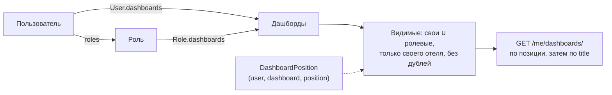

# Дашборды пользователей и ролей — реализация и API

Oct 29, 2026 · <https://room.io>

## Обзор

Раньше дашборд можно было привязать только к типу номера (`RoomType.dashboard` и `RoomType.engineering_dashboard`). Теперь дашборды выдаются и людям: напрямую пользователю или через его роль. Каждый пользователь сам сортирует свои дашборды, и этот порядок видит только он.

| Часть | Что сделано | Статус |
| --- | --- | --- |
| Модели | M2M `User.dashboards` и `Role.dashboards`, таблица порядка `DashboardPosition`, миграция `users/0015` | Готово |
| Назначение | Поле `dashboards` в API пользователей и ролей, проверка, что дашборд из того же отеля | Готово |
| Админский CRUD | `/users/dashboards/` — дашборды отеля, выданные пользователям или ролям, с управлением владельцами | Готово |
| «Мои дашборды» | `/users/me/dashboards/` и сохранение порядка `/users/me/dashboards/order/` | Готово |
| Ревью | Замечания code review исправлены: гонка при сохранении порядка, роли и пользователи без отеля, неактивные пользователи | Готово |

Коммит: `26da4147` в `dev`.

## Как это работает

- **Выдача пользователю** — `User.dashboards`. У пользователя может быть сколько угодно дашбордов.
- **Выдача роли** — `Role.dashboards`. Все пользователи с этой ролью видят её дашборды.
- **Видимые дашборды пользователя** — объединение своих и полученных через роли, без дублей. Дашборд, выданный и напрямую, и через роль, показывается один раз. Учитываются только дашборды текущего отеля пользователя (`tenant`).
- **Порядок (`DashboardPosition`)** — запись «пользователь, дашборд, позиция» в таблице `users_dashboard_positions`. Порядок у каждого пользователя свой: два человека с одной ролью сортируют одни и те же дашборды независимо.
- **Дашборды без позиции** — например, только что выданные — идут в конце списка, по `title`.

При удалении дашборда или пользователя связи и позиции удаляются каскадом. Если пользователю перестали выдавать дашборд, его старая позиция просто не используется и исчезает при следующем сохранении порядка.



## Правила и ограничения

- Дашборд должен быть из того же отеля, что и пользователь или роль. Иначе 400 `Dashboard out of scope: <названия>.`
- **Роль без отеля** (глобальная) не может держать дашборды: 400 `A role without a tenant cannot hold dashboards.`
- **Пользователь без отеля** (админ сети) не может держать дашборды: 400 `A user without a tenant cannot hold dashboards.` Список «Мои дашборды» показывает только дашборды своего отеля, поэтому такое назначение ни на что бы не влияло.
- **Деактивированные пользователи** не считаются владельцами: дашборд, выданный только им, пропадает из админского списка, а в поле `users` их нет. При этом их привязка сохраняется при PUT, и после повторной активации дашборды вернутся.
- Удалить дашборд, привязанный к типу номера, по-прежнему нельзя — сначала его нужно отвязать от `RoomType`. Это общее правило для `main` и `users` (`ensure_not_linked_to_room_types`).

## API для фронта

Все пути — под `/api/v1/users/`.

### Поле `dashboards` у пользователей и ролей

Затронутые эндпоинты: `users/`, `user/<id>/`, `roles/`, `role/<id>/` и админские эндпоинты пользователей, которые используют тот же сериализатор.

- **Запись** — список id: `"dashboards": ["<uuid>", ...]`. Поле необязательное; если его не передать при PUT, назначения не меняются.
- **Чтение** — список объектов в кратком виде:

```json
"dashboards": [
  {
    "id": "01b4ac29-32bd-4c5b-b42f-7a709d1ba68f",
    "title": "Thermostats",
    "assigned_customers": null,
    "mobile_hide": false,
    "mobile_order": null,
    "image": null,
    "external_id": null
  }
]
```

### Админский CRUD: дашборды, выданные людям

Показывает только дашборды отеля, у которых есть хотя бы один активный пользователь или роль. Дашборды, привязанные только к типам номеров или ни к чему, сюда не попадают — для них остаётся `/api/v1/main/dashboard/`.

| Метод | Путь | Право |
| --- | --- | --- |
| `GET` | `dashboards/` | `main.view_dashboard` |
| `POST` | `dashboards/` | `main.add_dashboard` |
| `GET` | `dashboard/<id>/` | `main.view_dashboard` |
| `PUT` | `dashboard/<id>/` | `main.change_dashboard` |
| `DELETE` | `dashboard/<id>/` | `main.delete_dashboard` |

Список принимает те же параметры, что и `main`: `page`, `size`, `search_field=title`, `search_value`, `sort_by` (`title`, `-title`, `created_at`, `-created_at`). Ответ — `{"count": ..., "results": [...]}`.

Тело `POST`/`PUT` — поля обычного дашборда плюс владельцы:

```json
{
  "title": "Reception board",
  "configuration": {},
  "user_ids": ["b5c0a9db-6082-402a-86c0-25e8f24ab19e"],
  "role_ids": ["4131460f-05d5-4597-aba5-53f34fbfc66e"]
}
```

- `user_ids` и `role_ids` **заменяют** список владельцев целиком: кого нет в списке, у того дашборд снимается. Не передали поле — владельцы этого типа не меняются.
- Пользователи и роли должны быть из отеля вызывающего, иначе 400 `User out of scope` / `Role out of scope`.
- Нельзя создать дашборд без владельцев или убрать всех: 400 `Assign the dashboard to a user or a role.` Иначе он молча пропал бы из этого списка.
- Повтор названия в отеле, как и в `main`, превращается в `<title> Copy N`.

В ответе владельцы приходят так:

```json
"users": [{"id": "b5c0a9db-...", "email": "test@gmail.com"}],
"roles": [{"id": "4131460f-...", "name": "SYS_ADMIN"}]
```

### «Мои дашборды»

Отдельные права не нужны — достаточно быть авторизованным.

| Метод | Путь | Что делает |
| --- | --- | --- |
| `GET` | `me/dashboards/` | Видимые дашборды текущего пользователя в его порядке (краткий вид, без пагинации) |
| `PUT` | `me/dashboards/order/` | Сохраняет новый порядок и возвращает список уже в нём |

Тело `PUT` — полный список id в нужном порядке, как после drag-and-drop:

```json
{"ids": ["01b4ac29-32bd-4c5b-b42f-7a709d1ba68f", "e91dd3e9-d109-4924-b82d-95262d4ceece"]}
```

- Список заменяет прежний порядок целиком. Дашборды, которых в нём нет, уйдут в конец по `title`.
- Повторы id — 400 `Dashboard ids must be unique.`
- Id, которого нет среди видимых пользователю, — 400 `Dashboard not available: <id>.`
- Пустой список `{"ids": []}` сбрасывает порядок: всё сортируется по `title`.
- Параллельные сохранения одного пользователя (двойной клик, две вкладки) выполняются по очереди, ответ последнего — итоговый порядок.

## Рекомендации по UI

- **Карточки пользователя и роли** — мультиселект «Дашборды» с дашбордами своего отеля; отправлять `dashboards` списком id. Для глобальной роли и для админа сети поле лучше скрывать: бэкенд всё равно вернёт 400.
- **Экран «Мои дашборды»** — список из `GET me/dashboards/` с перетаскиванием; после отпускания отправлять весь список в `PUT me/dashboards/order/` и рисовать порядок из ответа.
- **Админский экран** — таблица из `GET dashboards/` с колонками «Пользователи» и «Роли». При редактировании отправлять полные `user_ids`/`role_ids`, а не только изменения.
- **Открытие дашборда** — список «Мои дашборды» краткий, без `configuration`. Полный дашборд сейчас берётся из `GET /api/v1/main/dashboard/<id>/`, а там нужно право `main.view_dashboard`. Если у обычных пользователей его нет, нужен отдельный эндпоинт `me/dashboard/<id>/` — пока не сделан.

## Где код

| Что | Файл |
| --- | --- |
| Модели | `apps/users/models.py` (`User.dashboards`, `Role.dashboards`, `DashboardPosition`) |
| Миграция | `apps/users/migrations/0015_role_dashboards_user_dashboards_dashboardposition_and_more.py` |
| Админский сериализатор и порядок | `apps/users/serializers/dashboard.py` |
| Поле `dashboards` | `apps/users/serializers/user.py`, `apps/users/serializers/role.py` |
| Эндпоинты | `apps/users/views/dashboards.py`, `apps/users/urls.py` |
| Фильтр «выдан людям» | `apps/main/querysets/dashboard.py` (`assigned()`) |
| Защита от удаления | `apps/main/views/dashboard.py` (`ensure_not_linked_to_room_types`) |
| Тесты | `apps/users/tests/test_dashboards.py` |
