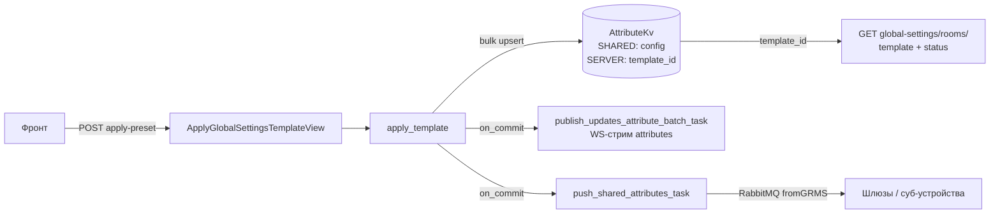

# Global Settings — шаблоны глобальных настроек

Справочник по шаблонам глобальных настроек: модель данных, как шаблон применяется к устройствам,
как вычисляется статус шаблона в комнате, REST API, права, ограничения и тесты.

Как собрать экраны на фронте, описано в [`global-settings-frontend.md`](global-settings-frontend.md).

## Содержание

1. [Обзор](#1-обзор)
2. [Карта кода](#2-карта-кода)
3. [Модель данных](#3-модель-данных)
4. [Применение шаблона](#4-применение-шаблона)
5. [Шаблон в комнате и его статус](#5-шаблон-в-комнате-и-его-статус)
6. [REST API](#6-rest-api)
7. [Права](#7-права)
8. [Ограничения и известные особенности](#8-ограничения-и-известные-особенности)
9. [Тесты](#9-тесты)

---

## 1. Обзор

**Шаблон глобальных настроек (`GlobalSettingsTemplate`)** — именованный набор настроек
(`config`, произвольный JSON-объект), который можно разом отправить на устройства выбранных комнат.
Шаблон принадлежит тенанту: другие тенанты его не видят, имя уникально в пределах тенанта без учёта
регистра.

**Применение** записывает настройки в атрибуты устройств и отправляет их на устройства:

- каждый ключ `config` → атрибут **SHARED_SCOPE** устройства;
- id шаблона → атрибут **SERVER_SCOPE** `template_id` (по нему потом видно, какой шаблон стоит);
- shared-атрибуты уходят на устройства через RabbitMQ, ответ устройства не ждём.

Отдельной таблицы «какой шаблон в какой комнате» нет: источник правды — атрибут `template_id`
на устройстве.



---

## 2. Карта кода

| Файл | Что внутри |
| --- | --- |
| `main/models.py` | `GlobalSettingsTemplate`, константы статусов `UP_TO_DATE` / `OUTDATED` / `DELETED` |
| `main/querysets/global_settings_template.py` | `list()`: поиск и сортировка списка шаблонов |
| `main/querysets/room.py` | `RoomQuerySet.global_settings()`: строки страницы комнат одним SQL |
| `main/serializers/global_settings_template.py` | Сериализаторы шаблона, параметры фильтров, строка комнаты, тело запроса применения |
| `main/services/global_settings.py` | `apply_template()` и `push_shared_attributes()` |
| `main/tasks.py` | `push_shared_attributes_task` (очередь `default`) |
| `main/views/global_settings_template.py` | Все представления API |
| `main/swagger/global_settings_template.py` | Примеры ответов для Swagger |
| `shuttle/utils/attributes_message.py` | `build_attributes_message()`: формат сообщения RabbitMQ (общий с `shuttle/views/attributes.py`) |

---

## 3. Модель данных

Таблица `main_global_settings_template`, базовый класс — `services.models.BaseModel`
(UUID, `created_at`/`updated_at` как `DateTimeField`, `created_by`/`updated_by`).

| Поле | Тип | Описание |
| --- | --- | --- |
| `tenant` | FK → `Tenant` | Владелец. Удаление тенанта удаляет его шаблоны |
| `name` | `CharField(255)` | Уникально в тенанте без учёта регистра (`UniqueConstraint("tenant", Lower("name"))`). Пробелы по краям обрезаются |
| `config` | `JSONField`, по умолчанию `{}` | Настройки. Только JSON-объект |
| `config_updated_at` | `DateTimeField` | Момент последнего **изменения `config`**. Переименование его не трогает. Нужен для статуса `outdated` |
| `used` | `PositiveIntegerField` | Сколько раз шаблон применяли (одно применение = +1, сколько бы комнат ни было) |

`config_updated_at` меняется в `GlobalSettingsTemplateSerializer.update()`, только если новый
`config` отличается от сохранённого. Сравнивать с `updated_at` нельзя: тогда переименование шаблона
делало бы все комнаты «устаревшими».

---

## 4. Применение шаблона

`apply_template(template, room_ids)` в `main/services/global_settings.py`.

### 4.1. Какие устройства

Все **активные** устройства (`is_active=True`) выбранных комнат: шлюзы, замки, датчики,
суб-устройства. Не только то устройство, которое показано на странице комнат.

Если в комнатах нет ни одного активного устройства, ничего не пишется, `used` не растёт, ответ —
`{"devices": []}`.

### 4.2. Запись атрибутов

Одна транзакция:

1. Ключи `config` раскладываются по типам через `find_compatible_field`:

   | Значение в JSON | Колонка `AttributeKv` |
   | --- | --- |
   | `true` / `false` | `bool_v` |
   | строка | `str_v` |
   | целое число | `long_v` |
   | дробное число | `dbl_v` |
   | объект / массив | `json_v` |
   | `null` | **пропускается**, атрибут не пишется |

2. Один `bulk_create(update_conflicts=True)` на все устройства: SHARED_SCOPE-ключи `config` и
   SERVER_SCOPE `template_id` (строка с UUID шаблона). При повторном применении значение и тип
   перезаписываются, остальные колонки обнуляются. `last_update_ts` — момент применения в мс.
   Строки сортируются в том же порядке, что и upsert-ы `mq-async`, чтобы не ловить дедлоки.
3. `used = used + 1`.

После коммита:

- `publish_updates_attribute_batch_task` рассылает изменения в WS-группу
  `attribute_kv_updates_<tenant_id>` (стрим `attributes` и другие подписчики этой группы);
- `push_shared_attributes_task` отправляет shared-атрибуты на устройства (если `config` не пустой).

### 4.3. Отправка на устройства

`push_shared_attributes(device_ids, attributes)` открывает **одно** соединение с RabbitMQ на весь
список и пишет в очередь `fromGRMS`. Формат сообщения (`build_attributes_message`):

Шлюз (`additional_info.gateway == true`) получает атрибуты напрямую:

```json
{
  "targetDeviceUUID": "<id шлюза>",
  "topic": "v1/devices/me/attributes",
  "data": {"temperature": 22, "eco_mode": true}
}
```

Суб-устройство получает их через свой шлюз:

```json
{
  "targetDeviceUUID": "<id шлюза>",
  "topic": "v1/gateway/attributes",
  "data": {"device": "Thermostat-102", "data": {"temperature": 22, "eco_mode": true}}
}
```

Шлюз суб-устройства — `from_id` входящей связи (`Relation`) от устройства с
`additional_info.gateway == true`; если таких связей несколько, берётся самая ранняя. Суб-устройство
без шлюза пропускается с `WARNING` «Device %s has no parent gateway, shared attributes not pushed».
В логе итог: «Global settings template attributes pushed to N of M devices».

Задача повторяется при `AMQPError` до 3 раз с паузой 30 с. Повтор отправляет весь список заново,
поэтому часть устройств может получить те же значения повторно. Значения одинаковые, так что
устройство просто перезапишет их.

---

## 5. Шаблон в комнате и его статус

Страница комнат (`GET global-settings/rooms/`) показывает для каждой комнаты одно устройство —
**первое активное**: сначала `additional_info.primary == true`, потом самое старое. Шаблон
читается из SERVER_SCOPE `template_id` **этого же устройства**. Шаблоны других устройств комнаты
на странице не видны.

Список комнат собирается одним SQL (подзапросы на устройство и атрибут `template_id`), затем вторым
запросом подтягиваются шаблоны этого тенанта по найденным id.

| `template` / `status` | Когда |
| --- | --- |
| `null` | У показанного устройства нет `template_id` (или у комнаты нет устройств) |
| `up_to_date` | `last_update_ts` атрибута `template_id` ≥ `config_updated_at` шаблона |
| `outdated` | `config` шаблона меняли после применения. Нужно применить заново |
| `deleted` | Шаблона с таким id нет у тенанта: удалён, чужой или в атрибуте мусор. `name` = `null` |

`up_to_date` значит «применён после последнего изменения шаблона», а **не** «устройство
подтвердило». Подтверждения от устройства нет, отправка работает по принципу fire-and-forget.

---

## 6. REST API

Базовый путь — `/api/v1/main/`. Тег в Swagger — `Main, Global Settings`. Ошибки валидации — `400`
в обычном формате DRF: `{"<поле>": ["<сообщение>"]}`.

### 6.1. Список шаблонов

`GET global-settings/templates/`

| Параметр | Значение |
| --- | --- |
| `search_field` | Только `name` |
| `search_value` | Подстрока, без учёта регистра |
| `sort_by` | `created_at`, `-created_at` (по умолчанию), `name`, `-name`, `used`, `-used`. Можно повторять |
| `page` | С `1`, по умолчанию `1` |
| `size` | `1`–`200`, по умолчанию `50` |

```json
{
  "count": 1,
  "results": [
    {
      "id": "9b0c7e2a-5d41-4f6e-8a3b-1c2d3e4f5a6b",
      "name": "Default hotel",
      "config": {"timezone": 5, "guest_auto_block": true},
      "used": 3,
      "config_updated_at": "2026-11-16T10:00:00Z",
      "created_at": "2026-11-16T10:00:00Z",
      "updated_at": "2026-11-16T10:00:00Z"
    }
  ]
}
```

### 6.2. Создание

`POST global-settings/templates/` → `201` с объектом шаблона.

```json
{"name": "Default hotel", "config": {"timezone": 5}}
```

- `name` обязателен; `config` необязателен (по умолчанию `{}`).
- `used`, `config_updated_at` только для чтения, переданные значения игнорируются.

Ошибки:

| Сообщение | Причина |
| --- | --- |
| `Global settings template with name '<name>' already exists.` | Имя занято в этом тенанте (без учёта регистра) |
| `Config must be a JSON object.` | `config` — массив, строка, число |

### 6.3. Чтение, изменение, удаление

| Метод | Путь | Ответ |
| --- | --- | --- |
| `GET` | `global-settings/templates/<id>/` | `200` с объектом; `404`, если шаблона нет в тенанте |
| `PUT` | `global-settings/templates/<id>/` | `200` с объектом |
| `DELETE` | `global-settings/templates/<id>/` | `204` |

`PUT`: `name` **обязателен**, `config` можно не передавать — тогда он не меняется. Если `config`
передан и отличается от текущего, обновляется `config_updated_at`, и все комнаты с этим шаблоном
становятся `outdated`.

`DELETE` не трогает устройства: атрибуты и `template_id` остаются, комнаты показывают `deleted`.

### 6.4. Комнаты

`GET global-settings/rooms/` — все активные комнаты тенанта, **без пагинации**, отсортированы по
`block`, `floor`, `number`.

| Параметр | Значение |
| --- | --- |
| `room_types` | id типов комнат через запятую; параметр можно повторять |
| `blocks` | Правило выбора блока/этажей, параметр повторяется на каждое правило (см. ниже) |
| `search_field` | `number`, `floor`, `block`, `room_type`, `device` |
| `search_value` | Подстрока, без учёта регистра. Передаётся только вместе с `search_field` |

Формат правила `blocks`:

| Правило | Что выбирает |
| --- | --- |
| `1:1,2,3` | Блок `1`, этажи `1`, `2`, `3` |
| `2` | Весь блок `2` |
| `:1,2` | Этажи `1` и `2` во всех блоках |

Правила объединяются через ИЛИ: `blocks=:1&blocks=2` — первый этаж везде и весь блок 2. Если
блок встречается дважды и в одном из правил без этажей, побеждает весь блок. `room_types`,
`blocks` и поиск объединяются через И.

`search_field=device` ищет по имени **показанного** устройства, а не всех устройств комнаты.
`floor` и `block` в поиске — подстрока: `floor` + `1` найдёт этажи `1`, `10`, `11`. Точный выбор
этажей — через `blocks`.

```json
[
  {
    "id": "5e1f2a3b-4c5d-4e6f-8a9b-0c1d2e3f4a5b",
    "number": "101",
    "floor": "1",
    "block": "A",
    "room_type": {"id": "7a8b9c0d-1e2f-4a3b-8c4d-5e6f7a8b9c0d", "title": "Standard"},
    "device": {"id": "2b3c4d5e-6f7a-4b8c-9d0e-1f2a3b4c5d6e", "name": "RCU-101"},
    "template": {"id": "9b0c7e2a-5d41-4f6e-8a3b-1c2d3e4f5a6b", "name": "Default hotel", "status": "up_to_date"}
  }
]
```

`room_type`, `device`, `template` могут быть `null`.

Ошибки:

| Сообщение | Причина |
| --- | --- |
| `Invalid blocks rule '<raw>', expected <block>, <block>:<floor>,<floor> or :<floor>,<floor>.` | Правило без блока и без этажей (`:`) |
| `search_value is required with search_field.` | Передан только `search_field` |
| `search_field is required with search_value.` | Передан только `search_value` |
| `Must be a valid UUID.` (в `room_types`) | Некорректный id типа |

### 6.5. Применение

`POST global-settings/apply-preset/`

```json
{
  "room_ids": ["5e1f2a3b-4c5d-4e6f-8a9b-0c1d2e3f4a5b"],
  "template_id": "9b0c7e2a-5d41-4f6e-8a3b-1c2d3e4f5a6b"
}
```

Ответ `200` — id устройств, на которые записан шаблон:

```json
{"devices": ["2b3c4d5e-6f7a-4b8c-9d0e-1f2a3b4c5d6e"]}
```

Дубликаты в `room_ids` убираются. Ошибки:

| Сообщение | Причина |
| --- | --- |
| `This list may not be empty.` | Пустой `room_ids` |
| `Rooms not found: <id>, <id>.` | Комнаты нет, она неактивна или чужого тенанта. Ничего не применяется |
| `Global settings template not found.` | Шаблона нет в тенанте |

---

## 7. Права

| Эндпоинт | Права |
| --- | --- |
| `GET templates/`, `GET templates/<id>/` | `main.view_globalsettingstemplate` |
| `POST templates/` | `main.add_globalsettingstemplate` |
| `PUT templates/<id>/` | `main.change_globalsettingstemplate` |
| `DELETE templates/<id>/` | `main.delete_globalsettingstemplate` |
| `GET rooms/` | `main.view_room` + `main.view_globalsettingstemplate` |
| `POST apply-preset/` | `main.view_globalsettingstemplate` + `shuttle.add_attributerpc` |

В фикстуре `users/fixtures/roles_permissions.yaml` все права есть у роли `TENANT_ADMIN`. Без прав —
`403`. Все запросы ограничены тенантом пользователя: чужие шаблоны дают `404` (CRUD) или `400`
(применение).

---

## 8. Ограничения и известные особенности

- **Ключи прошлого шаблона не удаляются.** Применили A `{x, y}`, затем B `{x}` — у устройства
  останется `y` из A, хотя `template_id` = B.
- **Ключ, удалённый из `config`, остаётся на устройствах**, даже после повторного применения.
- **`null` в `config` игнорируется**: так значение не сбросить.
- **Шаблон пишется на все активные устройства комнаты**, а на странице видно только одно.
- **Нет подтверждения от устройства**: `up_to_date` — состояние на сервере.
- **Гонка уникальности имени**: два одновременных запроса с одним именем могут пройти валидацию,
  второй получит `500` от `UniqueConstraint`.
- **Поиска по имени шаблона на странице комнат нет**: имя подтягивается после выборки.

---

## 9. Тесты

| Файл | Что проверяет |
| --- | --- |
| `main/tests/test_global_settings_template.py` | CRUD, уникальность имени, необязательный `config`, `config_updated_at`, права, изоляция тенантов |
| `main/tests/test_global_settings_room.py` | Фильтры `room_types`/`blocks`, поиск, выбор показанного устройства, статусы шаблона |
| `main/tests/test_global_settings_apply.py` | Запись атрибутов, повторное применение, `used`, чужие комнаты и шаблоны, формат сообщений RabbitMQ, суб-устройство без шлюза |

```bash
./manage.py test apps/main/tests/test_global_settings_template.py \
  apps/main/tests/test_global_settings_room.py apps/main/tests/test_global_settings_apply.py
```
