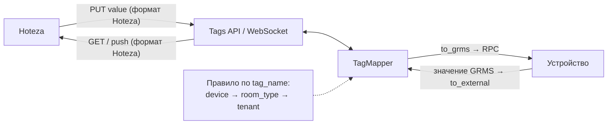

# Hoteza ↔ GRMS: Value Mapping — реализация и API

Oct 28, 2026 · <https://room.io>

## Обзор

GRMS теперь отдаёт Hoteza значения тегов в формате Hoteza и принимает от неё значения в том же формате. Пересчёт задаётся профилями маппинга отеля, а не кодом. Готовы этапы 1–3.

| Этап              | Что сделано                                                                                               | Статус   |
| ----------------- | --------------------------------------------------------------------------------------------------------- | -------- |
| 1. Движок         | Чистые функции пересчёта значений и проверка правил: `services/mapping/`                                  | Готово   |
| 2. Модели и API   | Профили, правила, миграции, REST API                                                                      | Готово   |
| 3. Подключение    | Tags API (`GET`/`PUT`) и WebSocket (`room_tags`, `tag`) отдают и принимают значения в формате интегратора | Готово   |
| Ревью             | 9 замечаний code review исправлены: общие `TagType`, `RESTRICT`, целые границы диапазонов и др.           | Готово   |
| Правила по тегу   | Правило привязано к `tag_name`, а не к `TagType`; переопределения и тестовый прогон удалены              | Готово   |
| Области профилей  | Профили `room_type` и `device` рядом с профилем интеграции: правило ищется device → room_type → tenant   | Готово   |
| 4. Профиль Hoteza | Готовый профиль Hoteza как fixture или management command                                                 | Не начат |

Если у интеграции нет профиля, всё работает как раньше: значения уходят и приходят в формате GRMS.

## Как это работает

Каждое значение тега проходит через правило своего `tag_name` (ключ атрибута или телеметрии) из профиля интеграции или его профилей для типа комнаты и устройства.

- **Профиль (`MappingProfile`)** — набор правил одного интегратора (например, `hoteza`) в рамках отеля. `name` уникально в отеле.
- **Правило (`MappingRule`)** — как значение тегов с одним `tag_name` переводится в формат интегратора и обратно, на любом устройстве. В профиле не больше одного правила на `tag_name`. Два тега одного типа на одном устройстве (например, `dimmer` и `dimmer_2`) получают каждый своё правило.
- **Привязка** — поле `mapping_profile` у интеграции. Подключается только профиль области `tenant` того же интегратора, что и интеграция. Новый профиль `tenant` привязывается к активной интеграции своего интегратора сам, если у неё профиля ещё нет; заменить уже привязанный — только явным `PUT integration/<id>/`.
- **Область (`scope`)** — `tenant` (по умолчанию), `room_type` или `device`. Профиль `room_type`/`device` указывает свою цель (`room_type` или `device`) и действует на интеграцию своего интегратора в отеле — подключать его не нужно. На одну цель у интегратора в отеле — один профиль. В таком профиле достаточно правил, которые отличаются от профиля интеграции. Частные профили работают, только пока у интеграции есть `mapping_profile`: `null` выключает маппинг целиком.

Правило тега ищется по цепочке: профиль устройства тега → профиль типа его комнаты → профиль интеграции; берётся первое найденное по `tag_name`. Тег без правила во всей цепочке идёт без изменений, так что исключить тег везде — убрать его правило из профиля интеграции. Исключить тег только для устройства или типа комнаты нельзя: частный профиль может заменить правило, но не отменить его. Правило ищется по имени тега, атрибут `TAG_TYPES` для этого не нужен. Из `TAG_TYPES`, как и раньше, берутся `tag_type` и `tag_ranges`: без записи значение всё равно пересчитывается, а `tag_ranges` остаётся `null`.

**Чтение** (`GET /tags/<room_id>/`, `GET /tag/<id>/`, WebSocket `room_tags` и `tag`): `value` и `tag_ranges` пересчитываются в формат интегратора, `tag_name` и `tag_type` остаются как в GRMS. Значение, которое правило не может перевести, уходит как `null`.

**Запись** (`PUT /tag/<id>/`): значение от интегратора переводится в значение GRMS и проверяется по `tag_ranges` устройства до отправки RPC. Потом, как и раньше: сначала RPC на устройство, сохранение только при успехе.

Правила читаются на каждый запрос и на каждую отправку в WebSocket, поэтому правки применяются сразу, без переподключения.



И запись, и чтение идут через один `TagMapper`; правила профиля интеграции и частных профилей её интегратора читаются свежими на каждый запрос.

## Формат правила

Правило — JSON-объект в массиве `rules` профиля. В правилах «GRMS» — значение в нашей системе, «external» — значение для интегратора.

| Поле                  | Обязательно   | Значения                                                                                                                                             |
| --------------------- | ------------- | ---------------------------------------------------------------------------------------------------------------------------------------------------- |
| `tag_name`            | да            | Ключ атрибута или телеметрии, до 255 символов. Одно правило на имя тега в профиле                                                                    |
| `external.value_type` | да            | `integer`, `number`, `string`, `boolean` — тип значения у интегратора                                                                                |
| `transform`           | да            | Способ пересчёта, см. ниже                                                                                                                           |
| `direction`           | нет, `both`   | `both` — в обе стороны; `to_external` — только чтение (PUT даст 400); `to_grms` — только запись (чтение отдаёт значение GRMS)                        |
| `on_invalid`          | нет, `reject` | Что делать с недопустимым значением при записи: `reject` — 400; `skip` — пропустить; `clamp` — подтянуть к ближайшему допустимому (только для чисел); `const` — записать `on_invalid_value` |
| `on_invalid_value`    | при `const`   | Значение GRMS, которое уходит на устройство вместо недопустимого. Обязательно при `on_invalid: const`, при других `on_invalid` должно отсутствовать |

**Типы `transform`:**

| `type`        | Поля                                                                            | Когда применять                                                                                                   |
| ------------- | ------------------------------------------------------------------------------- | ----------------------------------------------------------------------------------------------------------------- |
| `enum`        | `map`: список `{"grms": …, "external": …}`                                      | Фиксированные значения: скорость вентилятора, режим, вкл/выкл                                                     |
| `range`       | `grms`: `{min, max, step?}`, `external`: `{min, max, step?}`, `invert?`         | Линейная шкала: диммер 0–255 ↔ 0–100                                                                              |
| `linear`      | `ops`: список `{"op": "multiply"\|"divide"\|"add"\|"subtract", "value": число}` | Единицы измерения: десятые доли градуса → градусы. Обратный пересчёт строится сам                                 |
| `passthrough` | —                                                                               | Значение совпадает, нужно только привести тип                                                                     |

`range` и `linear` требуют числового `value_type`. Для `integer` результат округляется половиной вверх, а границы диапазонов в `tag_ranges` — внутрь (`"0-49.8"` → `"0-49"`). Числа, сохранённые строкой (`"22"`), принимаются как числа; в `enum` типы сравниваются строго (`"1"` ≠ `1`, но `1.0` = `1`).

Пример профиля с двумя правилами:

```json
{
  "name": "Hoteza",
  "integrator": "hoteza",
  "rules": [
    {
      "tag_name": "fanSpeed",
      "external": { "value_type": "integer" },
      "transform": {
        "type": "enum",
        "map": [
          { "grms": "Low", "external": 1 },
          { "grms": "Medium", "external": 2 },
          { "grms": "High", "external": 3 }
        ]
      }
    },
    {
      "tag_name": "dimmer",
      "external": { "value_type": "integer" },
      "transform": {
        "type": "range",
        "grms": { "min": 0, "max": 255 },
        "external": { "min": 0, "max": 100, "step": 10 }
      },
      "on_invalid": "clamp"
    }
  ]
}
```

## API для фронта

Все эндпоинты лежат под `/api/v1/services/`, требуют JWT (`Authorization: Bearer …`) и работают только с данными отеля пользователя. Чужой объект отвечает 404. В Swagger они в разделе **Services, Mapping Profiles**.

| Метод и путь                             | Что делает                                            | Право                                |
| ---------------------------------------- | ----------------------------------------------------- | ------------------------------------ |
| `GET mapping-profiles/`                  | Список профилей с правилами                           | `view_mappingprofile`                |
| `POST mapping-profiles/`                 | Создать профиль с правилами                           | `add_mappingprofile`                 |
| `GET mapping-profiles/<id>/`             | Один профиль                                          | `view_mappingprofile`                |
| `PUT mapping-profiles/<id>/`             | Заменить профиль и **все** его правила                | `change_mappingprofile`              |
| `DELETE mapping-profiles/<id>/`          | Удалить; у интеграций `mapping_profile` станет `null` | `delete_mappingprofile`              |
| `PUT integration/<id>/`                  | Новое поле `mapping_profile` (id профиля или `null`)  | `change_integration`                 |

Права с префиксом `services.`; без них — 403. Админам отелей их выдаёт `./manage.py give_perms`.

### Список

Ответ `{"count": N, "results": […]}`. Параметры: `page` (с 1), `size` (по умолчанию 50, максимум 500), `search` (подстрока в `name`), `integrator` (имя интегратора), `sort_by`: `name`, `-name`, `created_at`, `-created_at` (по умолчанию `name`), `scope` (`tenant`, `room_type`, `device`).

### Профиль

Тело `POST`/`PUT` — как в примере из раздела «Формат правила». Ответ добавляет `id`, `integrations` (id интеграций, которые используют профиль), `created_at`, `updated_at`, а в каждом правиле подставлены значения по умолчанию (`direction: "both"`, `on_invalid: "reject"`).

При сохранении проверяется:

- `name` уникально в отеле; `integrator` существует.
- У правил нет повторяющихся `tag_name`: правило определяется именем тега, отдельного `id` нет.
- Структура каждого правила верна. Значения `grms` при сохранении не сверяются с диапазонами: у разных устройств они свои. При записи результат проверяется по `tag_ranges` тега из `TAG_TYPES`.
- `scope` и цель согласованы: у `tenant` нет `room_type` и `device`; у `room_type` обязателен `room_type`, у `device` — `device`. Ошибка — 400 в поле, которое не подходит.
- У интегратора в отеле нет другого профиля на ту же цель (400 в `room_type` или `device`).
- При `PUT`: профиль не используется интеграциями другого интегратора, а профиль, подключённый к интеграции, остаётся `tenant`. Поля области, которых нет в теле, сохраняют прежнее значение.
- `DELETE` профиля `tenant` частные профили не трогает: они снова начнут действовать, как только к интеграции подключат любой профиль этого интегратора.

Пример профиля для одного устройства, где температура отдаётся в °C без пересчёта, а остальные теги берутся из `hoteza`:

```json
{
  "name": "Hoteza, номер 101",
  "integrator": "hoteza",
  "scope": "device",
  "device": "30c2dbba-db57-4cbf-b722-6312f46e3b48",
  "rules": [
    {
      "tag_name": "Room Temperature",
      "external": { "value_type": "number" },
      "transform": { "type": "passthrough" }
    }
  ]
}
```

Ошибки — стандартный 400 DRF. Ошибки одного правила приходят по его индексу в массиве:

```json
{
  "rules": [
    {
      "non_field_errors": [
        "transform.external.step must be a positive number."
      ]
    },
    {}
  ]
}
```

Ошибки профиля целиком — списком строк: `{"rules": ["Duplicate tag names: ['fanSpeed']."]}`.

### Интеграция

`PUT integration/<id>/` принимает `mapping_profile`. Не передали поле — профиль остаётся. Профиль другого интегратора или профиль области `room_type`/`device` дают 400 в `mapping_profile`.

Типы тегов с маппингом больше не связаны: `PUT`/`DELETE tag-types/<id>/` работают как до него.

## Что меняется для Hoteza

Адреса и форма ответов не меняются, меняются сами значения `value` и `tag_ranges`. Интеграция определяется по заголовкам `ClientToken` и `AccessToken` (для WebSocket — или `client_token`/`access_token` в query string).

Пример тега `fanSpeed` в `GET /api/v1/services/tags/<room_id>/` при правиле из примера выше:

| Поле         | Без профиля                 | С профилем   |
| ------------ | --------------------------- | ------------ |
| `tag_type`   | `"FCUSPEED"`                | `"FCUSPEED"` |
| `value`      | `"Medium"`                  | `2`          |
| `tag_ranges` | `["Low", "Medium", "High"]` | `[1, 2, 3]`  |

`PUT /api/v1/services/tag/<id>/` с телом `{"value": 3}` отправит на устройство `"High"`. Возможные ответы:

| Случай                              | Ответ                                                                                                 |
| ----------------------------------- | ----------------------------------------------------------------------------------------------------- |
| Устройство приняло                  | 200 `{"tag": {…}, "rpc": {…}}`, тег в формате Hoteza                                                  |
| Устройство отказало или не ответило | 502, как раньше                                                                                       |
| Значение не прошло правило          | 400 `{"value": ["…"], "code": "type" \| "direction" \| "unmapped" \| "invalid"}`, RPC не отправляется |
| Правило с `on_invalid: skip`        | 200 `{"tag": {…}, "rpc": null, "skipped": true}`, тег не изменён                                      |
| Правило с `on_invalid: clamp`       | Значение подтягивается к допустимому и записывается                                                   |
| Правило с `on_invalid: const`       | На устройство уходит `on_invalid_value` правила; ответ как при успешной записи                        |

Коды `code`: `type` — неверный тип значения; `direction` — правило не работает в эту сторону; `unmapped` — нет пары в enum; `invalid` — вне границ шкалы `range` или `tag_ranges` при `reject`.

Hoteza должна отличать пропущенную запись по флагу `skipped`: код ответа тот же, 200. Значение тега, которое нельзя перевести при чтении, приходит как `null`.

## Рекомендации по UI

Для настройки достаточно трёх экранов: список профилей, редактор профиля и выбор профиля в карточке интеграции. Это предложение, а не требование API.

1. **Список профилей** (`GET mapping-profiles/`): таблица `name`, `integrator`, область, число правил; поиск, фильтр по интегратору, сортировка. Перед удалением предупредить: интеграции с этим профилем станут отдавать значения GRMS.
2. **Редактор профиля**: шапка (`name`, `integrator`) и список правил. Сохраняется всё целиком одним `PUT`, так что форма должна держать все правила и отправлять их вместе.
   - `tag_name` — поле ввода с подсказками из ключей тегов отеля; уже занятые в профиле имена не предлагать.
   - Для `enum` — таблица пар: слева значение GRMS, справа значение интегратора.
   - Для `range` — две шкалы min/max/step и флажок `invert`; для `linear` — список операций.
   - `clamp` предлагать только для числового `value_type`; при `const` показать поле `on_invalid_value` (значение GRMS, подсказки — `tag_ranges` тега).
   - Ошибки 400 показывать у правила по индексу в `rules`.
   - В шапке — область и для `room_type`/`device` её цель. Частные профили интегратора — `GET mapping-profiles/?integrator=<name>&scope=room_type` (или `device`).
3. **Карточка интеграции**: выбор `mapping_profile` из профилей `tenant` того же интегратора (`GET mapping-profiles/?scope=tenant&integrator=<name>`), вариант «Без профиля» = `null`.
