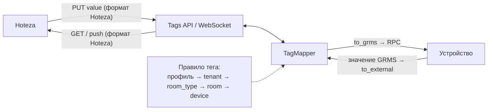

# Hoteza ↔ GRMS: Value Mapping — реализация и API

Oct 28, 2026 · <https://room.io>

## Обзор

GRMS теперь отдаёт Hoteza значения тегов в формате Hoteza и принимает от неё значения в том же формате. Пересчёт задаётся профилем маппинга на уровне отеля, а не кодом. Готовы этапы 1–3, коммита пока нет.

| Этап              | Что сделано                                                                                               | Статус   |
| ----------------- | --------------------------------------------------------------------------------------------------------- | -------- |
| 1. Движок         | Чистые функции пересчёта значений и проверка правил: `services/mapping/`                                  | Готово   |
| 2. Модели и API   | Профили, правила, переопределения по уровням, миграции, REST API, тестовый прогон правила                 | Готово   |
| 3. Подключение    | Tags API (`GET`/`PUT`) и WebSocket (`room_tags`, `tag`) отдают и принимают значения в формате интегратора | Готово   |
| Ревью             | 9 замечаний code review исправлены: общие `TagType`, `RESTRICT`, целые границы диапазонов и др.           | Готово   |
| 4. Профиль Hoteza | Готовый профиль Hoteza как fixture или management command                                                 | Не начат |

Если у интеграции нет профиля, всё работает как раньше: значения уходят и приходят в формате GRMS.

## Как это работает

Каждое значение тега проходит через правило своего `TagType`, собранное из профиля интеграции и её переопределений.

- **Профиль (`MappingProfile`)** — набор правил одного интегратора (например, `hoteza`) в рамках отеля. `code` уникален в отеле.
- **Правило (`MappingRule`)** — как значение одного `TagType` переводится в формат интегратора и обратно. В профиле не больше одного правила на `TagType`. Подходят свои типы отеля и общие (без отеля); при совпадении имени берётся свой.
- **Привязка** — поле `mapping_profile` у интеграции. Профиль должен быть того же интегратора, что и интеграция.
- **Переопределение (`MappingOverride`)** — замена отдельных полей правил для интеграции на уровне `tenant` (весь отель), `room_type`, `room` или `device`. Уровни накладываются от общего к частному: профиль → tenant → room\_type → room → device. Поле заменяется целиком; `id` и `tag_type` менять нельзя. На одну цель — одно переопределение.

Какой `TagType` у тега, берётся из атрибута `TAG_TYPES` устройства, как и раньше. Тег без `tag_type` или без правила для своего типа идёт без изменений.

**Чтение** (`GET /tags/<room_id>/`, `GET /tag/<id>/`, WebSocket `room_tags` и `tag`): `value` и `tag_ranges` пересчитываются в формат интегратора, `tag_type` остаётся именем типа GRMS. Значение, которое правило не может перевести, уходит как `null`.

**Запись** (`PUT /tag/<id>/`): значение от интегратора переводится в значение GRMS и проверяется по `tag_ranges` устройства до отправки RPC. Потом, как и раньше: сначала RPC на устройство, сохранение только при успехе.

Правила и переопределения читаются на каждый запрос и на каждую отправку в WebSocket, поэтому правки применяются сразу, без переподключения.



И запись, и чтение идут через один `TagMapper`; правило тега собирается из профиля и переопределений свежими на каждый запрос.

## Формат правила

Правило — JSON-объект в массиве `rules` профиля. В правилах «GRMS» — значение в нашей системе, «external» — значение для интегратора.

| Поле                  | Обязательно   | Значения                                                                                                                                             |
| --------------------- | ------------- | ---------------------------------------------------------------------------------------------------------------------------------------------------- |
| `id`                  | да            | Код правила, уникален в профиле, до 100 символов. На него ссылаются переопределения                                                                  |
| `tag_type`            | да            | Имя `TagType` отеля или общего. Одно правило на тип в профиле                                                                                        |
| `external.value_type` | да            | `integer`, `number`, `string`, `boolean` — тип значения у интегратора                                                                                |
| `transform`           | да            | Способ пересчёта, см. ниже                                                                                                                           |
| `direction`           | нет, `both`   | `both` — в обе стороны; `to_external` — только чтение (PUT даст 400); `to_grms` — только запись (чтение отдаёт значение GRMS)                        |
| `validate`            | нет           | Ограничения на значение интегратора: `min`, `max`, `step` (для чисел) или `allowed` (список)                                                         |
| `on_invalid`          | нет, `reject` | Что делать с недопустимым значением при записи: `reject` — 400; `skip` — пропустить; `clamp` — подтянуть к ближайшему допустимому (только для чисел) |

**Типы `transform`:**

| `type`        | Поля                                                                            | Когда применять                                                                                                   |
| ------------- | ------------------------------------------------------------------------------- | ----------------------------------------------------------------------------------------------------------------- |
| `enum`        | `map`: список `{"grms": …, "external": …}`                                      | Фиксированные значения: скорость вентилятора, режим, вкл/выкл. Значения `grms` должны быть в диапазонах `TagType` |
| `range`       | `grms`: `{min, max, step?}`, `external`: `{min, max, step?}`, `invert?`         | Линейная шкала: диммер 0–255 ↔ 0–100. Диапазон `grms` должен лежать в диапазонах `TagType`                        |
| `linear`      | `ops`: список `{"op": "multiply"\|"divide"\|"add"\|"subtract", "value": число}` | Единицы измерения: десятые доли градуса → градусы. Обратный пересчёт строится сам                                 |
| `passthrough` | —                                                                               | Значение совпадает, нужно только привести тип или проверить `validate`                                            |

`range` и `linear` требуют числового `value_type`. Для `integer` результат округляется половиной вверх, а границы диапазонов в `tag_ranges` — внутрь (`"0-49.8"` → `"0-49"`). Числа, сохранённые строкой (`"22"`), принимаются как числа; в `enum` типы сравниваются строго (`"1"` ≠ `1`, но `1.0` = `1`).

Пример профиля с двумя правилами:

```json
{
  "code": "hoteza",
  "name": "Hoteza",
  "integrator": "hoteza",
  "schema_version": "1.0",
  "rules": [
    {
      "id": "fan_speed",
      "tag_type": "FCUSPEED",
      "external": { "value_type": "integer" },
      "transform": {
        "type": "enum",
        "map": [
          { "grms": "Low", "external": 1 },
          { "grms": "Medium", "external": 2 },
          { "grms": "High", "external": 3 }
        ]
      }
    },
    {
      "id": "dimmer",
      "tag_type": "Light Dimmer",
      "external": { "value_type": "integer" },
      "transform": {
        "type": "range",
        "grms": { "min": 0, "max": 255 },
        "external": { "min": 0, "max": 100, "step": 10 }
      },
      "validate": { "min": 0, "max": 100 },
      "on_invalid": "clamp"
    }
  ]
}
```

## API для фронта

Все эндпоинты лежат под `/api/v1/services/`, требуют JWT (`Authorization: Bearer …`) и работают только с данными отеля пользователя. Чужой объект отвечает 404. В Swagger они в разделах **Services, Mapping Profiles** и **Services, Mapping Overrides**.

| Метод и путь                             | Что делает                                            | Право                                |
| ---------------------------------------- | ----------------------------------------------------- | ------------------------------------ |
| `GET mapping-profiles/`                  | Список профилей с правилами                           | `view_mappingprofile`                |
| `POST mapping-profiles/`                 | Создать профиль с правилами                           | `add_mappingprofile`                 |
| `GET mapping-profiles/<id>/`             | Один профиль                                          | `view_mappingprofile`                |
| `PUT mapping-profiles/<id>/`             | Заменить профиль и **все** его правила                | `change_mappingprofile`              |
| `DELETE mapping-profiles/<id>/`          | Удалить; у интеграций `mapping_profile` станет `null` | `delete_mappingprofile`              |
| `POST mapping-profiles/<id>/test/`       | Прогнать одно правило на значении, не трогая теги     | `view_mappingprofile`                |
| `GET mapping-overrides/`                 | Список переопределений                                | `view_mappingoverride`               |
| `POST mapping-overrides/`                | Создать переопределение                               | `add_mappingoverride`                |
| `GET/PUT/DELETE mapping-overrides/<id>/` | Чтение, замена, удаление                              | `view/change/delete_mappingoverride` |
| `PUT integration/<id>/`                  | Новое поле `mapping_profile` (id профиля или `null`)  | `change_integration`                 |

Права с префиксом `services.`; без них — 403. Админам отелей их выдаёт `./manage.py give_perms`.

### Списки

Ответ `{"count": N, "results": […]}`. Общие параметры: `page` (с 1), `size` (по умолчанию 50, максимум 500).

- `mapping-profiles/`: `search` (подстрока в `name`), `integrator` (имя интегратора), `sort_by`: `code`, `-code`, `name`, `-name`, `created_at`, `-created_at` (по умолчанию `code`).
- `mapping-overrides/`: `integration` (uuid), `level` (`tenant`, `room_type`, `room`, `device`).

### Профиль

Тело `POST`/`PUT` — как в примере из раздела «Формат правила». Ответ добавляет `id`, `created_at`, `updated_at`, а в каждом правиле подставлены значения по умолчанию (`direction: "both"`, `on_invalid: "reject"`, `validate: null`).

При сохранении проверяется:

- `code` уникален в отеле; `integrator` существует.
- У правил нет повторяющихся `id` и `tag_type`.
- Структура каждого правила верна, а значения `grms` входят в диапазоны его `TagType`.
- При `PUT`: профиль не используется интеграциями другого интегратора, и переопределения интеграций с этим профилем по-прежнему подходят к новым правилам.

Ошибки — стандартный 400 DRF. Ошибки одного правила приходят по его индексу в массиве:

```json
{
  "rules": [
    {
      "non_field_errors": [
        "GRMS values ['Turbo'] are not ranges of tag type 'FCUSPEED'."
      ]
    },
    {}
  ]
}
```

Ошибки профиля целиком — списком строк: `{"rules": ["Duplicate tag types: ['FCUSPEED']."]}`.

### Тестовый прогон

`POST mapping-profiles/<id>/test/` нужен для кнопки «Проверить» в редакторе. Он работает с сохранённым профилем, без учёта переопределений.

| Поле тела    | Значение                                                                                           |
| ------------ | -------------------------------------------------------------------------------------------------- |
| `rule`       | `id` правила в профиле                                                                             |
| `direction`  | `to_external` (значение GRMS → интегратору) или `to_grms` (от интегратора → GRMS)                  |
| `input`      | Любое JSON-значение                                                                                |
| `tag_ranges` | Необязательно. Для `to_external` тоже пересчитывается, для `to_grms` по нему проверяется результат |

| Исход                        | Ответ                                                                                |
| ---------------------------- | ------------------------------------------------------------------------------------ |
| Успех                        | 200 `{"output": 2, "tag_ranges": [1, 2, 3]}` (`tag_ranges` только для `to_external`) |
| `on_invalid: skip` сработал  | 200 `{"output": null, "skipped": true}`                                              |
| Правило не перевело значение | 400 `{"detail": "No enum pair for the value.", "code": "unmapped"}`                  |
| Нет такого правила           | 400 `{"rule": ["No such rule in the profile."]}`                                     |

Коды `code`: `type` — неверный тип значения; `direction` — правило не работает в эту сторону; `unmapped` — нет пары в enum; `invalid` — не прошло `validate` или `tag_ranges` при `reject`.

### Переопределение

```json
{
  "integration": "a1b2c3d4-…",
  "level": "device",
  "device": "47aef21b-…",
  "rule_overrides": { "dimmer": { "on_invalid": "reject" } }
}
```

- Поле цели заполняется по уровню: `room_type`, `room` или `device`; остальные пустые. У `tenant` цели нет.
- Ключи `rule_overrides` — `id` правил профиля интеграции. Менять можно `external`, `direction`, `transform`, `validate`, `on_invalid`.
- У интеграции должен быть профиль, иначе 400.
- Итоговое правило проверяется так же, как правило профиля. Ошибки — в `rule_overrides` с префиксом `id` правила.
- Второе переопределение на ту же цель — 400 `non_field_errors`.

### Интеграция и типы тегов

- `PUT integration/<id>/` принимает `mapping_profile`. Не передали поле — профиль остаётся. Профиль другого интегратора или неподходящие переопределения дают 400 в `mapping_profile`.
- `DELETE tag-types/<id>/` для типа, на который ссылается правило, — 409 `{"detail": "The tag type is used by mapping rules and cannot be deleted."}`.
- `PUT tag-types/<id>/` — 400 в `tag_ranges`, если новые диапазоны ломают правила типа или их переопределения.

## Что меняется для Hoteza

Адреса и форма ответов не меняются, меняются сами значения `value` и `tag_ranges`. Интеграция определяется по заголовкам `ClientToken` и `AccessToken` (для WebSocket — или `client_token`/`access_token` в query string).

Пример тега в `GET /api/v1/services/tags/<room_id>/` при правиле `fan_speed`:

| Поле         | Без профиля                 | С профилем   |
| ------------ | --------------------------- | ------------ |
| `tag_type`   | `"FCUSPEED"`                | `"FCUSPEED"` |
| `value`      | `"Medium"`                  | `2`          |
| `tag_ranges` | `["Low", "Medium", "High"]` | `[1, 2, 3]`  |

`PUT /api/v1/services/tag/<id>/` с телом `{"value": 3}` отправит на устройство `"High"`. Возможные ответы:

| Случай                              | Ответ                                                                                                 |
| ----------------------------------- | ----------------------------------------------------------------------------------------------------- |
| Устройство приняло                  | 200 `{"tag": {…}, "rpc": {…}}`, тег в формате Hoteza                                                  |
| Устройство отказало или не ответило | 502, как раньше                                                                                       |
| Значение не прошло правило          | 400 `{"value": ["…"], "code": "type" \| "direction" \| "unmapped" \| "invalid"}`, RPC не отправляется |
| Правило с `on_invalid: skip`        | 200 `{"tag": {…}, "rpc": null, "skipped": true}`, тег не изменён                                      |
| Правило с `on_invalid: clamp`       | Значение подтягивается к допустимому и записывается                                                   |

Hoteza должна отличать пропущенную запись по флагу `skipped`: код ответа тот же, 200. Значение тега, которое нельзя перевести при чтении, приходит как `null`.

## Рекомендации по UI

Для настройки достаточно трёх экранов: список профилей, редактор профиля и переопределения в карточке интеграции. Это предложение, а не требование API.

1. **Список профилей** (`GET mapping-profiles/`): таблица `code`, `name`, `integrator`, число правил; поиск, фильтр по интегратору, сортировка. Перед удалением предупредить: интеграции с этим профилем станут отдавать значения GRMS.
2. **Редактор профиля**: шапка (`code`, `name`, `integrator`) и список правил. Сохраняется всё целиком одним `PUT`, так что форма должна держать все правила и отправлять их вместе.
   - `tag_type` — выбор из `GET tag-types/`; уже занятые в профиле типы скрывать. Диапазоны выбранного типа подсказывают значения GRMS.
   - Для `enum` — таблица пар: слева значения из `tag_ranges` типа, справа поле для значения интегратора.
   - Для `range` — две шкалы min/max/step и флажок `invert`; для `linear` — список операций.
   - `clamp` предлагать только для числового `value_type`.
   - Кнопка «Проверить» у правила вызывает `test/` в обе стороны. Работает по сохранённой версии, поэтому при несохранённых правках её стоит блокировать.
   - Ошибки 400 показывать у правила по индексу в `rules`.
3. **Карточка интеграции**: выбор `mapping_profile` из профилей того же интегратора (`GET mapping-profiles/?integrator=<name>`), вариант «Без профиля» = `null`. Ниже — список переопределений (`GET mapping-overrides/?integration=<id>`), сгруппированных по уровню.
   - При создании сначала уровень, потом цель своего типа (тип комнаты, комната, устройство), потом правило и поля, которые оно меняет.
   - Рядом с полем показывать значение из профиля, чтобы было видно, что именно переопределено.
   - Кнопку «Добавить» блокировать, пока у интеграции нет профиля.

На экране типов тегов нужно обработать два новых ответа: 409 при удалении и 400 в `tag_ranges` при сохранении. В обоих случаях стоит показать текст ошибки: он называет правило и профиль.
