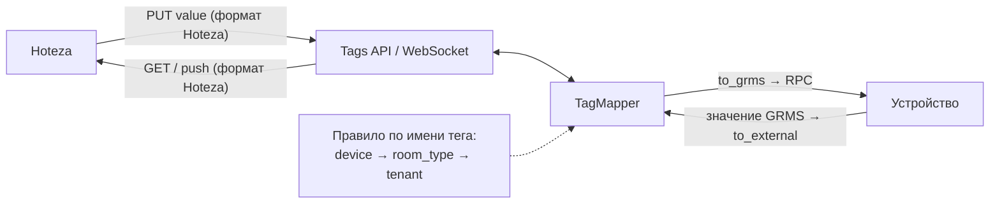

# Hoteza ↔ GRMS: Value Mapping — реализация и API

Oct 28, 2026 · <https://room.io>

## Обзор

GRMS теперь отдаёт Hoteza значения тегов в формате Hoteza и принимает от неё значения в том же формате. Пересчёт задаётся профилями маппинга отеля, а не кодом. Готовы этапы 1–3.

| Этап              | Что сделано                                                                                               | Статус   |
| ----------------- | --------------------------------------------------------------------------------------------------------- | -------- |
| 1. Движок         | Чистые функции пересчёта значений и проверка правил: `services/mapping/`                                  | Готово   |
| 2. Модели и API   | Профили, правила, миграции, REST API                                                                      | Готово   |
| 3. Подключение    | Tags API (`GET`/`PUT`) и WebSocket (`room_tags`, `tag`) отдают и принимают значения в формате интегратора | Готово   |
| Ревью             | 9 замечаний code review исправлены: общие `TagType`, `RESTRICT`, целые границы диапазонов и др.           | Готово   |
| Правила по тегу   | Правило привязано к именам тегов (`tag_names`), а не к `TagType`; переопределения и тестовый прогон удалены | Готово |
| Области профилей  | Профили `room_type` и `device` рядом с профилем интеграции: правило ищется device → room_type → tenant   | Готово   |
| Composite Mapping | Одно значение интегратора из нескольких тегов, обратная запись цепочкой RPC, виртуальные теги             | Готово   |
| Test Mapping API  | `POST mapping-test/`: прогон любого правила без сохранения и без RPC                                      | Готово   |
| 4. Профиль Hoteza | Готовый профиль Hoteza как fixture или management command                                                 | Не начат |

Если у интеграции нет профиля, всё работает как раньше: значения уходят и приходят в формате GRMS.

## Как это работает

Каждое значение тега проходит через правило, в `tag_names` которого есть имя тега (ключ атрибута или телеметрии), из профиля интеграции или его профилей для типа комнаты и устройства.

- **Профиль (`MappingProfile`)** — набор правил одного интегратора (например, `hoteza`) в рамках отеля. `name` уникально в отеле.
- **Правило (`MappingRule`)** — как значение тегов с именами из `tag_names` переводится в формат интегратора и обратно, на любом устройстве. Одно правило может охватывать несколько тегов (`["dimmer", "dimmer_2"]`), но имя тега входит не больше чем в одно правило профиля. Два тега одного типа на одном устройстве могут получить разные правила или одно общее.
- **Привязка** — поле `mapping_profile` у интеграции. Подключается только профиль области `tenant` того же интегратора, что и интеграция. Новый профиль `tenant` привязывается к активной интеграции своего интегратора сам, если у неё профиля ещё нет; заменить уже привязанный — только явным `PUT integration/<id>/`.
- **Область (`scope`)** — `tenant` (по умолчанию), `room_type` или `device`. Профиль `room_type`/`device` указывает свою цель (`room_type` или `device`) и действует на интеграцию своего интегратора в отеле — подключать его не нужно. На одну цель у интегратора в отеле — один профиль. В таком профиле достаточно правил, которые отличаются от профиля интеграции. Частные профили работают, только пока у интеграции есть `mapping_profile`: `null` выключает маппинг целиком.

Правило тега ищется по цепочке: профиль устройства тега → профиль типа его комнаты → профиль интеграции; берётся первое правило, где есть имя тега. Тег без правила во всей цепочке идёт без изменений, так что исключить тег везде — убрать его правило из профиля интеграции. Исключить тег только для устройства или типа комнаты нельзя: частный профиль может заменить правило, но не отменить его. Правило ищется по имени тега, атрибут `TAG_TYPES` для этого не нужен. Из `TAG_TYPES`, как и раньше, берутся `tag_type` и `tag_ranges`: без записи значение всё равно пересчитывается, а `tag_ranges` остаётся `null`.

**Чтение** (`GET /tags/<room_id>/`, `GET /tag/<id>/`, WebSocket `room_tags` и `tag`): `value` и `tag_ranges` пересчитываются в формат интегратора, `tag_name` и `tag_type` остаются как в GRMS. Значение, которое правило не может перевести, уходит как `null`.

**Запись** (`PUT /tag/<id>/`): значение от интегратора переводится в значение GRMS и проверяется по `tag_ranges` устройства до отправки RPC. Потом, как и раньше: сначала RPC на устройство, сохранение только при успехе.

Правила читаются на каждый запрос и на каждую отправку в WebSocket, поэтому правки применяются сразу, без переподключения.



И запись, и чтение идут через один `TagMapper`; правила профиля интеграции и частных профилей её интегратора читаются свежими на каждый запрос.

## Формат правила

Правило — JSON-объект в массиве `rules` профиля. В правилах «GRMS» — значение в нашей системе, «external» — значение для интегратора.

| Поле                  | Обязательно   | Значения                                                                                                                                             |
| --------------------- | ------------- | ---------------------------------------------------------------------------------------------------------------------------------------------------- |
| `tag_names`           | да            | Непустой список ключей атрибутов или телеметрии, каждый до 255 символов. Имя тега входит не больше чем в одно правило профиля                       |
| `external.value_type` | да            | `integer`, `number`, `string`, `boolean` — тип значения у интегратора                                                                                |
| `transform`           | да            | Способ пересчёта, см. ниже                                                                                                                           |
| `direction`           | нет, `both`   | `both` — в обе стороны; `to_external` — только чтение (PUT даст 400); `to_grms` — только запись (чтение отдаёт значение GRMS)                        |
| `on_invalid`          | нет, `reject` | Что делать с недопустимым значением при записи: `reject` — 400; `skip` — пропустить; `clamp` — подтянуть к ближайшему допустимому (только для чисел); `const` — записать `on_invalid_value` |
| `on_invalid_value`    | при `const`   | Значение GRMS, которое уходит на устройство вместо недопустимого. Обязательно при `on_invalid: const`, при других `on_invalid` должно отсутствовать |

**Типы `transform`:**

| `type`        | Поля                                                                            | Когда применять                                                                                                   |
| ------------- | ------------------------------------------------------------------------------- | ----------------------------------------------------------------------------------------------------------------- |
| `enum`        | `map`: список `{"grms": …, "external": …}`                                      | Фиксированные значения: скорость вентилятора, режим, вкл/выкл                                                     |
| `range`       | `grms`: `{min, max, step?}`, `external`: `{min, max, step?}`, `invert?`         | Линейная шкала: диммер 0–255 ↔ 0–100                                                                              |
| `linear`      | `ops`: список `{"op": "multiply"\|"divide"\|"add"\|"subtract", "value": число}` | Единицы измерения: десятые доли градуса → градусы. Обратный пересчёт строится сам                                 |
| `passthrough` | —                                                                               | Значение совпадает, нужно только привести тип                                                                     |

`range` и `linear` требуют числового `value_type`. Для `integer` результат округляется половиной вверх, а границы диапазонов в `tag_ranges` — внутрь (`"0-49.8"` → `"0-49"`). Числа, сохранённые строкой (`"22"`), принимаются как числа; в `enum` типы сравниваются строго (`"1"` ≠ `1`, но `1.0` = `1`).

Пример профиля с двумя правилами:

```json
{
  "name": "Hoteza",
  "integrator": "hoteza",
  "rules": [
    {
      "tag_names": ["fanSpeed"],
      "external": { "value_type": "integer" },
      "transform": {
        "type": "enum",
        "map": [
          { "grms": "Low", "external": 1 },
          { "grms": "Medium", "external": 2 },
          { "grms": "High", "external": 3 }
        ]
      }
    },
    {
      "tag_names": ["dimmer", "dimmer_2"],
      "external": { "value_type": "integer" },
      "transform": {
        "type": "range",
        "grms": { "min": 0, "max": 255 },
        "external": { "min": 0, "max": 100, "step": 10 }
      },
      "on_invalid": "clamp"
    }
  ]
}
```

## API для фронта

Все эндпоинты лежат под `/api/v1/services/`, требуют JWT (`Authorization: Bearer …`) и работают только с данными отеля пользователя. Чужой объект отвечает 404. В Swagger они в разделе **Services, Mapping Profiles**.

| Метод и путь                             | Что делает                                            | Право                                |
| ---------------------------------------- | ----------------------------------------------------- | ------------------------------------ |
| `GET mapping-profiles/`                  | Список профилей с правилами                           | `view_mappingprofile`                |
| `POST mapping-profiles/`                 | Создать профиль с правилами                           | `add_mappingprofile`                 |
| `GET mapping-profiles/<id>/`             | Один профиль                                          | `view_mappingprofile`                |
| `PUT mapping-profiles/<id>/`             | Заменить профиль и **все** его правила                | `change_mappingprofile`              |
| `DELETE mapping-profiles/<id>/`          | Удалить; у интеграций `mapping_profile` станет `null` | `delete_mappingprofile`              |
| `POST mapping-test/`                     | Прогнать правило без сохранения и без RPC             | `view_mappingprofile`                |
| `PUT integration/<id>/`                  | Новое поле `mapping_profile` (id профиля или `null`)  | `change_integration`                 |

Права с префиксом `services.`; без них — 403. Админам отелей их выдаёт `./manage.py give_perms`.

### Список

Ответ `{"count": N, "results": […]}`. Параметры: `page` (с 1), `size` (по умолчанию 50, максимум 500), `search` (подстрока в `name`), `integrator` (имя интегратора), `sort_by`: `name`, `-name`, `created_at`, `-created_at` (по умолчанию `name`), `scope` (`tenant`, `room_type`, `device`).

### Профиль

Тело `POST`/`PUT` — как в примере из раздела «Формат правила». Ответ добавляет `id`, `integrations` (id интеграций, которые используют профиль), `created_at`, `updated_at`, а в каждом правиле подставлены значения по умолчанию (`direction: "both"`, `on_invalid: "reject"`).

При сохранении проверяется:

- `name` уникально в отеле; `integrator` существует.
- Имя тега не повторяется ни внутри правила, ни между правилами профиля: правило тега находится по имени, отдельного `id` у правила нет.
- Структура каждого правила верна. Значения `grms` при сохранении не сверяются с диапазонами: у разных устройств они свои. При записи результат проверяется по `tag_ranges` тега из `TAG_TYPES`.
- `scope` и цель согласованы: у `tenant` нет `room_type` и `device`; у `room_type` обязателен `room_type`, у `device` — `device`. Ошибка — 400 в поле, которое не подходит.
- У интегратора в отеле нет другого профиля на ту же цель (400 в `room_type` или `device`).
- При `PUT`: профиль не используется интеграциями другого интегратора, а профиль, подключённый к интеграции, остаётся `tenant`. Поля области, которых нет в теле, сохраняют прежнее значение.
- `DELETE` профиля `tenant` частные профили не трогает: они снова начнут действовать, как только к интеграции подключат любой профиль этого интегратора.

Пример профиля для одного устройства, где температура отдаётся в °C без пересчёта, а остальные теги берутся из `hoteza`:

```json
{
  "name": "Hoteza, номер 101",
  "integrator": "hoteza",
  "scope": "device",
  "device": "30c2dbba-db57-4cbf-b722-6312f46e3b48",
  "rules": [
    {
      "tag_names": ["Room Temperature"],
      "external": { "value_type": "number" },
      "transform": { "type": "passthrough" }
    }
  ]
}
```

Ошибки — стандартный 400 DRF. Ошибки одного правила приходят по его индексу в массиве:

```json
{
  "rules": [
    {
      "non_field_errors": [
        "transform.external.step must be a positive number."
      ]
    },
    {}
  ]
}
```

Ошибки профиля целиком — списком строк: `{"rules": ["Duplicate tag names: ['fanSpeed']."]}`.

### Интеграция

`PUT integration/<id>/` принимает `mapping_profile`. Не передали поле — профиль остаётся. Профиль другого интегратора или профиль области `room_type`/`device` дают 400 в `mapping_profile`.

Типы тегов с маппингом больше не связаны: `PUT`/`DELETE tag-types/<id>/` работают как до него.

## Что меняется для Hoteza

Адреса и форма ответов не меняются, меняются сами значения `value` и `tag_ranges`. Интеграция определяется по заголовкам `ClientToken` и `AccessToken` (для WebSocket — или `client_token`/`access_token` в query string).

Пример тега `fanSpeed` в `GET /api/v1/services/tags/<room_id>/` при правиле из примера выше:

| Поле         | Без профиля                 | С профилем   |
| ------------ | --------------------------- | ------------ |
| `tag_type`   | `"FCUSPEED"`                | `"FCUSPEED"` |
| `value`      | `"Medium"`                  | `2`          |
| `tag_ranges` | `["Low", "Medium", "High"]` | `[1, 2, 3]`  |

`PUT /api/v1/services/tag/<id>/` с телом `{"value": 3}` отправит на устройство `"High"`. Возможные ответы:

| Случай                              | Ответ                                                                                                 |
| ----------------------------------- | ----------------------------------------------------------------------------------------------------- |
| Устройство приняло                  | 200 `{"tag": {…}, "rpc": {…}}`, тег в формате Hoteza                                                  |
| Устройство отказало или не ответило | 502, как раньше                                                                                       |
| Значение не прошло правило          | 400 `{"value": ["…"], "code": "type" \| "direction" \| "unmapped" \| "invalid"}`, RPC не отправляется |
| Правило с `on_invalid: skip`        | 200 `{"tag": {…}, "rpc": null, "skipped": true}`, тег не изменён                                      |
| Правило с `on_invalid: clamp`       | Значение подтягивается к допустимому и записывается                                                   |
| Правило с `on_invalid: const`       | На устройство уходит `on_invalid_value` правила; ответ как при успешной записи                        |
| Composite-тег                       | Цепочка записей, см. «Обратное преобразование»; 409 `busy`, если цепочка этого тега уже идёт           |

Тело 400 — `{"value": ["…"], "code": "…", "field": "value"}` (`field` — у composite-тега путь вида `set.mode`, `inputs.mode`). Коды `code`: `type` — неверный тип значения; `direction` — правило не работает в эту сторону; `unmapped` — нет пары в enum; `invalid` — вне границ шкалы `range` или `tag_ranges` при `reject`.

Hoteza должна отличать пропущенную запись по флагу `skipped`: код ответа тот же, 200. Значение тега, которое нельзя перевести при чтении, приходит как `null`.

## Composite Mapping

Composite-правило собирает одно значение интегратора из нескольких тегов GRMS, а при записи раскладывает одно значение интегратора на упорядоченный список записей в теги. Пример Hoteza: `AC ON OFF` + `AC Mode` → `fcumode`.

| `AC ON OFF` | `AC Mode` | `fcumode` |
| ----------- | --------- | --------- |
| 0           | любой     | 0         |
| 1           | Heat      | 1         |
| 1           | Cool      | 2         |

Правила хранятся в поле профиля `composite_rules` (JSON-массив). Массив `rules` и его формат не меняются. Старые профили получают `composite_rules: []`. Если поле не передано в `PUT`, сохранённые composite-правила остаются.

### Формат

```json
{
  "id": "fcumode",
  "output": { "tag_name": "fcumode", "value_type": "integer", "tag_type": "FCUMODE", "tag_ranges": [0, 1, 2] },
  "inputs": [
    { "alias": "power", "tag_name": "AC ON OFF", "source": "telemetry" },
    { "alias": "mode", "tag_name": "AC Mode", "source": "telemetry" }
  ],
  "direction": "both",
  "conditions": [
    { "when": { "power": 0 }, "value": 0 },
    { "when": { "power": 1, "mode": "Heat" }, "value": 1 },
    { "when": { "power": 1, "mode": "Cool" }, "value": 2 }
  ],
  "actions": [
    { "value": 0, "set": [{ "alias": "power", "value": 0 }] },
    { "value": 1, "set": [{ "alias": "mode", "value": "Heat" }, { "alias": "power", "value": 1 }] },
    { "value": 2, "set": [{ "alias": "mode", "value": "Cool" }, { "alias": "power", "value": 1, "required": true }] }
  ],
  "on_no_match": "reject",
  "on_missing": "skip"
}
```

| Поле                 | Обязательно             | Значения                                                                                                                                                                 |
| -------------------- | ----------------------- | ------------------------------------------------------------------------------------------------------------------------------------------------------------------------ |
| `id`                 | да                      | 1–64 символа: буквы, цифры, `_ . -`. Уникален в профиле, по нему правило перекрывается в частных профилях                                                                |
| `output.tag_name`    | да                      | Имя выходного тега. Уникально среди composite-правил профиля, не входит в `tag_names` обычных правил и не совпадает ни с одним входом                                   |
| `output.value_type`  | да                      | `integer`, `number`, `string`, `boolean`                                                                                                                                 |
| `output.tag_type`    | нет                     | `tag_type` виртуального тега                                                                                                                                             |
| `output.tag_ranges`  | нет                     | Допустимые значения выхода (в формате интегратора). Если заданы, ими проверяются все `value`. Если нет, берутся все значения условий и действий                          |
| `inputs`             | да                      | Непустой список: `alias` (идентификатор, уникален), `tag_name`, `source` (`attribute` — CLIENT_SCOPE атрибут, `telemetry` — последняя телеметрия)                       |
| `direction`          | нет, `both`             | `both`, `to_external` (только чтение), `to_grms` (только запись)                                                                                                         |
| `conditions`         | для чтения              | Список `{when, value}`: `when` — alias → ограничение, `value` — значение интегратора                                                                                     |
| `actions`            | для записи              | Список `{value, set}`: `set` — упорядоченные записи `{alias, value, required?}`. `value` действий уникальны. `required` по умолчанию `true`                               |
| `on_no_match`        | нет, `reject`           | Нет подходящего условия или действия: `reject` — ошибка, `skip` — пропустить, `const` — отдать `default_value` (только для чтения)                                       |
| `default_value`      | при `const`             | Значение интегратора для чтения, если ни одно условие не подошло                                                                                                         |
| `on_missing`         | нет, `skip`             | Результат зависит от входа без значения: `skip` — `null`, `reject` — ошибка                                                                                              |

**Ограничения в `when`:** литерал (равенство, типы строгие, как в `enum`: `"1"` ≠ `1`, но `1.0` = `1`), `{"in": [...]}` или `{"min": a, "max": b}` (включительно, любая граница может отсутствовать, числа-строки принимаются). Alias, которого нет в `when`, означает «любое значение».

**Проверки при сохранении** (400, ошибки по индексу правила и пути поля):

- уникальность `id`, `alias` и `output.tag_name`; выход не пересекается с обычными правилами профиля и с входами;
- каждый alias в `when` и `set` объявлен в `inputs`; один тег (`source` + `tag_name`) не читается двумя входами;
- `value` условий, действий и `default_value` соответствуют `value_type` и `output.tag_ranges`;
- **нет конфликтующих условий**: два условия с разными `value` не могут совпасть ни на одном наборе значений (например, `{"power": 0}` и `{"mode": "Cool"}` пересекаются на `power=0, mode=Cool`). Условия с одинаковым `value` пересекаться могут;
- **обратные действия согласованы с условиями**: если записи действия полностью определяют условие, оно должно давать то же значение (записать `2` и прочитать `1` нельзя).

```json
{
  "composite_rules": [
    {},
    {
      "conditions[3]": ["Overlaps conditions[0] with another value: an input set would match both."],
      "actions[0].set[0].alias": ["alias must name an input."]
    }
  ]
}
```

Ошибки списка целиком приходят строками: `{"composite_rules": ["Composite rule ids ['fcumode'] repeat."]}`.

### Прямое преобразование (GRMS → интегратор)

При каждом чтении (`GET tags/<room_id>/`, `GET tag/<id>/`, WebSocket `room_tags`/`tag`) правило читает текущие значения всех входов **этой комнаты** и берёт `value` условия, которому они удовлетворяют. Пересчитывается при изменении любого входа, даже если остальные не менялись. Подписка `tag` на composite-тег реагирует на изменение входа на любом устройстве комнаты, в том числе добавленном в неё после подписки.

Вход без значения (тега нет в комнате, значение `null` или тег с этим именем есть на нескольких устройствах комнаты) важен, только если без него ни одно условие не подошло. Поскольку условия не пересекаются, совпадение без этого входа однозначно: при `power = 0` значение `fcumode` будет `0`, даже если `AC Mode` отсутствует. Иначе действует `on_missing`. В Tags API значение, которое нельзя вычислить, уходит как `null` (как у обычных правил).

### Виртуальные теги

- Если в комнате есть **ровно один** физический тег с именем `output.tag_name` (для правила профиля `device` — на этом устройстве), composite вычисляет его `value`, `tag_ranges` и `updated_at` (время последнего изменения входов). `id` остаётся id физического тега.
- Если тегов с этим именем в комнате несколько или он есть только на другом устройстве (для правила профиля `device`), composite не вычисляет ничего: виртуальный тег повторил бы имя, которое в комнате уже есть. В лог пишется предупреждение.
- Иначе комната получает **виртуальный тег**, если в ней есть хотя бы один вход правила. Его поля: `id` (стабильный UUID: id комнаты XOR хеш `id` правила, по нему комната находится одним запросом), `tag_name`, `value`, `updated_at` (самое позднее время обновления среди входов), `tag_type` (из `output.tag_type`), `tag_ranges` и `"virtual": true`. Виртуальные теги идут в конце списка, по `tag_name`.
- Виртуальный тег доступен везде, где обычный: `GET tags/<room_id>/`, `GET`/`PUT tag/<id>/`, WebSocket `room_tags` и `tag`. Подписка `tag` на composite-тег пересылает его при изменении любого входа на устройствах комнаты.

Поле с именем тега в Tags API называется `tag_name` (не `key_name`), как у всех тегов.

### Области

Composite-правила следуют той же цепочке, что и обычные: правило профиля `device` → `room_type` → профиль интеграции. Более частное правило заменяет менее частное с тем же `id` **или** с тем же `output.tag_name`, так что у одного имени выхода в комнате одно правило. Правило профиля `device` читает входы только с этого устройства. Если в одной комнате правила с одним `id` или одним выходом есть в профилях двух устройств, применяется первое (по id устройства), в лог пишется предупреждение. Если у имени тега есть и composite-, и обычное правило из разных профилей, действует composite. Частные профили работают, только пока у интеграции есть `mapping_profile`.

### Обратное преобразование (интегратор → GRMS)

`PUT tag/<id>/` с `{"value": 2}` для composite-тега:

1. Значение приводится к `output.value_type` и ищется среди `actions[].value`. Если не найдено, срабатывает `on_no_match`: `skip` даёт 200 со `skipped: true`, иначе 400 `unmapped`.
2. **До первого RPC** проверяется каждая запись: тег входа есть в комнате ровно один раз (иначе 400 `missing_input` или `ambiguous_source`), значение разрешено `tag_ranges` тега из `TAG_TYPES` (400 `invalid`) и у значения есть колонка для хранения (400 `type`).
3. Записи выполняются по порядку `set`. Каждая — RPC `setAttribute`/`setTelemetry` с ожиданием ответа устройства (тайм-аут как у обычного `PUT`). Значение сохраняется, только если устройство его приняло.
4. Если обязательная запись (`required: true`) не прошла, остальные не выполняются (`not_run`). Неудача необязательной записи цепочку не останавливает.

Ответ 400: `{"value": ["…"], "code": "invalid", "field": "set.mode"}`.

Одновременно выполняется только одна запись одного composite-тега. Пока цепочка идёт, другой `PUT` того же тега получает 409 `{"detail": "Another write of this tag is in progress.", "code": "busy"}` и ничего не отправляет: две цепочки не перемешивают свои записи. Блокировка снимается по окончании цепочки (не позже чем через 120 с).

Ответ при выполнении:

```json
{
  "tag": { "id": "…", "tag_name": "fcumode", "value": 2, "virtual": true, "…": "…" },
  "actions": [
    { "alias": "mode", "tag_name": "AC Mode", "source": "telemetry", "value": "Cool", "required": true,
      "tag_id": "…", "device": "…", "status": "ok", "rpc": { "success": true } },
    { "alias": "power", "tag_name": "AC ON OFF", "source": "telemetry", "value": 1, "required": true,
      "tag_id": "…", "device": "…", "status": "failed", "rpc": { "data": { "success": false, "msg": "Timeout error" } } }
  ],
  "success": false,
  "partial": true
}
```

| Случай                                           | Код | `success` | `partial` |
| ------------------------------------------------ | --- | --------- | --------- |
| Все записи прошли                                | 200 | `true`    | `false`   |
| Не прошла только необязательная запись           | 200 | `true`    | `false`   |
| Обязательная запись не прошла, до неё были `ok`  | 502 | `false`   | `true`    |
| Первая же обязательная запись не прошла          | 502 | `false`   | `false`   |

`status` записи: `ok`, `failed` (устройство отказало или не ответило), `not_run` (не выполнялась после ошибки). Записи со статусом `ok` уже применены на устройстве и в БД, они не откатываются. Получив `partial: true`, интегратор видит по `actions`, что именно изменилось, и в `tag` — фактическое значение после записи.

## Test Mapping API

`POST /api/v1/services/mapping-test/` (JWT, право `services.view_mappingprofile`) прогоняет одно значение через правило. **Ничего не сохраняется и ни один RPC не отправляется**: не меняются теги, телеметрия, атрибуты, профили и подписки. Поддерживаются все типы: `enum` (включая boolean/value-маппинг через enum), `range`, `linear`, `passthrough` и composite.

### Запрос

| Поле                          | Описание                                                                                                                               |
| ----------------------------- | -------------------------------------------------------------------------------------------------------------------------------------- |
| `direction`                   | `to_external` (GRMS → интегратор) или `to_grms` (интегратор → GRMS). Обязательно                                                       |
| `rule`                        | Несохранённое обычное правило (как элемент `rules`)                                                                                    |
| `composite_rule`              | Несохранённое composite-правило (как элемент `composite_rules`)                                                                        |
| `profile`                     | Сохранённый профиль + `tag_name` (обычное правило) или `composite_id`                                                                  |
| `integration`                 | Интеграция + `tag_name` или `composite_id`: берётся правило, которое интеграция применяет по цепочке device → room_type → tenant        |
| `room` / `device`             | Контекст (одно из двух): выбирает эффективное правило; для composite — откуда брать живые значения входов и в какие теги пошли бы записи |
| `value`                       | Значение: GRMS для `to_external`, интегратора для `to_grms`. Для composite `to_external` не нужно                                      |
| `inputs`                      | Composite `to_external`: значения входов по alias. Если не передано, читаются текущие значения комнаты (`room`/`device` обязателен)    |
| `tag_ranges`                  | Обычное правило: `tag_ranges` тега в формате GRMS — проверяются при `to_grms`, переводятся при `to_external`                           |

Источник правила — ровно одно из `rule`, `composite_rule`, `profile`, `integration`.

### Ответ

Тест выполнен — всегда 200, результат в `success`. 400 — запрос составлен неверно (нет `direction`, два источника правила, сохранённое правило не найдено), 404 — профиль, интеграция, комната или устройство другого отеля.

```json
{
  "success": true,
  "direction": "to_grms",
  "input": 2,
  "result": null,
  "actions": [
    { "alias": "mode", "tag_name": "AC Mode", "source": "telemetry", "value": "Cool", "required": true },
    { "alias": "power", "tag_name": "AC ON OFF", "source": "telemetry", "value": 1, "required": true }
  ],
  "skipped": false,
  "errors": [],
  "warnings": [],
  "rule": { "source": "inline" }
}
```

- `result` — преобразованное значение (для composite `to_grms` — `null`, вместо него `actions`).
- `actions` — записи, которые выполнил бы composite `to_grms`, по порядку. С `room`/`device` у каждой есть `tag_id` и `device`, и они проверены по `tag_ranges` тегов.
- `skipped` — правило пропускает значение (`on_invalid: skip`, `on_no_match: skip`, `on_missing: skip`). Причина пропуска в composite — в `warnings`.
- `tag_ranges` — для обычного `to_external` с `tag_ranges`: диапазоны в формате интегратора.
- `unavailable` — для composite `to_external` с живыми входами: alias → `missing_input` / `ambiguous_source`.
- `rule` — откуда взято правило: `{"source": "inline"}`, `{"source": "profile", "profile", "scope"}` или `{"source": "integration", "integration", "scope"}`.

### Ошибки

Каждая ошибка и предупреждение — `{"field", "code", "message"}`. `field` — путь в теле запроса, чтобы показать ошибку у поля формы.

| `code`             | Когда                                                                                 | Пример `field`                            |
| ------------------ | ------------------------------------------------------------------------------------- | ----------------------------------------- |
| `config`           | Некорректная конфигурация правила                                                     | `rule.transform.grms.min`                 |
| `conflict`         | Пересекающиеся условия или действие, которое читается обратно другим значением        | `composite_rule.conditions[3]`            |
| `type`             | Неверный тип значения                                                                 | `value`                                   |
| `direction`        | Правило не работает в этом направлении                                                | `direction`                               |
| `unmapped`         | Нет пары enum, подходящего условия или действия                                       | `value`, `inputs`                         |
| `invalid`          | Значение вне диапазона (`range`, `tag_ranges`) при `reject`                           | `value`, `set.mode`                       |
| `missing_input`    | У входа нет значения или тега в комнате                                               | `inputs.mode`                             |
| `ambiguous_source` | Тег входа есть на нескольких устройствах комнаты                                      | `inputs.mode`                             |

Предупреждения: `round_trip` (записи действия не определяют ни одного условия, круговую проверку не сделать), `unknown_alias` (в `inputs` передан лишний alias), `const` (значение могло быть заменено на `on_invalid_value`).

```json
{
  "success": false,
  "direction": "to_external",
  "input": { "power": 1 },
  "result": null,
  "actions": null,
  "skipped": false,
  "errors": [{ "field": "inputs.mode", "code": "missing_input", "message": "Input 'mode' has no value." }],
  "warnings": [],
  "rule": { "source": "inline" }
}
```

## Рекомендации по UI

Для настройки достаточно трёх экранов: список профилей, редактор профиля и выбор профиля в карточке интеграции. Это предложение, а не требование API.

1. **Список профилей** (`GET mapping-profiles/`): таблица `name`, `integrator`, область, число правил; поиск, фильтр по интегратору, сортировка. Перед удалением предупредить: интеграции с этим профилем станут отдавать значения GRMS.
2. **Редактор профиля**: шапка (`name`, `integrator`) и список правил. Сохраняется всё целиком одним `PUT`, так что форма должна держать все правила и отправлять их вместе.
   - `tag_names` — мультиселект с вводом своих значений и подсказками из ключей тегов; имена, занятые другими правилами профиля, не предлагать.
   - Для `enum` — таблица пар: слева значение GRMS, справа значение интегратора.
   - Для `range` — две шкалы min/max/step и флажок `invert`; для `linear` — список операций.
   - `clamp` предлагать только для числового `value_type`; при `const` показать поле `on_invalid_value` (значение GRMS, подсказки — `tag_ranges` тега).
   - Ошибки 400 показывать у правила по индексу в `rules`.
   - В шапке — область и для `room_type`/`device` её цель. Частные профили интегратора — `GET mapping-profiles/?integrator=<name>&scope=room_type` (или `device`).
3. **Карточка интеграции**: выбор `mapping_profile` из профилей `tenant` того же интегратора (`GET mapping-profiles/?scope=tenant&integrator=<name>`), вариант «Без профиля» = `null`.
