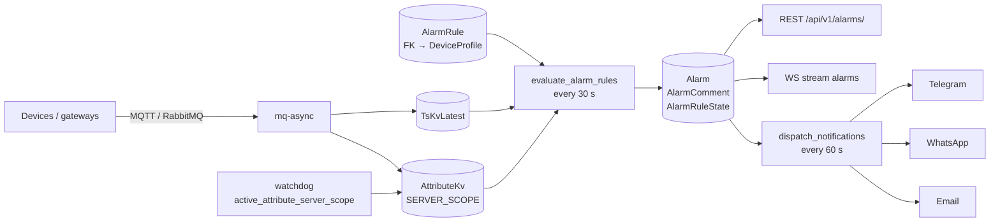
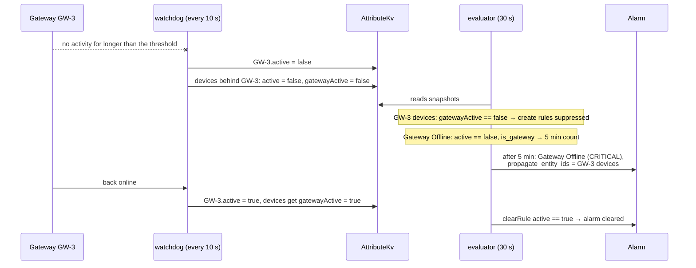

# Alarms — alarms, alarm rules and notifications

Reference for the `backend/apps/alarms` app: how alarms work, how to write rules, how the
evaluator works, the API, the WebSocket stream, Telegram notifications, operations and troubleshooting.

The rule model is ported from ThingsBoard, so the structures and field names match its
documentation; the differences are collected in [Differences from ThingsBoard](#differences-from-thingsboard).

> Keys in the recipes, except `Room Temperature`, `active`, `notifyOnOffline` and `gatewayActive`, are
> placeholders (`Humidity`, `Water Leak`, etc.). The real key names of a given tenant are returned by
> [`GET /api/v1/alarms/available-keys/`](#available-keys).

## Contents

1. [Overview](#1-overview)
2. [Code map](#2-code-map)
3. [Data model](#3-data-model)
4. [Rule format](#4-rule-format)
5. [How rules are evaluated](#5-how-rules-are-evaluated)
6. [Connectivity rules: devices and gateways](#6-connectivity-rules-devices-and-gateways)
7. [Recipes](#7-recipes)
8. [REST API](#8-rest-api)
9. [WebSocket: the `alarms` stream](#9-websocket-the-alarms-stream)
10. [Telegram notifications](#10-telegram-notifications) (email and WhatsApp are there too)
11. [Configuration and operations](#11-configuration-and-operations)
12. [Troubleshooting](#12-troubleshooting)
13. [Tests](#13-tests)
14. [Extending](#14-extending)

---

## 1. Overview

**An alarm (`Alarm`)** is one incident on one device: "gateway GW-3 offline from 10:15 to 10:42",
"temperature in room 305 above 30° since 14:00". The alarm row **is the journal**: there is no separate
events table, and the incident duration is `clear_ts - start_ts`.

**An alarm rule** is a row in the `alarms_alarm_rule` table with an FK to a device profile: the rule
applies to all active devices of that profile. The conditions inside the rule stay JSON in the
ThingsBoard format (they are recursive and polymorphic), while the rule itself has its own CRUD, an
`enabled` switch and an audit trail.

**The evaluator** is a Celery task that every `ALARMS_EVAL_INTERVAL_SEC` (30 s) reads the latest
telemetry values (`TsKvLatest`) and server attributes (`AttributeKv`), runs the rules and
creates, updates or clears alarms.



### Glossary

| Term | Where in the code | Meaning |
|---|---|---|
| Rule (`DeviceProfileAlarm` in TB) | `alarms.AlarmRule` | One alarm type on a profile: a set of create rules by severity and a clear rule |
| `alarmType` | `Alarm.alarm_type` | Alarm type name: `Device Offline`, `High Temperature`. Unique within a profile |
| Severity | `AlarmSeverity` | `CRITICAL` > `MAJOR` > `MINOR` > `WARNING` > `INDETERMINATE` |
| Originator | `Alarm.originator` | The device the rule fired on |
| Condition (`condition`) | `AlarmCondition` | A list of filters combined with AND |
| Spec (`spec`) | `AlarmConditionSpec` | How long the condition must hold: immediately, for N time, or for N passes in a row |
| Schedule (`schedule`) | `AlarmSchedule` | When the rule is in effect at all |
| Propagation (`propagate`) | `Alarm.propagate_entity_ids` | Which other entities the alarm is visible on |
| Acknowledgement (ack) | `Alarm.acknowledged` | "An operator has seen it". Does not affect the lifecycle |
| Clear | `Alarm.cleared` | The incident is over: automatically via `clearRule` or manually |

---

## 2. Code map

| Path | What is there |
|---|---|
| `apps/alarms/models.py` | `AlarmRule`, `Alarm`, `AlarmComment`, `AlarmRuleState` |
| `apps/alarms/constants.py` | TB vocabulary: severities, key types, operations, specs, schedules, the `ENTITY_FIELD` whitelist |
| `apps/alarms/serializers/rules/` | Rule format validation (mirrors the TB classes) |
| `apps/alarms/serializers/rule.py` | Rule CRUD contract: GRMS envelope + TB object |
| `apps/alarms/querysets/rule.py` | Rule queries: `active()`, `for_profiles()`, `list()` |
| `apps/alarms/views/rule.py` | Rule CRUD, `bulk`, `preview` |
| `apps/alarms/serializers/alarm.py` | Serializers for alarms, comments and filter parameters |
| `apps/alarms/services/engine.py` | The evaluator pass: profiles → devices → snapshots → rules |
| `apps/alarms/services/state.py` | One rule on one device: create / update / escalate / clear; `ack`, `clear`, `assign` |
| `apps/alarms/services/snapshot.py` | `DataSnapshot` — the device's values at the time of the pass, type coercion |
| `apps/alarms/services/predicates.py` | Predicate and filter evaluation |
| `apps/alarms/services/dynamic.py` | `defaultValue` / `dynamicValue` with `inherit` |
| `apps/alarms/services/spec.py` | `SIMPLE` / `DURATION` / `REPEATING` |
| `apps/alarms/services/schedule.py` | `ANY_TIME` / `SPECIFIC_TIME` / `CUSTOM` |
| `apps/alarms/services/details.py` | The `alarmDetails` template |
| `apps/alarms/services/propagate.py` | Propagation targets |
| `apps/alarms/services/preview.py` | Dry run of a profile's rules |
| `apps/alarms/services/keys.py` | Key catalog for the rule builder |
| `apps/alarms/templates.py` | Rule template catalog: what the builder offers via the "add a typical rule" button |
| `apps/alarms/services/attributes.py` | Writing the `notifyOnOffline` and `gatewayActive` server attributes |
| `apps/alarms/notifications/` | Notification dispatcher and tenant settings |
| `apps/alarms/channels/`, `apps/alarms/telegram/`, `apps/alarms/whatsapp/` | Delivery channels (Telegram, WhatsApp, email), HTTP clients for the Bot API and the WhatsApp Cloud API |
| `apps/alarms/views/`, `urls.py`, `swagger/` | REST API |
| `apps/alarms/v2_consumers/alarms.py` | The `alarms` WS stream |
| `apps/alarms/observables/alarm.py` | Pushes changes to the `alarms_<tenant_id>` group |
| `apps/alarms/tasks.py` | `evaluate_alarm_rules`, `dispatch_notifications`, `purge_alarms` |
| `apps/main/serializers/notification_settings.py`, `views/notification_settings.py` | Tenant notification settings |
| `apps/main/serializers/device.py` | The device's `notify_on_offline` field |
| `apps/core/management/commands/active_attribute_server_scope.py` | Watchdog: maintains `gatewayActive` |

---

## 3. Data model

### 3.1. `AlarmRule` (`alarms_alarm_rule`)

An alarm rule. A port of ThingsBoard's `DeviceProfileAlarm`, which keeps rules inside
`DeviceProfile.profile_data["alarms"]`; here every rule is a row.

| Field | Type | Meaning |
|---|---|---|
| `id` | UUID | Also the rule identifier in the API |
| `tenant` | FK `main.Tenant` | Taken from the profile, not read from the request body |
| `device_profile` | FK `main.DeviceProfile` | The rule applies to all active devices of the profile |
| `alarm_type` | str | Alarm type. Unique within a profile (DB constraint) |
| `enabled` | bool | The evaluator does not see a disabled rule |
| `create_rules` | JSON | `{"CRITICAL": {condition, schedule, alarmDetails}, …}` in the TB format (camelCase inside) |
| `clear_rule` | JSON, null | The clear rule |
| `propagate`, `propagate_relation_types`, `propagate_to_owner`, `propagate_to_tenant` | | Propagation, see [4.10](#410-propagation) |
| `created_at`, `created_by`, `updated_at`, `updated_by` | | Audit from `BaseModel` / `UpdateByModel` |

```python
UniqueConstraint(fields=["device_profile", "alarm_type"], name="uniq_alarm_rule_profile_type")
```

Two rules of the same type on one profile would fight over the same alarm row, so
uniqueness is enforced by the DB, not by the validator. Indexes: `(tenant, enabled)` and
`(device_profile, enabled)` — exactly what the evaluator selects rules by.

**Why the conditions stayed JSON.** The condition tree is recursive (`COMPLEX`) and polymorphic (`spec`,
`schedule`), the evaluator reads it as dicts, and storing it in the TB format makes it possible to paste
a rule exported from ThingsBoard without rework. Normalizing this into tables would be weeks of work
for no gain.

The `AlarmRule.as_rule()` method turns a row back into a `DeviceProfileAlarm` object. This is
the only conversion point, so neither the evaluator nor the validators know that the rules
moved into a table.

### 3.2. `Alarm` (`alarms_alarm`)

| Field | Type | Meaning |
|---|---|---|
| `id` | UUID | |
| `tenant` | FK `main.Tenant` | |
| `originator` | FK `main.Device` | The device the rule fired on |
| `room` | FK `main.Room`, null | The device's room **at creation time**. Denormalized: the journal survives the device being moved |
| `alarm_type` | str | The rule's `alarmType` |
| `severity` | str | Current severity. Can only go up (escalation), never down |
| `acknowledged`, `ack_ts` | bool, datetime | Acknowledgement |
| `cleared`, `clear_ts` | bool, datetime | Clear |
| `start_ts` | datetime | When the alarm was created (the condition with its spec held for the first time) |
| `end_ts` | datetime | The last pass on which the create rule still fired |
| `details` | JSON | `{"message": "…", "values": {…}}` — the rendered `alarmDetails` and the values of the keys from the condition |
| `propagate`, `propagate_relation_types`, `propagate_to_owner`, `propagate_to_tenant` | | A copy of the rule's propagation settings |
| `propagate_entity_ids` | UUID[] (GIN) | Entities on which the alarm is also visible |
| `assignee`, `assign_ts` | FK `users.User`, datetime | The assigned person |
| `created_at`, `created_by`, `updated_at`, `updated_by` | | From `BaseModel` / `UpdateByModel` (`created_at` is Unix ms) |

Computed properties: `status` and `duration_ms` (`(clear_ts or end_ts) - start_ts`).

What the notification channels have already reported about it is stored not in the alarm itself but in
`AlarmNotification` (`alarms_alarm_notification`): `alarm`, `channel`, `raised_at`, `cleared_at`, unique on
`(alarm, channel)`. `channel` holds the delivery **target** key: `telegram`, `email` or
`whatsapp:<number>` — WhatsApp has a row per recipient. In the alarm API this is the
`notifications` list.

Indexes: `(tenant, cleared, -start_ts)`, `(originator, -start_ts)`, `(alarm_type, -start_ts)`,
`(severity, -start_ts)`, GIN on `propagate_entity_ids`.

### 3.3. Status

The status is not stored — it is a pair of two independent flags:

| | `acknowledged = false` | `acknowledged = true` |
|---|---|---|
| **`cleared = false`** | `ACTIVE_UNACK` | `ACTIVE_ACK` |
| **`cleared = true`** | `CLEARED_UNACK` | `CLEARED_ACK` |

Acknowledging does not clear an alarm, and clearing does not acknowledge it. A cleared alarm can be acknowledged.

### 3.4. Deduplication

A device can have **at most one uncleared alarm of each type** — this is a partial
unique index in the DB:

```python
UniqueConstraint(fields=["originator", "alarm_type"], condition=Q(cleared=False),
                 name="uniq_active_alarm_per_originator_type")
```

Consequences:

- repeated firings of a rule do not create new rows, they move the `end_ts` of the existing one;
- after a clear, the next incident is a **new** row;
- a race between two processes inserting the same alarm is resolved at the DB level:
  `get_or_create` returns the existing row.

### 3.5. `AlarmComment` (`alarms_alarm_comment`)

| Field | Meaning |
|---|---|
| `alarm` | FK `Alarm`, cascade delete |
| `user` | Author (null for evaluator entries) |
| `alarm_comment_type` | `OTHER` — a human comment, `SYSTEM` — lifecycle audit |
| `comment` | JSON |

`SYSTEM` comments are written automatically and cannot be edited through the API. Their shapes:

```json
{"subtype": "SEVERITY_CHANGED", "from": "MINOR", "to": "MAJOR", "text": "Severity changed from MINOR to MAJOR"}
{"subtype": "ACKNOWLEDGED", "text": "Alarm acknowledged"}
{"subtype": "CLEARED", "text": "Alarm cleared"}
{"subtype": "CLEARED", "text": "Cleared manually"}
{"subtype": "ASSIGNED", "assignee": "5b8f0c0e-7d8f-4a55-9d4e-0f2f6d1f7a10", "text": "Assigned to engineer@hotel.uz"}
{"subtype": "UNASSIGNED", "assignee": null, "text": "Unassigned"}
```

`CLEARED` with the text `Alarm cleared` is left by the evaluator (the `clearRule` fired, `user = null`);
`Cleared manually` is a manual clear via `POST …/clear/` (`user` is the operator). A bulk
clear (`bulk/clear/`) writes `Alarm cleared` with the operator as `user`.

A user comment: `{"text": "Technician dispatched"}`; after an edit —
`{"text": "…", "edited": true, "edited_at": "2026-09-14T10:31:02.114Z"}`.

### 3.6. `AlarmRuleState` (`alarms_rule_state`)

Counters of the `DURATION` / `REPEATING` specs between evaluator passes. One row per pair
(device, `alarmType`); created on the first condition match and deleted as soon as no
rule of that type is counting anything.

```json
{
  "MAJOR": {"since": "2026-09-14T10:00:00.123456+00:00"},
  "MINOR": {"since": "2026-09-14T09:58:30.000000+00:00"},
  "CLEAR": {"count": 2}
}
```

The keys are the severities of the create rules and `CLEAR` for the clear rule. The counters are stored in the DB,
not in process memory, so they survive deploys and worker restarts. A row can safely be deleted:
counting simply starts over.

---

## 4. Rule format

A rule arrives in the API as a `DeviceProfileAlarm` object — camelCase, **as in ThingsBoard**:
a rule exported from a TB profile can be pasted without changes (subject to the
[GRMS differences](#differences-from-thingsboard)). The top-level fields are spread over the columns of
`alarms_alarm_rule`; conditions and schedules are stored as JSON exactly as the validator returned
them — with default values filled in.

The skeleton below is the body of one rule in `POST /api/v1/alarms/rules/` and one element of the array in
`POST /api/v1/alarms/rules/bulk/`.

### 4.1. Full skeleton

```jsonc
{
  "id": "myHighTemperature",            // optional; any string
  "alarmType": "High Temperature",      // required; unique within the profile
  "createRules": {                      // required; keys are severities
    "MAJOR": {                          // AlarmRule
      "condition": {
        "condition": [                  // filters, AND; at least one
          {
            "key": {"type": "TIME_SERIES", "key": "Room Temperature"},
            "valueType": "NUMERIC",
            "predicate": {
              "type": "NUMERIC",
              "operation": "GREATER",
              "value": {
                "defaultValue": 30,
                "dynamicValue": {"sourceType": "CURRENT_ROOM", "sourceAttribute": "temperatureMax", "inherit": true}
              }
            }
          }
        ],
        "spec": {"type": "DURATION", "unit": "MINUTES", "predicate": {"defaultValue": 5}}
      },
      "schedule": {"type": "ANY_TIME"},
      "alarmDetails": "Temperature ${Room Temperature}° in room ${room}",
      "dashboardId": null
    }
  },
  "clearRule": {                        // optional; without it the alarm can only be cleared manually
    "condition": {
      "condition": [
        {
          "key": {"type": "TIME_SERIES", "key": "Room Temperature"},
          "valueType": "NUMERIC",
          "predicate": {"type": "NUMERIC", "operation": "LESS", "value": {"defaultValue": 29}}
        }
      ],
      "spec": {"type": "SIMPLE"}
    }
  },
  "propagate": false,
  "propagateRelationTypes": [],
  "propagateToOwner": false,
  "propagateToTenant": false
}
```

(`jsonc` is used here only for the comments — the API receives plain JSON.)

### 4.2. `DeviceProfileAlarm` — top level

| Field | Req. | Default | Meaning |
|---|---|---|---|
| `id` | — | — | Responses only: the UUID of the rule row. Ignored in the request body |
| `alarmType` | yes | — | Alarm type, up to 255 characters |
| `createRules` | yes | — | A `severity → AlarmRule` dict, non-empty, keys only from the five severities |
| `clearRule` | no | — | The clear `AlarmRule` (`alarmDetails` is not used in it) |
| `propagate` | no | `false` | Propagate to related devices |
| `propagateRelationTypes` | no | `[]` | `shuttle.Relation` relation types; empty means any |
| `propagateToOwner` | no | `false` | Add the id of the device's room to `propagate_entity_ids` |
| `propagateToTenant` | no | `false` | Add the tenant id to `propagate_entity_ids` |

Next to these fields, the request body carries the GRMS envelope — snake_case, like the rest of the API:

| Field | Req. | Meaning |
|---|---|---|
| `device_profile` | yes, on create | UUID of the profile the rule is attached to |
| `enabled` | no, defaults to `true` | Rule switch |

### 4.3. `AlarmRule`

| Field | Req. | Meaning |
|---|---|---|
| `condition` | yes | `{"condition": [filters], "spec": {…}}`; `spec` defaults to `{"type": "SIMPLE"}` |
| `schedule` | no | Schedule; missing or `null` means always in effect |
| `alarmDetails` | no | Message template, see [4.9](#49-alarmdetails--message-template) |
| `dashboardId` | no | Stored for TB compatibility, not used |

### 4.4. Condition filter

```json
{
  "key": {"type": "ATTRIBUTE", "key": "active"},
  "valueType": "BOOLEAN",
  "value": null,
  "predicate": {"type": "BOOLEAN", "operation": "EQUAL", "value": {"defaultValue": false}}
}
```

**Key types (`key.type`):**

| Type | Where the value comes from |
|---|---|
| `TIME_SERIES` | The device's `TsKvLatest` — the latest value of a telemetry key (name from `TsKvDictionary`, spaces and case as is) |
| `ATTRIBUTE` | The device's `AttributeKv` with the **`SERVER_SCOPE`** scope |
| `ENTITY_FIELD` | A field of the device itself or of its room, only from the whitelist below |
| `CONSTANT` | A literal from the filter's `value` field; `key.key` is not needed |

**The `ENTITY_FIELD` whitelist:**

| Field | Value type | Suitable `valueType` |
|---|---|---|
| `name` | string | `STRING` |
| `type` | string | `STRING` |
| `label` | string or null | `STRING` |
| `status` | bool (`Device.status`) | `BOOLEAN` |
| `is_active` | bool | `BOOLEAN` — useless: the evaluator only takes active devices |
| `is_gateway` | bool, `Device.additional_info["gateway"]` | `BOOLEAN` |
| `room.number` | string | `STRING` |
| `room.floor` | string (!) | `STRING` — `"3"`, not `3` |
| `room.state` | list of numbers | not recommended: the string representation `"[1, 3]"` is compared |

A device without a room has no `room.*` fields — any predicate on them is false.

**`valueType` and reading the value:**

| `valueType` | How the value is read from a `TsKvLatest` / `AttributeKv` row |
|---|---|
| `NUMERIC` | `dbl_v`, else `long_v`, else `str_v` if the string parses as a number |
| `BOOLEAN` | `bool_v`, else `str_v` from `true/1/yes/on` or `false/0/no/off` (case-insensitive). **`long_v` is not read** |
| `STRING` | `str_v`, else the first non-empty value converted to a string |
| `DATE_TIME` | like `NUMERIC` — Unix time in milliseconds |

> **Pitfall:** if a controller sends a boolean as the number `0`/`1` (it lands in `long_v`),
> a `BOOLEAN` filter will not see it and will never match. For such keys use
> `NUMERIC` + `EQUAL 1`.

**Compatibility of `valueType` and the predicate type** is checked by the validator, including for all
`COMPLEX` leaves:

| `valueType` | Predicate type |
|---|---|
| `NUMERIC`, `DATE_TIME` | `NUMERIC` |
| `BOOLEAN` | `BOOLEAN` |
| `STRING` | `STRING` |

### 4.5. Predicates

**`NUMERIC`** — `EQUAL`, `NOT_EQUAL`, `GREATER`, `LESS`, `GREATER_OR_EQUAL`, `LESS_OR_EQUAL`.
Both sides are converted to `float`.

```json
{"type": "NUMERIC", "operation": "GREATER_OR_EQUAL", "value": {"defaultValue": 30}}
```

**`BOOLEAN`** — `EQUAL`, `NOT_EQUAL`.

```json
{"type": "BOOLEAN", "operation": "EQUAL", "value": {"defaultValue": true}}
```

**`STRING`** — `EQUAL`, `NOT_EQUAL`, `STARTS_WITH`, `ENDS_WITH`, `CONTAINS`, `NOT_CONTAINS`,
`IN`, `NOT_IN`; the `ignoreCase` flag (default `false`). For `IN`/`NOT_IN` the value is a list
or a comma-separated string (spaces around elements are trimmed):

```json
{"type": "STRING", "operation": "IN", "ignoreCase": true, "value": {"defaultValue": ["error", "fault"]}}
{"type": "STRING", "operation": "NOT_IN", "value": {"defaultValue": "2.4.1, 2.4.2"}}
```

**`COMPLEX`** — `AND` / `OR` over nested predicates, recursively, up to 5 levels. All
nested predicates compare **the same** value of the filter's key. Conditions on different keys
are written as separate filters (they are combined with AND); OR between different keys cannot be
expressed in the TB format — it takes two separate rules.

```json
{
  "type": "COMPLEX",
  "operation": "OR",
  "predicates": [
    {"type": "NUMERIC", "operation": "LESS", "value": {"defaultValue": 30}},
    {"type": "NUMERIC", "operation": "GREATER", "value": {"defaultValue": 70}}
  ]
}
```

**A missing value never matches.** If the device does not have the key (it sent no
telemetry, there is no attribute) or the threshold could not be resolved, the predicate is false, **including
`NOT_EQUAL` and `NOT_IN`**. A device that has never sent `Room Temperature` cannot
fire any temperature rule.

### 4.6. Predicate value: `defaultValue` and `dynamicValue`

```json
{
  "defaultValue": 30,
  "dynamicValue": {"sourceType": "CURRENT_ROOM", "sourceAttribute": "temperatureMax", "inherit": true}
}
```

At least one of the two is required. Resolution order:

1. If there is a `dynamicValue`, the `sourceAttribute` attribute is looked up in the `sourceType` source.
2. Not found and `inherit: true` — the lookup continues **upwards** along the chain
   `CURRENT_DEVICE → CURRENT_ROOM → CURRENT_TENANT`, starting at the level after the source.
3. Nothing found — `defaultValue` is used.
4. No `defaultValue` either — the predicate is false.

**Where the source attributes live:**

| `sourceType` | Storage |
|---|---|
| `CURRENT_DEVICE` | The device's `AttributeKv`, `SERVER_SCOPE` |
| `CURRENT_ROOM` | `Room.additional_info["attributes"]` |
| `CURRENT_TENANT` | `Tenant.additional_info["attributes"]` |

TB's `CURRENT_USER` and `CURRENT_CUSTOMER` are not supported — the validator rejects them.

**Resolution example** for `{"defaultValue": 30, "dynamicValue": {"sourceType": "CURRENT_ROOM", "sourceAttribute": "temperatureMax", "inherit": …}}`:

| Room | Tenant | `inherit: false` | `inherit: true` |
|---|---|---|---|
| `26` | `28` | 26 | 26 |
| — | `28` | 30 | 28 |
| — | — | 30 | 30 |

The device attribute never takes part in this chain: the lookup only goes up from the source.
For a device to be able to override the room threshold, the source must be `CURRENT_DEVICE`
with `inherit: true`.

Room and tenant attribute values are plain JSON; the string `"26"` is converted to a number as well.

### 4.7. Condition spec

| Type | Fires | Fields |
|---|---|---|
| `SIMPLE` | on the first pass where the condition holds | — |
| `DURATION` | when the condition has held continuously for at least the given time | `unit`: `SECONDS` / `MINUTES` / `HOURS` / `DAYS`; `predicate`: the value (positive) |
| `REPEATING` | on the N-th consecutive pass where the condition holds | `predicate`: integer ≥ 1 |

```json
{"type": "DURATION", "unit": "MINUTES", "predicate": {"defaultValue": 10}}
{"type": "REPEATING", "predicate": {"defaultValue": 3}}
```

The spec's `predicate` is the same kind of predicate value as in 4.6, so the duration and the number
of repeats can be taken from an attribute (`dynamicValue`).

**Continuity.** A single pass where the condition does not hold resets both the `DURATION` clock and
the `REPEATING` counter.

**`DURATION` on a timeline** (evaluator interval 30 s, rule "`active == false` for 10 minutes"):

| Time | `active` | What happens |
|---|---|---|
| 10:00:00 | `false` | First match: `AlarmRuleState = {"MAJOR": {"since": "10:00:00"}}`, no alarm |
| 10:05:00 | `false` | 5 min elapsed < 10 — waiting |
| 10:07:30 | `true` | The condition does not hold — state deleted |
| 10:08:00 | `false` | Counting starts over from 10:08:00 |
| 10:18:00 | `false` | 10 min elapsed — **alarm created**, `start_ts = 10:18:00` |
| 10:18:30 | `false` | The alarm exists — `end_ts` moves |

**Difference from TB: `REPEATING` counts evaluator passes, not incoming messages.** The evaluator
reads the latest value from `TsKvLatest`; if the device is silent, the same value is
counted on every pass. `REPEATING 3` with a 30 s interval means "the condition is seen on three
passes in a row", i.e. about a minute. In practice it is a short `DURATION` that protects against
single outliers between passes.

### 4.8. Schedule

Outside its schedule a rule **does not exist**: it does not fire and loses the accumulated
`DURATION`/`REPEATING` count. A schedule is set separately for each create rule and for the
clear rule.

**`ANY_TIME`** — always (same as no `schedule`).

**`SPECIFIC_TIME`** — one window for the selected days of the week:

```json
{
  "type": "SPECIFIC_TIME",
  "timezone": "Asia/Tashkent",
  "daysOfWeek": [1, 2, 3, 4, 5],
  "startsOn": 32400000,
  "endsOn": 64800000
}
```

**`CUSTOM`** — a separate window for each day:

```json
{
  "type": "CUSTOM",
  "timezone": "Asia/Tashkent",
  "items": [
    {"enabled": true,  "dayOfWeek": 1, "startsOn": 28800000, "endsOn": 72000000},
    {"enabled": true,  "dayOfWeek": 6, "startsOn": 36000000, "endsOn": 57600000},
    {"enabled": false, "dayOfWeek": 7, "startsOn": 0, "endsOn": 0}
  ]
}
```

Interpretation rules:

- `daysOfWeek` / `dayOfWeek` — ISO: Monday is `1`, Sunday is `7`;
- `startsOn` / `endsOn` — milliseconds from midnight **in the schedule's `timezone`** (an IANA name,
  `UTC` by default; an unknown zone is rejected by the validator);
- the window is half-open: `startsOn ≤ t < endsOn`;
- `startsOn == endsOn` — the whole day;
- `startsOn > endsOn` — a window across midnight (`22:00 → 06:00`): active when `t ≥ startsOn` **or**
  `t < endsOn`. The day of the week is checked against the **current** local day, so for
  `daysOfWeek: [1]` Mon 00:00–06:00 and Mon 22:00–24:00 are active, and Tue 00:00–06:00 only if the
  list also contains `2`. For the nights "Mon→Tue … Fri→Sat" list days `1–6`;
- in `CUSTOM`, a day without an element in `items` or with `enabled: false` means the rule is inactive all day.

Time cheat sheet:

| Time | ms | Time | ms |
|---|---|---|---|
| 00:00 | `0` | 13:00 | `46800000` |
| 06:00 | `21600000` | 18:00 | `64800000` |
| 07:00 | `25200000` | 20:00 | `72000000` |
| 08:00 | `28800000` | 22:00 | `79200000` |
| 09:00 | `32400000` | 23:00 | `82800000` |
| 10:00 | `36000000` | 24:00 | `86400000` |

Formula: `(hours × 60 + minutes) × 60 000`.

### 4.9. `alarmDetails` — message template

A string with `${…}` placeholders. The result goes into `Alarm.details["message"]`, the alarm card
and Telegram. The template is re-rendered on **every** pass where the create rule fires,
so the message shows the fresh value.

| Placeholder | Value |
|---|---|
| `${originatorName}` | Device name |
| `${room}` | The device's room number or an empty string |
| `${alarmType}` | The rule's `alarmType` |
| `${alarmSeverity}` | Severity of the rule that fired |
| `${<telemetry key>}` | Latest value, e.g. `${Room Temperature}` — spaces in the name are allowed |
| `${<attribute key>}` | Server attribute value |
| `${<ENTITY_FIELD>}` | `${name}`, `${room.floor}`, `${is_gateway}` … |

Lookup order for an arbitrary name: telemetry → attribute → device field.

- An unrecognized placeholder stays as literal text (`${Humidity}`); the task does not fail.
- Only keys that **are used in the rule conditions** of this profile are guaranteed to be
  available: the evaluator does not load keys nobody refers to.
- An empty or missing template produces `"<alarmType> — <device name>"`.

Example: `"Temperature ${Room Temperature}° in room ${room}, floor ${room.floor} (${alarmSeverity})"`
→ `"Temperature 31.5° in room 305, floor 3 (MAJOR)"`.

`details["values"]` is a snapshot of the values of the keys from the filters of the rule that fired (except
`CONSTANT`), e.g. `{"Room Temperature": 31.5}`.

### 4.10. Propagation

By default an alarm is visible only on the originating device. With propagation, the identifiers
of the target entities are written to `Alarm.propagate_entity_ids` **once, on creation**:

| Rule field | What is added |
|---|---|
| `propagate: true` | Devices on **either** end of a `shuttle.Relation` with the originator (both `from` and `to`); `propagateRelationTypes` narrows by `relation_type` |
| `propagateToOwner: true` | The id of the device's room |
| `propagateToTenant: true` | The tenant id |

The `device=<id>` filter in the API and WS returns alarms where the device is the originator **or** is in
`propagate_entity_ids`. That is how a gateway alarm is visible in the card of every device behind it.

Relations created after the alarm was created do not affect it (as in TB).

### 4.11. Validation

Rules are checked on create and update (`POST`/`PUT /api/v1/alarms/rules/…`), on bulk
replacement (`rules/bulk/`) and in [`preview`](#preview) — by one and the same validator. It checks that:

- `alarmType` is unique within the profile;
- `createRules` is non-empty and its keys are only `CRITICAL`/`MAJOR`/`MINOR`/`WARNING`/`INDETERMINATE`;
- every condition has at least one filter;
- `CONSTANT` has a `value`, and the other key types have a non-empty `key.key`;
- `ENTITY_FIELD` is from the whitelist only;
- `valueType` is compatible with the predicate type, including all `COMPLEX` leaves;
- the operation is valid for the predicate type; `COMPLEX` has a non-empty `predicates` and depth ≤ 5;
- the predicate value has a `defaultValue` or a `dynamicValue`;
- `dynamicValue.sourceType` is `CURRENT_DEVICE` / `CURRENT_ROOM` / `CURRENT_TENANT`;
- `DURATION` has a known `unit` and a positive `defaultValue`; `REPEATING` is an integer ≥ 1;
- schedule: days 1–7, time 0…86 400 000, a known `timezone`, `CUSTOM` has a non-empty `items`.

The validator fills in defaults: `spec: {"type": "SIMPLE"}`, `ignoreCase: false`,
`inherit: false`, `timezone: "UTC"`, `propagate*`.

Example of a `400` response to a `POST`/`PUT` of a single rule (`valueType` is `NUMERIC` for a boolean
predicate, the duration is `0`):

```json
{
  "createRules": {
    "MAJOR": {
      "condition": {
        "condition": [
          {"predicate": ["valueType NUMERIC needs NUMERIC predicates, got ['BOOLEAN']."]}
        ],
        "spec": {"predicate": ["A DURATION needs a positive 'defaultValue'."]}
      }
    }
  }
}
```

The path to an error mirrors the path in the rule JSON; array elements are addressed by index. In `rules/bulk/` and
`rules/preview/` the same thing is wrapped in `alarms` with the rule index:

```json
{"alarms": [{}, {"createRules": ["This dictionary may not be empty."]}]}
```

An empty object in place of the first rule means it is fine — the indexes are preserved.

### Differences from ThingsBoard

| ThingsBoard | GRMS |
|---|---|
| Rules are evaluated on every incoming message in the rule chain | Periodically, every `ALARMS_EVAL_INTERVAL_SEC`, on the latest values |
| `REPEATING` counts messages | Counts evaluator passes |
| Any entity can have attributes | `AttributeKv` exists for devices only; rooms and tenants use `additional_info["attributes"]` |
| `CURRENT_USER`, `CURRENT_CUSTOMER` | Not supported; `CURRENT_ROOM` added |
| `ENTITY_FIELD` — any field | A whitelist, including `is_gateway` and `room.*` |
| A rule fires on any device of the profile | Behind a dead gateway (`gatewayActive == false`) create rules never fire, see [6.3](#63-suppression-behind-a-dead-gateway) |
| The "alarm ↔ entity" link in the `relation` table | The `Alarm.propagate_entity_ids` array |
| Notification Center | A simplified dispatcher with Telegram, WhatsApp and email channels |

In the code these places are marked with a `GRMS deviation:` comment.

---

## 5. How rules are evaluated

### 5.1. The pass

The `alarms.tasks.evaluate_alarm_rules` task (`default` queue, beat every
`ALARMS_EVAL_INTERVAL_SEC`, 30 s by default). With `ALARMS_ENABLED=false` it returns immediately.

1. A single query fetches the enabled rules of active profiles (`AlarmRule.objects.active()`,
   i.e. `enabled = true` and `device_profile.active = true`), grouped by profile.
2. Their active devices are fetched (`Device.is_active = true`), in batches of 500.
3. For a batch, all keys the rules refer to are collected: `TIME_SERIES` names,
   `ATTRIBUTE` names, device attributes from a `dynamicValue` with `CURRENT_DEVICE`.
4. `TsKvLatest` and `AttributeKv` (`SERVER_SCOPE`) are read for these keys with one query each, plus
   the `additional_info["attributes"]` of rooms and tenants. A `DataSnapshot` is built from this for
   every device.
5. Every rule of the profile is run on the snapshot of every device (5.2).
6. Counter changes are written to `AlarmRuleState` in bulk.
7. If anything was created, escalated or cleared, `alarm.update` is sent to the WS groups of the
   affected tenants (after the transaction commits).

An error in one rule is logged (`Alarm rule '<type>' failed on device <id>`) and does not
stop the pass over the other rules and devices.

### 5.2. One rule on one device

A port of TB's `AlarmState.process` (`services/state.py`):

```text
for severity in the order CRITICAL, MAJOR, MINOR, WARNING, INDETERMINATE:
    no rule of this severity             → next
    rule outside its schedule            → next (its count is forgotten)
    matched = all condition filters are true
    fired, count = spec(matched, previous count)
    if fired:
        no active alarm of this type     → CREATE (severity, start_ts = end_ts = now, details)
        there is an active one           → end_ts = now, update details;
                                           if this severity is higher than the current one → ESCALATE + SYSTEM comment
        END (lower severities and clearRule are not looked at on this pass)

no create rule fired:
    there is an active alarm and a clearRule, and the clearRule is within its schedule:
        matched = clearRule filters; fired = spec(…)
        if fired                         → CLEAR (cleared, clear_ts = now, SYSTEM comment)
```

### 5.3. Consequences worth remembering

- **The first rule that *fires* wins, not the first one that matches.** While `CRITICAL` with
  `DURATION` is counting, `MAJOR` with `SIMPLE` can already create the alarm; when `CRITICAL`
  finishes counting, an escalation happens. Multi-level rules are built on this (recipe 7.2).
- **A rule that fires resets the counts of lower severities.** Rules below the one that fired are
  not evaluated on this pass, and their `since`/`count` are not saved. If the temperature drops from the
  `CRITICAL` zone into the `MAJOR` zone with `DURATION`, the `MAJOR` count starts from zero.
- **Severity only goes up.** If a rule below the current severity fires later, the alarm's
  `end_ts` is updated, but the severity is not lowered.
- **`clearRule` is checked only if no create rule fired on this pass.**
  If the create and clear conditions overlap, the alarm will never be cleared. There must be a
  gap between the thresholds: create `> 30`, clear `< 29`.
- **The zone between the thresholds "freezes" the alarm.** At 29.5 the create rule `> 30` does not
  fire and neither does the clear `< 29`: the alarm stays active and `end_ts` does not move.
- **Without a `clearRule` the alarm lives until it is cleared manually.**
- **Clearing or deleting manually while the condition still holds** leads to a new
  alarm being created on the next pass. This is true for `DURATION` as well: while the alarm was active, the count
  was kept, and the duration has already been reached.
- **A missing value matches nothing** (4.5). No key — no alarm, and no clear.
- **The age of a value is not taken into account.** The evaluator sees the latest value in `TsKvLatest`,
  even if the device has been silent for a day. If this matters, add the filter
  `ATTRIBUTE active == true` to the condition (recipe 7.1). The case "silent because the gateway is down" is handled
  in code: create rules skip such devices ([6.3](#63-suppression-behind-a-dead-gateway)).
- **`end_ts` moves without a WS push.** The client receives an update only on creation,
  escalation and clear (and on actions via the API).
- **Delay.** An alarm appears no earlier than the `spec duration` after the first pass that
  saw the condition, and no later than one more evaluator interval after that.

### 5.4. Performance

Per pass: two queries to `TsKvLatest`/`AttributeKv` for every 500 devices, plus queries for
active alarms and `AlarmRuleState` for the same batch. An index was added for lookups by key
(`shuttle/0028_alter_tskvlatest_entity_and_more`). Evaluation in Python takes microseconds per comparison. The interval is controlled by
`ALARMS_EVAL_INTERVAL_SEC`.

The celery-default log after each pass:

```text
Alarm evaluation: 1480 devices × 12 rules → 2 created, 0 escalated, 1 cleared
```

`rules` is the total number of rules across all profiles that have rules (three profiles with four rules each gives `12`), not
the number of "device × rule" pairs.

---

## 6. Connectivity rules: devices and gateways

**There are no built-in rules in the system.** A new tenant's profiles are created without rules, and each tenant
sets up its own — through the [rule CRUD](#82-rules). These two rules are served as templates
(`GET /api/v1/alarms/rule-templates/`, see [8.2](#82-rules)), so in the panel they are added with a
button rather than by copy-paste. Below is the same pair in full:
it covers the journal of device and gateway outages and takes care of the gateway cascade. Temperature thresholds are
in [recipe 7.1](#71-temperature-threshold-per-room-and-tenant-online-devices-only).

| `alarmType` | Severity | Create | Clear |
|---|---|---|---|
| `Device Offline` | `MAJOR` | `active == false` AND `notifyOnOffline == true` AND `gatewayActive == true` AND `is_gateway == false`, `DURATION` 10 min | `active == true` |
| `Gateway Offline` | `CRITICAL` | `active == false` AND `is_gateway == true`, `DURATION` 5 min, `propagate: true` | `active == true` |

Both rules live on the same profile: the `is_gateway` filter splits them between devices, so
a separate profile for gateways is not needed.

The message texts below are quoted verbatim as the templates in `apps/alarms/templates.py` produce them.

```json
[
  {
    "id": "myDeviceOffline",
    "alarmType": "Device Offline",
    "createRules": {
      "MAJOR": {
        "condition": {
          "condition": [
            {"key": {"type": "ATTRIBUTE", "key": "active"}, "valueType": "BOOLEAN",
             "predicate": {"type": "BOOLEAN", "operation": "EQUAL", "value": {"defaultValue": false}}},
            {"key": {"type": "ATTRIBUTE", "key": "notifyOnOffline"}, "valueType": "BOOLEAN",
             "predicate": {"type": "BOOLEAN", "operation": "EQUAL", "value": {"defaultValue": true}}},
            {"key": {"type": "ATTRIBUTE", "key": "gatewayActive"}, "valueType": "BOOLEAN",
             "predicate": {"type": "BOOLEAN", "operation": "EQUAL", "value": {"defaultValue": true}}},
            {"key": {"type": "ENTITY_FIELD", "key": "is_gateway"}, "valueType": "BOOLEAN",
             "predicate": {"type": "BOOLEAN", "operation": "EQUAL", "value": {"defaultValue": false}}}
          ],
          "spec": {"type": "DURATION", "unit": "MINUTES", "predicate": {"defaultValue": 10}}
        },
        "schedule": {"type": "ANY_TIME"},
        "alarmDetails": "Устройство ${originatorName} не на связи"
      }
    },
    "clearRule": {
      "condition": {
        "condition": [
          {"key": {"type": "ATTRIBUTE", "key": "active"}, "valueType": "BOOLEAN",
           "predicate": {"type": "BOOLEAN", "operation": "EQUAL", "value": {"defaultValue": true}}}
        ],
        "spec": {"type": "SIMPLE"}
      }
    }
  },
  {
    "id": "myGatewayOffline",
    "alarmType": "Gateway Offline",
    "createRules": {
      "CRITICAL": {
        "condition": {
          "condition": [
            {"key": {"type": "ATTRIBUTE", "key": "active"}, "valueType": "BOOLEAN",
             "predicate": {"type": "BOOLEAN", "operation": "EQUAL", "value": {"defaultValue": false}}},
            {"key": {"type": "ENTITY_FIELD", "key": "is_gateway"}, "valueType": "BOOLEAN",
             "predicate": {"type": "BOOLEAN", "operation": "EQUAL", "value": {"defaultValue": true}}}
          ],
          "spec": {"type": "DURATION", "unit": "MINUTES", "predicate": {"defaultValue": 5}}
        },
        "schedule": {"type": "ANY_TIME"},
        "alarmDetails": "Шлюз ${originatorName} не на связи"
      }
    },
    "clearRule": {
      "condition": {
        "condition": [
          {"key": {"type": "ATTRIBUTE", "key": "active"}, "valueType": "BOOLEAN",
           "predicate": {"type": "BOOLEAN", "operation": "EQUAL", "value": {"defaultValue": true}}}
        ],
        "spec": {"type": "SIMPLE"}
      }
    },
    "propagate": true
  }
]
```

The same pair is built by the `device_offline_rule()` and `gateway_offline_rule()` builders in
`apps/alarms/templates.py`, and `test_propagate.py::GatewayCascadeTest` runs the cascade on them,
so the example above is verified by tests, not just written down.

### 6.1. Attributes the offline rules depend on

| Attribute (`SERVER_SCOPE`) | Written by | Purpose |
|---|---|---|
| `active` | The existing connectivity mechanisms: the MQ handler and the `active_attribute_server_scope` watchdog | Connectivity itself |
| `notifyOnOffline` | The device toggle (`notify_on_offline` in the API); `true` on device creation | Turn off connectivity alarms for a specific device |
| `gatewayActive` | The watchdog — for devices behind gateways that go live (`true`) or down (`false`); `true` on device creation | Avoid flooding with device alarms when their gateway goes down. The evaluator reads it for all rules ([6.3](#63-suppression-behind-a-dead-gateway)) |

If a device has no `notifyOnOffline` or `gatewayActive` row, the filter is false and `Device
Offline` **will never fire** on it (4.5). The attributes are written only when a device is created
through the API, so on a fleet that was set up earlier the rule stays silent until the attributes
appear. The watchdog sets `gatewayActive` itself for devices behind the gateways it sees;
the others (and `notifyOnOffline` for all) need a one-off run:

```python
from alarms.constants import ATTR_GATEWAY_ACTIVE, ATTR_NOTIFY_ON_OFFLINE
from alarms.services.attributes import set_server_attribute
from main.models import Device

for device_id in Device.objects.filter(tenant_id="<tenant_id>", is_active=True).values_list("id", flat=True):
    set_server_attribute(device_id, ATTR_NOTIFY_ON_OFFLINE, True)
    set_server_attribute(device_id, ATTR_GATEWAY_ACTIVE, True)
```

Skip devices behind a gateway that is offline right now (or set `gatewayActive = false` for them): the
watchdog only goes over gateways with `active == true` and writes `false` once, at the moment a gateway
goes down. A `true` written by this script to a device behind an already dead gateway stays until the
gateway comes back, and suppression ([6.3](#63-suppression-behind-a-dead-gateway)) does not work for it
until then.

### 6.2. Gateway cascade



Result: one `CRITICAL` alarm on the gateway, visible in the card of each of its devices, instead of a hundred
`MAJOR` alarms. A device that goes down on its own while the gateway is alive still gets its own
`Device Offline`.

"Gateway → device" relations are taken from `shuttle.Relation` (`from_id` is the gateway, `to_id` is the device).

### 6.3. Suppression behind a dead gateway

The `gatewayActive == true` filter in `Device Offline` protects only that rule. The others —
temperature, leaks, any user-defined ones — see the device's "frozen" telemetry and
would raise an alarm on every device behind the gateway. That is why the check is built into the evaluator
(`DataSnapshot.behind_dead_gateway`, `services/state.py`) and applies to **all** rules without
exception; there is no need to write it into a rule:

| Device | Create rules | Clear rule |
|---|---|---|
| Not a gateway, `gatewayActive == false` | Do not fire: treated as not matched, `DURATION`/`REPEATING` counts are reset | Works as usual |
| Not a gateway, `gatewayActive == true` or no attribute | As usual | As usual |
| Gateway (`is_gateway`) | As usual — `Gateway Offline` must fire | As usual |

Consequences:

- **No new alarms are created behind a dead gateway**; only `Gateway Offline` remains.
- **An already active alarm stays** until its `clearRule`: a clear on frozen data usually
  does not fire, and suppression does not clear the alarm.
- **After the gateway comes back, counting starts over.** Duration accumulated before the outage does not
  count, so a `DURATION` alarm does not appear right after connectivity is restored.
- **No attribute — no suppression.** Only an explicit `false` counts; the watchdog sets it for
  devices related to the gateway through `Relation`. A device without a relation to a gateway is not suppressed.
- **Suppression cannot be turned off for an individual rule.**
- **`preview` (Check) takes suppression into account**: devices behind a dead gateway are not counted
  as matches of create rules.

---

## 7. Recipes

Each recipe is the body of one rule: `POST /api/v1/alarms/rules/` together with the
`device_profile` field, or an array element in `rules/bulk/` (see [8.2](#82-rules)). Before saving,
run the rules through [`preview`](#preview).

### 7.1. Temperature threshold per room and tenant, online devices only

```json
{
  "alarmType": "High Temperature",
  "createRules": {
    "MINOR": {
      "condition": {
        "condition": [
          {
            "key": {"type": "TIME_SERIES", "key": "Room Temperature"},
            "valueType": "NUMERIC",
            "predicate": {
              "type": "NUMERIC",
              "operation": "GREATER",
              "value": {
                "defaultValue": 30,
                "dynamicValue": {"sourceType": "CURRENT_ROOM", "sourceAttribute": "temperatureMax", "inherit": true}
              }
            }
          },
          {
            "key": {"type": "ATTRIBUTE", "key": "active"},
            "valueType": "BOOLEAN",
            "predicate": {"type": "BOOLEAN", "operation": "EQUAL", "value": {"defaultValue": true}}
          }
        ],
        "spec": {"type": "DURATION", "unit": "MINUTES", "predicate": {"defaultValue": 5}}
      },
      "alarmDetails": "Temperature ${Room Temperature}° in room ${room} (threshold exceeded)"
    }
  },
  "clearRule": {
    "condition": {
      "condition": [
        {
          "key": {"type": "TIME_SERIES", "key": "Room Temperature"},
          "valueType": "NUMERIC",
          "predicate": {
            "type": "NUMERIC",
            "operation": "LESS",
            "value": {
              "defaultValue": 29,
              "dynamicValue": {"sourceType": "CURRENT_ROOM", "sourceAttribute": "temperatureMaxClear", "inherit": true}
            }
          }
        }
      ]
    }
  }
}
```

The `active == true` filter discards a stale value from a device that is no longer online.

**Per-room threshold.** API: `PUT /api/v1/main/room/<pk>/` with the full room body — `additional_info`
is replaced as a whole, so its other keys must be passed as they are. From the shell:

```python
from main.models import Room

room = Room.objects.get(tenant_id="<tenant_id>", number="305", active=True)
info = room.additional_info or {}
info.setdefault("attributes", {}).update({"temperatureMax": 26, "temperatureMaxClear": 25})
room.additional_info = info
room.save(update_fields=["additional_info"])
```

**Per-tenant threshold** (there is no API for tenant attributes, shell only):

```python
from main.models import Tenant

tenant = Tenant.objects.get(id="<tenant_id>")
info = tenant.additional_info or {}
info.setdefault("attributes", {}).update({"temperatureMax": 28, "temperatureMaxClear": 27})
tenant.additional_info = info
tenant.save(update_fields=["additional_info"])
```

Result: room 305 has a 26/25 threshold, the tenant's other rooms 28/27; if neither the room
nor the tenant has the attribute, 30/29 from `defaultValue`.

> Value scale: some controllers send the temperature as an integer (`235` instead of `23.5`).
> The rule format has no multiplier — the threshold is set in the same units as the telemetry. Check
> the value column, as in [7.11](#711-boolean-value-sent-as-a-number).

The change is picked up on the next evaluator pass.

### 7.2. Multi-level escalation

```json
{
  "alarmType": "Overheat",
  "createRules": {
    "CRITICAL": {
      "condition": {
        "condition": [
          {"key": {"type": "TIME_SERIES", "key": "Room Temperature"}, "valueType": "NUMERIC",
           "predicate": {"type": "NUMERIC", "operation": "GREATER", "value": {"defaultValue": 35}}}
        ],
        "spec": {"type": "SIMPLE"}
      },
      "alarmDetails": "CRITICAL: ${Room Temperature}° in room ${room}"
    },
    "MAJOR": {
      "condition": {
        "condition": [
          {"key": {"type": "TIME_SERIES", "key": "Room Temperature"}, "valueType": "NUMERIC",
           "predicate": {"type": "NUMERIC", "operation": "GREATER", "value": {"defaultValue": 30}}}
        ],
        "spec": {"type": "DURATION", "unit": "MINUTES", "predicate": {"defaultValue": 15}}
      },
      "alarmDetails": "Hot for 15+ minutes: ${Room Temperature}° in room ${room}"
    },
    "MINOR": {
      "condition": {
        "condition": [
          {"key": {"type": "TIME_SERIES", "key": "Room Temperature"}, "valueType": "NUMERIC",
           "predicate": {"type": "NUMERIC", "operation": "GREATER", "value": {"defaultValue": 28}}}
        ],
        "spec": {"type": "DURATION", "unit": "MINUTES", "predicate": {"defaultValue": 5}}
      },
      "alarmDetails": "Warm: ${Room Temperature}° in room ${room}"
    }
  },
  "clearRule": {
    "condition": {
      "condition": [
        {"key": {"type": "TIME_SERIES", "key": "Room Temperature"}, "valueType": "NUMERIC",
         "predicate": {"type": "NUMERIC", "operation": "LESS", "value": {"defaultValue": 27}}}
      ]
    }
  }
}
```

| Time | Temperature | Result |
|---|---|---|
| 10:00 | 31 | `MAJOR` and `MINOR` start counting; no alarm |
| 10:05 | 31 | `MINOR` has finished counting — `Overheat MINOR` **created** |
| 10:15 | 31 | `MAJOR` has finished counting — **escalation** `MINOR → MAJOR`, `SYSTEM` comment |
| 10:16 | 36 | `CRITICAL` (`SIMPLE`) — **escalation** `MAJOR → CRITICAL` |
| 10:20 | 29 | `MINOR` starts counting **again**: `CRITICAL` fired at 10:16 and the counts of lower severities were reset. `end_ts` stays, severity remains `CRITICAL` |
| 10:25 | 29 | `MINOR` has finished counting — `end_ts` moves, severity is still `CRITICAL` |
| 10:30 | 27.5 | Neither create nor clear holds — the alarm is active, `end_ts` stays |
| 10:31 | 26 | `clearRule` — **cleared** |

The order of severities in the JSON does not matter: they are always iterated from `CRITICAL` to `INDETERMINATE`.

### 7.3. Protection against sensor outliers: `REPEATING` and a delayed clear

```json
{
  "alarmType": "Temperature Sensor Suspicious",
  "createRules": {
    "WARNING": {
      "condition": {
        "condition": [
          {"key": {"type": "TIME_SERIES", "key": "Room Temperature"}, "valueType": "NUMERIC",
           "predicate": {
             "type": "COMPLEX", "operation": "OR",
             "predicates": [
               {"type": "NUMERIC", "operation": "LESS", "value": {"defaultValue": -10}},
               {"type": "NUMERIC", "operation": "GREATER", "value": {"defaultValue": 60}}
             ]
           }}
        ],
        "spec": {"type": "REPEATING", "predicate": {"defaultValue": 3}}
      },
      "alarmDetails": "The sensor in room ${room} reads ${Room Temperature}°"
    }
  },
  "clearRule": {
    "condition": {
      "condition": [
        {"key": {"type": "TIME_SERIES", "key": "Room Temperature"}, "valueType": "NUMERIC",
         "predicate": {
           "type": "COMPLEX", "operation": "AND",
           "predicates": [
             {"type": "NUMERIC", "operation": "GREATER_OR_EQUAL", "value": {"defaultValue": 0}},
             {"type": "NUMERIC", "operation": "LESS_OR_EQUAL", "value": {"defaultValue": 50}}
           ]
         }}
      ],
      "spec": {"type": "DURATION", "unit": "MINUTES", "predicate": {"defaultValue": 2}}
    }
  }
}
```

The alarm appears if the value is out of range on three passes in a row (about a minute with a
30 s interval), and is cleared only when the value has stayed normal for two minutes. The `clearRule`'s
`spec` works the same way as the create rules' — the count is stored under the `CLEAR` key.

### 7.4. Duration from an attribute

A per-device `Device Offline` delay, falling back to the room, the tenant and a default of 10 minutes —
replace the `spec` in the create rule:

```json
{
  "type": "DURATION",
  "unit": "MINUTES",
  "predicate": {
    "defaultValue": 10,
    "dynamicValue": {"sourceType": "CURRENT_DEVICE", "sourceAttribute": "offlineAlarmMinutes", "inherit": true}
  }
}
```

The device attribute is written to `AttributeKv` (`SERVER_SCOPE`):

```python
from alarms.services.attributes import set_server_attribute

set_server_attribute("<device_id>", "offlineAlarmMinutes", 30)
```

For a room and a tenant — `additional_info["attributes"]["offlineAlarmMinutes"]`, as in 7.1.

### 7.5. A night window across midnight

A door left open for more than 10 minutes at night. The clear has no schedule — closing the door clears the alarm at
any time of day.

```json
{
  "alarmType": "Door Open At Night",
  "createRules": {
    "WARNING": {
      "condition": {
        "condition": [
          {"key": {"type": "TIME_SERIES", "key": "Door Contact"}, "valueType": "BOOLEAN",
           "predicate": {"type": "BOOLEAN", "operation": "EQUAL", "value": {"defaultValue": true}}}
        ],
        "spec": {"type": "DURATION", "unit": "MINUTES", "predicate": {"defaultValue": 10}}
      },
      "schedule": {
        "type": "SPECIFIC_TIME",
        "timezone": "Asia/Tashkent",
        "daysOfWeek": [1, 2, 3, 4, 5, 6, 7],
        "startsOn": 82800000,
        "endsOn": 25200000
      },
      "alarmDetails": "The door of room ${room} is open at night"
    }
  },
  "clearRule": {
    "condition": {
      "condition": [
        {"key": {"type": "TIME_SERIES", "key": "Door Contact"}, "valueType": "BOOLEAN",
         "predicate": {"type": "BOOLEAN", "operation": "EQUAL", "value": {"defaultValue": false}}}
      ]
    }
  }
}
```

The window is 23:00 → 07:00 Tashkent time, every day of the week. A door opened at 22:55 starts counting only
at 23:00: before the window starts, the rule does not exist. At 07:00 the create rule disappears, but an alarm
already created stays active until the door is closed.

### 7.6. Severity by working hours (`CUSTOM`)

During the maintenance team's working hours a leak is `CRITICAL`, the rest of the time it is `MAJOR`:

```json
{
  "alarmType": "Water Leak",
  "createRules": {
    "CRITICAL": {
      "condition": {
        "condition": [
          {"key": {"type": "TIME_SERIES", "key": "Water Leak"}, "valueType": "BOOLEAN",
           "predicate": {"type": "BOOLEAN", "operation": "EQUAL", "value": {"defaultValue": true}}}
        ]
      },
      "schedule": {
        "type": "CUSTOM",
        "timezone": "Asia/Tashkent",
        "items": [
          {"enabled": true, "dayOfWeek": 1, "startsOn": 32400000, "endsOn": 64800000},
          {"enabled": true, "dayOfWeek": 2, "startsOn": 32400000, "endsOn": 64800000},
          {"enabled": true, "dayOfWeek": 3, "startsOn": 32400000, "endsOn": 64800000},
          {"enabled": true, "dayOfWeek": 4, "startsOn": 32400000, "endsOn": 64800000},
          {"enabled": true, "dayOfWeek": 5, "startsOn": 32400000, "endsOn": 64800000},
          {"enabled": true, "dayOfWeek": 6, "startsOn": 36000000, "endsOn": 57600000},
          {"enabled": false, "dayOfWeek": 7}
        ]
      },
      "alarmDetails": "Leak in room ${room} — maintenance is on shift"
    },
    "MAJOR": {
      "condition": {
        "condition": [
          {"key": {"type": "TIME_SERIES", "key": "Water Leak"}, "valueType": "BOOLEAN",
           "predicate": {"type": "BOOLEAN", "operation": "EQUAL", "value": {"defaultValue": true}}}
        ]
      },
      "alarmDetails": "Leak in room ${room} — outside working hours"
    }
  },
  "propagateToOwner": true
}
```

Mon–Fri 09:00–18:00, Sat 10:00–16:00, Sun off. A leak at 20:00 creates `MAJOR`; if it
continues at 09:00 the next day, the `CRITICAL` rule enters its schedule and escalates the
alarm. After 18:00 the severity stays `CRITICAL` — there is no downgrade.

There is intentionally no `clearRule` here: a leak is cleared by a person after an inspection (7.10).
`propagateToOwner` adds the room to `propagate_entity_ids`.

### 7.7. Value range (`COMPLEX`)

```json
{
  "alarmType": "Humidity Out Of Range",
  "createRules": {
    "WARNING": {
      "condition": {
        "condition": [
          {"key": {"type": "TIME_SERIES", "key": "Humidity"}, "valueType": "NUMERIC",
           "predicate": {
             "type": "COMPLEX", "operation": "OR",
             "predicates": [
               {"type": "NUMERIC", "operation": "LESS", "value": {"defaultValue": 30}},
               {"type": "NUMERIC", "operation": "GREATER", "value": {"defaultValue": 70}}
             ]
           }}
        ],
        "spec": {"type": "DURATION", "unit": "MINUTES", "predicate": {"defaultValue": 30}}
      },
      "alarmDetails": "Humidity ${Humidity}% in room ${room}"
    }
  },
  "clearRule": {
    "condition": {
      "condition": [
        {"key": {"type": "TIME_SERIES", "key": "Humidity"}, "valueType": "NUMERIC",
         "predicate": {
           "type": "COMPLEX", "operation": "AND",
           "predicates": [
             {"type": "NUMERIC", "operation": "GREATER_OR_EQUAL", "value": {"defaultValue": 35}},
             {"type": "NUMERIC", "operation": "LESS_OR_EQUAL", "value": {"defaultValue": 65}}
           ]
         }}
      ]
    }
  }
}
```

Create — outside 30…70, clear — inside 35…65: a 5% hysteresis on both sides.

### 7.8. String attribute

```json
{
  "alarmType": "Outdated Firmware",
  "createRules": {
    "WARNING": {
      "condition": {
        "condition": [
          {"key": {"type": "ATTRIBUTE", "key": "firmwareVersion"}, "valueType": "STRING",
           "predicate": {"type": "STRING", "operation": "NOT_IN", "value": {"defaultValue": "2.4.1, 2.4.2"}}}
        ]
      },
      "alarmDetails": "${originatorName}: firmware ${firmwareVersion}"
    }
  },
  "clearRule": {
    "condition": {
      "condition": [
        {"key": {"type": "ATTRIBUTE", "key": "firmwareVersion"}, "valueType": "STRING",
         "predicate": {"type": "STRING", "operation": "IN", "value": {"defaultValue": ["2.4.1", "2.4.2"]}}}
      ]
    }
  }
}
```

Devices without the `firmwareVersion` attribute do not get an alarm: `NOT_IN` on a missing value
is false.

### 7.9. Selecting devices by fields (`ENTITY_FIELD`)

Filters that can be added to any condition:

```json
[
  {"key": {"type": "ENTITY_FIELD", "key": "room.floor"}, "valueType": "STRING",
   "predicate": {"type": "STRING", "operation": "IN", "value": {"defaultValue": ["3", "4"]}}},
  {"key": {"type": "ENTITY_FIELD", "key": "name"}, "valueType": "STRING",
   "predicate": {"type": "STRING", "operation": "STARTS_WITH", "ignoreCase": true, "value": {"defaultValue": "knx"}}},
  {"key": {"type": "ENTITY_FIELD", "key": "is_gateway"}, "valueType": "BOOLEAN",
   "predicate": {"type": "BOOLEAN", "operation": "EQUAL", "value": {"defaultValue": false}}}
]
```

Floors 3 and 4, the name starts with `KNX` in any case, not a gateway. `room.floor` is a string.

### 7.10. An alarm without an automatic clear

A rule without a `clearRule` (like 7.6): the alarm is cleared only via `POST /api/v1/alarms/<id>/clear/`
or `bulk/clear/`. If the condition still holds at the moment of clearing, a new alarm appears on the next pass,
so clear it after the cause has been fixed.

### 7.11. Boolean value sent as a number

If the key is stored in `long_v` as `0`/`1`:

```json
{"key": {"type": "TIME_SERIES", "key": "AC ON OFF"}, "valueType": "NUMERIC",
 "predicate": {"type": "NUMERIC", "operation": "EQUAL", "value": {"defaultValue": 1}}}
```

To check which column holds the value:

```sql
SELECT l.bool_v, l.long_v, l.dbl_v, l.str_v
FROM shuttle_ts_kv_latest l
JOIN shuttle_ts_kv_dictionary d ON d.key_id = l.key
WHERE d.key = 'AC ON OFF'
LIMIT 10;
```

### 7.12. How to turn a rule off

| Method | What happens to already active alarms |
|---|---|
| `PUT /api/v1/alarms/rules/<id>/` with `{"enabled": false}` | No new ones are created; active ones stay and can only be cleared manually — the `clearRule` of a disabled rule does not work either |
| `DELETE /api/v1/alarms/rules/<id>/` | They stay active forever: the evaluator no longer processes this type. Clear them with `bulk/clear/` |
| A create-rule schedule that is never active, e.g. `{"type": "CUSTOM", "timezone": "UTC", "items": [{"enabled": false, "dayOfWeek": 1}]}` | No new ones are created, and active ones are cleared by the `clearRule` as usual |
| `notify_on_offline: false` on a device | Only for `Device Offline` and only for that device |
| `ALARMS_ENABLED=false` | Turns off the evaluator and notifications entirely, for the whole installation |

---

## 8. REST API

### 8.1. General

- Base — `/api/v1/`. Authentication — `Authorization: Bearer <access JWT>`; without a token, `401`.
- Alarms are visible only to their own tenant; another tenant's alarm returns `404`. A superuser sees the alarms of all
  tenants (in `list`, `summary`, `types`, the card and actions). `available-keys`, `preview` and
  profiles always work within the user's tenant.
- List pagination: `page` (from 1) and `size` (15 by default), response `{"count": N, "results": […]}`.
- Dates in responses are ISO 8601 in UTC: `2026-09-14T10:18:00.412305Z`. Filters accept ISO 8601 with a
  zone: `2026-09-14T00:00:00+05:00`. `created_at` is Unix time in milliseconds.
- List parameters in the query are repeated: `?severity=CRITICAL&severity=MAJOR`.

**Permissions** are Django permissions, checked on the server. The `users/fixtures/roles_permissions.yaml` fixture
grants them to the `TENANT_ADMIN` role. The server does not check the `s-gen-alarms*` UI permissions.

| Permission | What it grants |
|---|---|
| `alarms.view_alarm` | List, card, comments (read), `summary`, `types` |
| `alarms.change_alarm` | Creating, editing and deleting one's own comments |
| `alarms.delete_alarm` | Deleting an alarm |
| `alarms.ack_alarm` | `ack`, `bulk/ack` |
| `alarms.clear_alarm` | `clear`, `bulk/clear` |
| `alarms.assign_alarm` | `assign` |
| `alarms.view_alarmrule` | Rule list and card, `rules/preview/` |
| `alarms.add_alarmrule` | Creating a rule |
| `alarms.change_alarmrule` | Changing a rule and bulk replacement (`rules/bulk/`) |
| `alarms.delete_alarmrule` | Deleting a rule |
| `main.view_deviceprofile` | `available-keys` |
| `main.view_notificationsettings` / `main.change_notificationsettings` | Notification settings |

No permission — `403 {"detail": "You do not have permission to perform this action."}`.

| Method and path | Purpose |
|---|---|
| `GET /api/v1/alarms/` | Journal and active alarms with filters |
| `GET /api/v1/alarms/<id>/` | Card |
| `DELETE /api/v1/alarms/<id>/` | Delete an alarm with its comments |
| `POST /api/v1/alarms/<id>/ack/` | Acknowledge |
| `POST /api/v1/alarms/<id>/clear/` | Clear manually |
| `POST /api/v1/alarms/<id>/assign/` | Assign / unassign |
| `GET`, `POST /api/v1/alarms/<id>/comments/` | Comments |
| `PUT`, `DELETE /api/v1/alarms/<id>/comments/<comment_id>/` | Edit and delete one's own comment |
| `POST /api/v1/alarms/bulk/ack/` | Acknowledge a list |
| `POST /api/v1/alarms/bulk/clear/` | Clear a list |
| `GET /api/v1/alarms/summary/` | Counters for the dashboard |
| `GET /api/v1/alarms/types/` | Alarm types that occur for the tenant |
| `GET /api/v1/alarms/available-keys/` | Keys for the rule builder |
| `GET`, `POST /api/v1/alarms/rules/` | Rule list and creating a rule |
| `GET`, `PUT`, `DELETE /api/v1/alarms/rules/<id>/` | Rule card, partial update, delete |
| `POST /api/v1/alarms/rules/bulk/` | Replace all of a profile's rules at once |
| `POST /api/v1/alarms/rules/preview/` | Dry run of rules |
| `GET /api/v1/alarms/rule-templates/` | Template catalog for the builder |
| `GET`, `PUT /api/v1/main/notification-settings/` | Tenant notification settings (Telegram, WhatsApp, email) |

Swagger: the `Alarms` and `Alarm Rules` tags.

### 8.2. Rules

Rules have their own CRUD: a rule is a row and can be changed one at a time without re-saving the profile.
The builder's workflow:

1. `GET /api/v1/alarms/available-keys/` — what can be chosen as a key;
2. `GET /api/v1/alarms/rules/?device_profile=<id>` — the profile's current rules;
3. `POST /api/v1/alarms/rules/preview/` — how many devices would match right now;
4. `POST` or `PUT /api/v1/alarms/rules/…` — save.

**List.** `GET /api/v1/alarms/rules/`

| Parameter | Values |
|---|---|
| `device_profile` | Profile UUID |
| `alarm_type` | string, repeatable |
| `enabled` | `true` / `false` |
| `search_value` | substring of the alarm type or profile name |
| `sort_by` | `alarm_type`, `created_at`, with `-` for descending. Defaults to `alarm_type` |
| `page`, `size` | `size` defaults to 50 |

**Create.** `POST /api/v1/alarms/rules/` — the body is a `DeviceProfileAlarm` object from
[§4](#4-rule-format) plus `device_profile` and an optional `enabled`:

```json
{
  "device_profile": "7c1e2a8e-3b0f-4a8e-9f0d-51b7e0c7a4d2",
  "enabled": true,
  "alarmType": "High Temperature",
  "createRules": {
    "MINOR": {
      "condition": {
        "condition": [
          {"key": {"type": "TIME_SERIES", "key": "Room Temperature"}, "valueType": "NUMERIC",
           "predicate": {"type": "NUMERIC", "operation": "GREATER", "value": {"defaultValue": 27}}}
        ],
        "spec": {"type": "DURATION", "unit": "MINUTES", "predicate": {"defaultValue": 5}}
      },
      "alarmDetails": "Temperature ${Room Temperature}° in room ${room}"
    }
  },
  "clearRule": {
    "condition": {
      "condition": [
        {"key": {"type": "TIME_SERIES", "key": "Room Temperature"}, "valueType": "NUMERIC",
         "predicate": {"type": "NUMERIC", "operation": "LESS", "value": {"defaultValue": 26}}}
      ]
    }
  }
}
```

Response `201` — the rule with defaults filled in:

```json
{
  "id": "4f1c9a0b-62d7-4f1e-9b3a-5c8d7e6f0a12",
  "device_profile": "7c1e2a8e-3b0f-4a8e-9f0d-51b7e0c7a4d2",
  "device_profile_name": "Thermostats",
  "enabled": true,
  "alarmType": "High Temperature",
  "createRules": {"MINOR": {"condition": {"condition": ["…"], "spec": {"type": "DURATION", "unit": "MINUTES", "predicate": {"defaultValue": 5}}}, "alarmDetails": "Temperature ${Room Temperature}° in room ${room}"}},
  "clearRule": {"condition": {"condition": ["…"], "spec": {"type": "SIMPLE"}}},
  "propagate": false,
  "propagateRelationTypes": [],
  "propagateToOwner": false,
  "propagateToTenant": false,
  "created_at": 1789381080412,
  "updated_at": 1789381080412
}
```

The rule's `tenant` is taken from the profile and is not accepted in the body. Another tenant's profile — `400`.
A second rule with the same `alarm_type` on the same profile — `400` (on different profiles it is allowed).

**Update.** `PUT /api/v1/alarms/rules/<id>/` is **partial**: send only what
changes. Turning a rule off without resending its conditions:

```json
{"enabled": false}
```

If the body contains `createRules` or `clearRule`, they are validated in full — the validator cannot
check "half a tree".

**Delete.** `DELETE /api/v1/alarms/rules/<id>/` → `204`. Alarms already raised by this rule
stay in the journal and are no longer cleared by anyone — clear them with `bulk/clear/` if they are not needed.

**Bulk replacement.** `POST /api/v1/alarms/rules/bulk/` — the body is the very array that used to
live in `profile_data["alarms"]`, so this is also the way to import a profile from ThingsBoard:

```json
{
  "device_profile": "7c1e2a8e-3b0f-4a8e-9f0d-51b7e0c7a4d2",
  "alarms": [{"alarmType": "Device Offline", "createRules": {"…": "…"}}]
}
```

Matching is by `alarmType`: a rule from the array updates the existing row of the same type
(the id and audit are kept), new types are created, and those missing from the array are deleted. An empty
array clears the profile's rules. Response `200` — the resulting list of the profile's rules.

A validation error returns `400`, in the format from [4.11](#411-validation): for a single rule the paths start
directly with `createRules`, for `bulk` with `alarms` and an index.

Changes are picked up by the evaluator on the next pass, no later than
`ALARMS_EVAL_INTERVAL_SEC` seconds.

<a id="preview"></a>

**Dry run.** `POST /api/v1/alarms/rules/preview/`

```json
{"device_profile": "7c1e2a8e-3b0f-4a8e-9f0d-51b7e0c7a4d2", "alarms": [{"alarmType": "High Temperature", "createRules": {"…": "…"}}]}
```

Without `alarms`, the profile's **enabled** rules are run, i.e. "what would fire now".
Writes nothing.

```json
{
  "device_count": 42,
  "alarms": [
    {
      "alarmType": "High Temperature",
      "create_rules": [
        {
          "severity": "MINOR",
          "spec": "DURATION",
          "matched_count": 2,
          "sample": [
            {"id": "9a4d7c2e-1f3b-4c5d-8e6f-7a8b9c0d1e2f", "name": "Thermostat 305", "room": "305", "message": "Temperature 27.6° in room 305"}
          ]
        }
      ],
      "clear_rule": null
    }
  ]
}
```

- `matched_count` — how many of the `device_count` devices have **all filters** of the condition true right now;
  `sample` — up to five examples with the rendered message;
- `spec` and `schedule` **are ignored**: the preview only knows "now", not "how long it has held";
- a `matched_count` close to `device_count` is almost certainly a mistake in the threshold or the operation.

<a id="rule-templates"></a>

**Templates.** `GET /api/v1/alarms/rule-templates/` — ready-made rules for the "add a typical
rule" button. Permission — `alarms.view_alarmrule`.

```json
{
  "results": [
    {
      "id": "high-temperature",
      "name": "Высокая температура",
      "description": "Температура выше 30° дольше 5 минут. Порог можно переопределить на номере атрибутом «temperatureMax».",
      "requires": {"attributes": [], "timeseries": ["Room Temperature"]},
      "rule": {"alarmType": "High Temperature", "createRules": {"MINOR": {}}, "clearRule": {}}
    }
  ]
}
```

- `rule` is a ready `DeviceProfileAlarm`: it can be sent to `POST /alarms/rules/` as is,
  with `device_profile` added;
- `requires` lists the keys the template relies on. Check them against
  [`available-keys`](#available-keys): a rule on a key the tenant does not send will never fire,
  and there is no other way to find out;
- the catalog lives in `apps/alarms/templates.py`, and the tests use the same module, so a broken template
  never reaches the panel;
- there are four of them now: two connectivity rules and two temperature rules;
- `name` and `description` are returned as they are in the catalog (currently in Russian).

Nothing is seeded automatically: a template reaches a tenant only when it is chosen.

<a id="available-keys"></a>

**Key catalog.** `GET /api/v1/alarms/available-keys/`

```json
{
  "timeseries": ["AC Setpoint", "Room Temperature"],
  "attributes": ["active", "gatewayActive", "lastActivityTime", "notifyOnOffline"],
  "entity_fields": ["name", "type", "label", "status", "is_active", "is_gateway", "room.number", "room.floor", "room.state"]
}
```

- `timeseries` — keys that actually exist in the `TsKvLatest` of the tenant's active devices;
- `attributes` — the keys of these devices' `SERVER_SCOPE` attributes;
- `entity_fields` — the whitelist, always in full;
- `search_value` — a case-insensitive substring, filters `timeseries` and `attributes`;
- a 5-minute cache per tenant: a new key appears in the catalog with a delay.

### 8.3. Journal and active alarms

`GET /api/v1/alarms/`

| Parameter | Values | Meaning |
|---|---|---|
| `alarm_type` | string, repeatable | Alarm type |
| `severity` | severity, repeatable | |
| `status` | `ACTIVE`, `CLEARED`, `UNACK`, `ACK`, `ACTIVE_UNACK`, `ACTIVE_ACK`, `CLEARED_UNACK`, `CLEARED_ACK` | `ACTIVE`/`CLEARED` — by `cleared` only, `UNACK`/`ACK` — by `acknowledged` only |
| `device` | UUID | The device is the originator **or** a propagation target |
| `room` | UUID | `Alarm.room` — the device's room at the time the alarm was created |
| `assignee` | UUID or `none` | `none` — unassigned |
| `date_from`, `date_to` | ISO 8601 | By `start_ts`, bounds inclusive |
| `search_value` | string | Substring of the type, device name or room number |
| `sort_by` | `start_ts`, `end_ts`, `severity`, `alarm_type`, with `-` for descending; repeatable | Defaults to `-start_ts` |
| `page`, `size` | integers | |

> `sort_by=severity` sorts **alphabetically** (`CRITICAL`, `INDETERMINATE`, `MAJOR`, `MINOR`,
> `WARNING`), not by importance. Do ordering by importance on the client.

Examples:

```http
# Active unacknowledged CRITICAL and MAJOR
GET /api/v1/alarms/?status=ACTIVE_UNACK&severity=CRITICAL&severity=MAJOR

# Journal of gateway outages for September (bounds in Tashkent time)
GET /api/v1/alarms/?alarm_type=Gateway%20Offline&date_from=2026-09-01T00:00:00%2B05:00&date_to=2026-09-30T23:59:59%2B05:00&size=100

# The "Alarms" tab in a device card (including the alarms of its gateway)
GET /api/v1/alarms/?device=9a4d7c2e-1f3b-4c5d-8e6f-7a8b9c0d1e2f&status=ACTIVE

# Active alarms without an assignee
GET /api/v1/alarms/?status=ACTIVE&assignee=none

# Search by room 305
GET /api/v1/alarms/?search_value=305
```

A `+` in a time zone in the query is encoded as `%2B`, otherwise it turns into a space.

Response:

```json
{
  "count": 1,
  "results": [
    {
      "id": "0b3e6a52-4d7e-4f0e-9a51-2d5b8a0f3c11",
      "alarm_type": "Gateway Offline",
      "severity": "CRITICAL",
      "status": "CLEARED_ACK",
      "acknowledged": true,
      "cleared": true,
      "start_ts": "2026-09-14T10:18:00.412305Z",
      "end_ts": "2026-09-14T10:41:30.108214Z",
      "ack_ts": "2026-09-14T10:20:12.551002Z",
      "clear_ts": "2026-09-14T10:42:00.305117Z",
      "duration_ms": 1439892,
      "details": {
        "message": "Шлюз GW-3 не на связи",
        "values": {"active": false, "is_gateway": true}
      },
      "tenant": "28c81921-f78e-4864-87d2-cec674f19d1c",
      "originator": "5e6f7a8b-9c0d-4e1f-a2b3-c4d5e6f7a8b9",
      "originator_name": "GW-3",
      "room": null,
      "room_number": null,
      "assignee": {"id": "5b8f0c0e-7d8f-4a55-9d4e-0f2f6d1f7a10", "email": "engineer@hotel.uz"},
      "assign_ts": "2026-09-14T10:21:40.002118Z",
      "propagate_entity_ids": [
        "1b2c3d4e-5f60-4718-8293-a4b5c6d7e8f9",
        "9a4d7c2e-1f3b-4c5d-8e6f-7a8b9c0d1e2f"
      ],
      "notifications": [
        {"channel": "telegram", "raised_at": "2026-09-14T10:24:00.017733Z", "cleared_at": null},
        {"channel": "email", "raised_at": "2026-09-14T10:24:00.017733Z", "cleared_at": null}
      ],
      "created_at": 1789381080412
    }
  ]
}
```

`duration_ms` = `clear_ts − start_ts` for cleared alarms and `end_ts − start_ts` for active ones.

**Card** — `GET /api/v1/alarms/<id>/`, the same object.

**Delete** — `DELETE /api/v1/alarms/<id>/` → `204`. Deletes the alarm together with its comments;
the journal loses the incident. For the sake of history, clearing is better than deleting. If the rule's condition still
holds, a new alarm appears on the next pass.

### 8.4. Actions on an alarm

**Acknowledge** — `POST /api/v1/alarms/<id>/ack/`, no body → `200` and the alarm object.
Idempotent: a repeated call changes nothing and writes no comment.

**Clear** — `POST /api/v1/alarms/<id>/clear/`, no body → `200`. Writes the `SYSTEM` comment
`Cleared manually`. An already cleared alarm is returned unchanged.

**Assign** — `POST /api/v1/alarms/<id>/assign/`:

```json
{"assignee": "5b8f0c0e-7d8f-4a55-9d4e-0f2f6d1f7a10"}
```

Unassign — `{"assignee": null}` (or an empty body). The assignee must be an active
user of the same tenant as the alarm, otherwise `404`. Every call writes an `ASSIGNED`/`UNASSIGNED`
`SYSTEM` comment.

**In bulk** — `POST /api/v1/alarms/bulk/ack/` and `POST /api/v1/alarms/bulk/clear/`:

```json
{"ids": ["0b3e6a52-4d7e-4f0e-9a51-2d5b8a0f3c11", "7d9e0f1a-2b3c-4d5e-8f60-718293a4b5c6"]}
```

```json
{"updated": 1, "requested": 2}
```

From 1 to 500 ids. `updated` is how many rows actually changed: already acknowledged (cleared),
non-existent and other tenants' ids are silently skipped.

### 8.5. Comments

`GET /api/v1/alarms/<id>/comments/` — an array without pagination, newest first:

```json
[
  {
    "id": "3c4d5e6f-7a8b-4c9d-8e0f-1a2b3c4d5e6f",
    "alarm_comment_type": "OTHER",
    "comment": {"text": "Technician on the way, ETA 15 minutes"},
    "user": {"id": "5b8f0c0e-7d8f-4a55-9d4e-0f2f6d1f7a10", "email": "engineer@hotel.uz"},
    "created_at": 1789381332000
  },
  {
    "id": "8f9a0b1c-2d3e-4f5a-9b6c-7d8e9f0a1b2c",
    "alarm_comment_type": "SYSTEM",
    "comment": {"subtype": "ACKNOWLEDGED", "text": "Alarm acknowledged"},
    "user": {"id": "5b8f0c0e-7d8f-4a55-9d4e-0f2f6d1f7a10", "email": "engineer@hotel.uz"},
    "created_at": 1789381212551
  }
]
```

`POST /api/v1/alarms/<id>/comments/` with `{"text": "…"}` (up to 4000 characters) → `201` and the comment.

`PUT /api/v1/alarms/<id>/comments/<comment_id>/` with the same body → `200`; `edited: true` and `edited_at`
appear in `comment`. `DELETE` → `204`. Both only for **one's own** comment of type
`OTHER`:

| Situation | Response |
|---|---|
| A `SYSTEM` comment | `403 {"detail": "System comments are read-only."}` |
| Someone else's comment | `403 {"detail": "You can only edit your own comments."}` |

### 8.6. Summary and types

`GET /api/v1/alarms/summary/?date_from=2026-09-01T00:00:00Z&date_to=2026-09-14T23:59:59Z`

```json
{
  "total": 12,
  "active": 5,
  "unacknowledged": 3,
  "by_severity": {"MAJOR": 7, "CRITICAL": 3, "MINOR": 2},
  "by_type": {"Device Offline": 7, "Gateway Offline": 3, "High Temperature": 2}
}
```

Parameters — `date_from`, `date_to` (by `start_ts`) and `status`. `active` and `unacknowledged`
are counted within the same selection: `active` — uncleared, `unacknowledged` — uncleared and
unacknowledged. `by_*` are sorted by descending count.

`GET /api/v1/alarms/types/` → `{"results": ["Device Offline", "Gateway Offline"]}` — the types that
**have already occurred** in the tenant's alarm table (not the types from the profiles' rules).

### 8.7. Tenant notification settings

`GET /api/v1/main/notification-settings/`:

```json
{
  "tenant_id": "28c81921-f78e-4864-87d2-cec674f19d1c",
  "notify_delay_sec": 300,
  "min_severity": "MINOR",
  "channels": {
    "telegram": {"enabled": true, "chat_id": "-1002345678901", "last_error": null},
    "whatsapp": {"enabled": true, "recipients": ["998901234567"], "phone_number_id": "", "has_access_token": false, "last_error": null},
    "email": {"enabled": true, "recipients": ["ops@hotel.uz", "engineer@hotel.uz"], "last_error": null}
  }
}
```

`PUT` is **partial**: you can send only the fields that change, including inside a channel block —
blocks are merged by key, and neighbouring channels and fields are left untouched.

```json
{"min_severity": "MAJOR", "channels": {"telegram": {"enabled": true, "chat_id": "-1002345678901"}}}
```

| Field | Type | Default | Meaning |
|---|---|---|---|
| `notify_delay_sec` | 0…86400 | `300` | Delay before notifying about a new alarm (flapping protection), shared by the channels |
| `min_severity` | severity | `MINOR` | Lower bound: notify about this severity and above, shared by the channels |
| `channels.<channel>.enabled` | bool | `false` | Channel switch |
| `channels.<channel>.last_error` | string, read-only | `null` | The channel's last permanent error. Reset by any `PUT` that touches this channel's block |
| `channels.telegram.chat_id` | string up to 64 | `""` | Chat or group id |
| `channels.whatsapp.recipients` | list of phone numbers, up to 20 | `[]` | Numbers in international format. Stored as E.164 digits without `+` (`998901234567`); spaces, dashes and parentheses are removed, and so are duplicates |
| `channels.whatsapp.phone_number_id` | digits | `""` | The Phone number ID of the hotel's number (not the number itself). Required for `enabled: true` |
| `channels.whatsapp.access_token` | string, write-only | — | The hotel's permanent System User token. Required for `enabled: true`. Stored encrypted, not returned in responses; `""` deletes it |
| `channels.whatsapp.has_access_token` | bool, read-only | `false` | Whether a token is set |
| `channels.email.recipients` | list of emails, up to 20 | `[]` | Recipients. Lower-cased, duplicates removed |

The response always contains every channel the server knows about (`alarms/channels/registry.py`), with
defaults for those not configured.

Stored in `Tenant.additional_info["notification_settings"]`; other `additional_info` blocks are not
touched.

### 8.8. The "notify about connectivity loss" toggle on a device

The device serializer (`/api/v1/main/device/…`) has a boolean `notify_on_offline` field —
a wrapper around the `notifyOnOffline` server attribute:

- in responses — the attribute value; no attribute means `true`;
- on device creation — the value from the body, `true` by default; `gatewayActive = true` is written
  along with it;
- in a device `PUT` the field is optional: if it is not passed, the attribute does not change.

```json
{"notify_on_offline": false}
```

(as part of the regular `PUT /api/v1/main/device/<id>/` body).

`false` turns off the `Device Offline` rule for the device entirely — not only notifications, but also
the alarms themselves in the journal. The toggle affects user-defined rules only if they themselves
filter by `notifyOnOffline`.

---

## 9. WebSocket: the `alarms` stream

A live list of alarms through the v2 demultiplexer.

**Connection:** `wss://<api-host>/api/ws/v2/?token=<access JWT>`. An invalid or expired
token closes the connection with code `4001`.

**Subscription:**

```json
{
  "stream": "alarms",
  "payload": {
    "action": "list_subscribe",
    "request_id": 42,
    "query_params": {
      "status": "ACTIVE_UNACK",
      "severity": ["CRITICAL", "MAJOR"],
      "page": 1,
      "size": 50
    }
  }
}
```

`query_params` are the same filters as in [`GET /api/v1/alarms/`](#83-journal-and-active-alarms), but
lists are passed as arrays (`"severity": ["MAJOR"]`, not a string). If `status` is not given,
the stream returns **only active** alarms (`ACTIVE`); to get the journal, pass `status` explicitly.

**Response** — right after subscribing and then on every change:

```json
{
  "stream": "alarms",
  "payload": {
    "errors": [],
    "data": {
      "count": 1,
      "results": [
        {
          "id": "0b3e6a52-4d7e-4f0e-9a51-2d5b8a0f3c11",
          "alarm_type": "Gateway Offline",
          "severity": "CRITICAL",
          "status": "ACTIVE_UNACK",
          "acknowledged": false,
          "cleared": false,
          "start_ts": "2026-09-14T10:18:00.412305Z",
          "end_ts": "2026-09-14T10:18:00.412305Z",
          "ack_ts": null,
          "clear_ts": null,
          "duration_ms": 0,
          "details": {"message": "Шлюз GW-3 не на связи", "values": {"active": false, "is_gateway": true}},
          "tenant": "28c81921f78e486487d2cec674f19d1c",
          "originator": "5e6f7a8b9c0d4e1fa2b3c4d5e6f7a8b9",
          "originator_name": "GW-3",
          "room": null,
          "room_number": null,
          "assignee": null,
          "assign_ts": null,
          "propagate_entity_ids": ["1b2c3d4e-5f60-4718-8293-a4b5c6d7e8f9"],
          "notifications": [],
          "created_at": 1789381080412
        }
      ]
    },
    "action": "list_subscribe",
    "response_status": 200,
    "request_id": 42
  }
}
```

The alarm object is the same as in REST, with one quirk shared by all v2 streams: the UUIDs of foreign keys
(`tenant`, `originator`, `room`) arrive **without dashes** (encoded by `UUIDEncoder`), while `id`,
`propagate_entity_ids` and `assignee.id` have dashes. Compare identifiers in
normalized form.

**When an update arrives.** An event is published to the `alarms_<tenant_id>` group, and the server re-sends
**the whole page** for each subscription of the connection, with its `request_id` and filters.
Triggers:

| Source | Event |
|---|---|
| Evaluator | An alarm was created, escalated or cleared |
| API | `ack`, `clear`, `assign`, `DELETE`, `bulk/ack`, `bulk/clear` |

Not triggers: `end_ts` moving and `details` being updated on a regular pass, comments. If
the UI needs "the latest value", re-fetch the card via REST.

**A one-off list without a subscription** — `"action": "list"` with the same `query_params`.

**Unsubscribe:**

```json
{"stream": "alarms", "payload": {"action": "list_unsubscribe", "request_id": 42}}
```

> Unsubscribing removes the connection from the tenant group entirely, and updates stop arriving
> for **all** `alarms` subscriptions of that connection. Keep one subscription per connection, and when the
> filters change, do `list_unsubscribe` → `list_subscribe` with the new `query_params`.

A `query_params` validation error arrives in `payload.errors` with `response_status: 400`.

**The old `current_alarms` stream** (`InactiveDeviceAttributeConsumer`) returns `active == false`
attributes without history and stays until the frontend is moved to `alarms`.

---

## 10. Telegram notifications

One bot for the whole installation (token in env), each tenant has its own chat.

### 10.1. Setup

1. Create a bot with [@BotFather](https://t.me/BotFather) and get a token. You can reuse
   the Alertmanager bot from `deploy/monitoring/` — the stacks have different env files, there is no collision.
2. Put the token in `deploy/.env` and recreate the services that run Celery (the dispatcher
   runs in `celery-low`):

   ```bash
   TELEGRAM_BOT_TOKEN=1234567890:AAH...
   ```

3. Add the bot to a group (or as an administrator to a channel) and send any message to the group.
4. Find the chat id:

   ```bash
   curl -s "https://api.telegram.org/bot<TOKEN>/getUpdates" | jq '.result[].message.chat | {id, title}'
   ```

   Group ids are negative; supergroup ids start with `-100`.
5. Enable notifications for the tenant:

   ```http
   PUT /api/v1/main/notification-settings/
   Content-Type: application/json

   {"channels": {"telegram": {"enabled": true, "chat_id": "-1002345678901"}}}
   ```

6. Check delivery manually (a message is sent only if there are alarms to send):

   ```bash
   docker exec -it celery-low python manage.py shell -c \
     "from alarms.notifications.dispatcher import dispatch; print(dispatch())"
   # {'tenants': 1, 'raised': 2, 'cleared': 0, 'failed': 0}
   ```

   If after that `GET /api/v1/main/notification-settings/` shows `channels.telegram.last_error`,
   Telegram rejected the chat (see 10.5).

### 10.2. How the dispatcher works

The `alarms.tasks.dispatch_notifications` task — beat every 60 s, `low` queue. State is stored
in the `alarms_alarm_notification` table (`AlarmNotification`): a row per (alarm, channel) pair with
`raised_at` — when the channel reported the alarm — and `cleared_at` — when it reported the clear. No row means
the channel has not reported the alarm. A repeated run sends nothing twice, and the channels are delivered
independently: an email error does not delay Telegram and vice versa, and
a channel that has recovered catches up on what it missed without duplicating the other one.

For each tenant and each of its enabled channels (Telegram — `enabled` and a non-empty
`chat_id`; email and WhatsApp — `enabled` and a non-empty `recipients`), the channel is split into **targets**:
Telegram and email have one target (key `telegram` / `email`), WhatsApp has a target per number
(`whatsapp:<number>`), because every message is a separate paid call. Per target's rows:

1. **New** — alarms with `cleared = false`, no `AlarmNotification` row for the channel,
   `start_ts ≤ now − notify_delay_sec` and a severity not below `min_severity`.
2. **Cleared** — alarms with `cleared = true` that have a channel row with `cleared_at IS NULL`. A clear notification is sent only for alarms that
   were reported.
3. Neither — the tenant is skipped.
4. One message per target per tick: both sections, up to 20 lines each, plus "… and N more".
5. Right after a target is sent successfully, its rows are created (new) or `cleared_at` is
   set (cleared). On an error nothing is written, and on the next tick only **that target**
   is retried — recipients who already got the message do not get it again.
6. Permanent errors of a channel's targets are collected together and written to the channel's `last_error`.
   `last_error` is re-read from the database under a lock before writing, so settings
   saved during the tick (a new token) are not overwritten.
7. A pass is limited by `TIME_BUDGET_SEC` = 240 s (the Celery soft limit is 300 s). Having used up the budget,
   the dispatcher stops **between** targets (`out_of_time` in the stats), and the rest goes out on the
   next tick. Otherwise Celery could interrupt the task between sending and writing the row, and the
   message would be sent again.

The limit of 10 messages per minute is counted per target: for WhatsApp, per number.

### 10.3. What a message looks like

The message texts are quoted verbatim as the dispatcher produces them:

```text
Grand Hotel Tashkent

Новые аварии (2)
🔴 14.09 15:18 — Шлюз GW-3 не на связи
🟡 14.09 15:21 · 305 — Температура 31.5° в номере 305

Снятые аварии (1)
🟠 14.09 15:40 · 412 — Устройство Thermostat 412 не на связи
```

- Headings are bold (`parse_mode=HTML`); the name and the texts are escaped.
- The icon is the severity: 🔴 `CRITICAL`, 🟠 `MAJOR`, 🟡 `MINOR`, 🔵 `WARNING`, ⚪ `INDETERMINATE`.
- The time is `start_ts` for new alarms and `clear_ts` for cleared ones, shifted by the tenant's
  `additional_info["general_settings"]["timezone"]` (a whole number of hours; `+5` in the example).
- `· 305` is the alarm's room number, if there is one.
- The text is `details["message"]`, otherwise `alarm_type`.
- A message longer than 4096 characters is truncated.

### 10.4. Delays, using `Device Offline` as an example

| Moment | What happens |
|---|---|
| T | The device's `active` became `false` |
| T + up to 30 s | The first pass sees the condition, the `DURATION` count starts |
| ≈ T + 10–10.5 min | Alarm created (`start_ts`) — visible in the journal and WS |
| ≈ `start_ts` + 5–6 min | The "new alarms" message (`notify_delay_sec = 300`, dispatcher tick 60 s) |
| `active` became `true` | Up to 30 s — alarm cleared; up to 60 s more — the "cleared alarms" message |

Hence:

- a connectivity loss shorter than ~10 minutes creates no alarm at all;
- an alarm cleared faster than `notify_delay_sec` stays in the journal but does not reach Telegram —
  neither the raise nor the clear. This is the flapping protection.

### 10.5. Special cases

- **Turning notifications on for the first time** sends all of the tenant's **active** alarms older than the delay
  that have not been reported yet — in a single message.
- **An escalation is not sent again.** An alarm already reported as `MINOR` produces no new message after
  escalating to `CRITICAL`. But if `min_severity = MAJOR` and the alarm
  was created as `MINOR`, it is sent at the moment it escalates to `MAJOR`: the filter looks at the current
  severity.
- **A manual clear** produces a "cleared alarms" entry if the raise was reported.
- **A deleted alarm** produces nothing.
- **Alarms cleared while Telegram was unavailable** do not reach the chat: only
  uncleared alarms are picked up for sending.

| Situation | Reaction |
|---|---|
| Empty `TELEGRAM_BOT_TOKEN` | The Telegram channel is skipped for the rest of the tick (email keeps working), the log says `telegram notifications skipped: TELEGRAM_BOT_TOKEN must be set …`, nothing is marked |
| `channels.telegram.enabled = false` or an empty `chat_id` | The tenant's channel is skipped silently |
| `400` / `401` / `403` / `404` — wrong chat, bot removed from the group, wrong token | The error text is written to the tenant's `channels.telegram.last_error`, the log says `telegram rejected tenant … permanently`. Alarms are not marked, the attempt is repeated every minute until the chat or the token is fixed |
| Any other error response (`5xx`, `ok: false`) | A warning in the log, retried on the next tick |
| `429 Too Many Requests` | The task is retried after `retry_after` from the response (up to 5 times); what has already been sent is marked |
| Network error or timeout (`TELEGRAM_TIMEOUT`) | A warning in the log, retried on the next tick; the tick's other tenants and channels are sent |
| Our own limit — more than 10 messages per minute per tenant (counter in Redis) | The tenant is skipped until the next tick |

The bot token is masked in logs and exception texts (`/bot***`).

### 10.6. Email notifications

The second channel, built the same way as Telegram: the same `notify_delay_sec` and `min_severity`, the same
grouping, its own limit of 10 emails per minute per tenant. Emails go out through the project's SMTP — the same
`EMAIL_*` as for password reset — so nothing new needs to be configured at the installation level;
the tenant only specifies the recipients.

```http
PUT /api/v1/main/notification-settings/
Content-Type: application/json

{"channels": {"email": {"enabled": true, "recipients": ["ops@hotel.uz", "engineer@hotel.uz"]}}}
```

One email per tenant per tick, all recipients in `To`:

- subject (produced verbatim by the code): `<tenant name>: аварии — новых 2, снятых 1`;
- body — `text/plain` with the same lines as in Telegram, plus a `text/html` version as a table
  (severity by colour, time, room, text).

| Situation | Reaction |
|---|---|
| Empty `EMAIL_HOST` or `DEFAULT_FROM_EMAIL` (and `EMAIL_HOST_USER`) | The email channel is skipped for the rest of the tick, the log says `email notifications skipped: …`, nothing is marked |
| SMTP rejected the login or the sender | The same: a problem of the installation, not of the tenant |
| SMTP rejected **all** recipients | The text is written to the tenant's `channels.email.last_error`, alarms are not marked, attempted every minute until the list is fixed. If only some addresses are rejected, the email counts as sent |
| Network error, timeout (`EMAIL_TIMEOUT`), other SMTP errors | A warning in the log, retried on the next tick |

Turning email on for the first time sends all active alarms older than the delay that have not yet been reported
**by email** — even if they have already gone to Telegram.

### 10.7. WhatsApp notifications

The third channel, built the same way: the same `notify_delay_sec` and `min_severity`, the same grouping,
its own limit of 10 sends per minute per tenant.

**There is no shared number.** Each hotel sends from its own WhatsApp Business number and pays
Meta itself: Meta bills the account the message was sent from. A hotel cannot send at roomio's
expense — the code has no installation number to fall back to.

#### Connecting a hotel

1. The hotel creates a WhatsApp Business Account in Meta Business Manager, adds and registers
   a number, and sets a payment method.
2. It issues a **permanent** System User token (Business Settings → System users, Admin role,
   access to the app and the WABA, the `whatsapp_business_messaging` and
   `whatsapp_business_management` permissions, expiry Never). The temporary 24-hour token from API Setup is
   not suitable for production.
3. It gets a template approved **with the same name, language and text** as
   `WA_ALARM_TEMPLATE` / `WA_TEMPLATE_LANGUAGE` (see below). Templates belong to the account.
4. It enters the number, the token and the recipients in the panel:

```http
PUT /api/v1/main/notification-settings/
Content-Type: application/json

{"channels": {"whatsapp": {
  "enabled": true,
  "phone_number_id": "1295729336966479",
  "access_token": "EAA...",
  "recipients": ["+998 90 123-45-67"]
}}}
```

- `phone_number_id` is the **ID** from WhatsApp Manager → API Setup, not the phone number. With the number
  instead of the ID, the Graph API responds with `100` "Object with ID … does not exist".
- The channel cannot be enabled (`enabled: true`) without a `phone_number_id` and a token: `400` with an error in
  `channels.whatsapp.enabled`. The check takes what is already saved into account, so the fields can be
  sent in separate requests. Deleting the token (`""`) of an enabled channel is not allowed either.
- The token is encrypted with Fernet (`core/utils/secrets.py`) using the `SECRETS_ENCRYPTION_KEY` key, or, if it
  is empty, a key derived from `DJANGO_SECRET_KEY`. The API response does not contain the token, only
  `has_access_token`. Changing the key makes saved tokens unreadable: the channel writes "enter it again"
  to `last_error`, and the token has to be entered again.

#### The message

- **Template only.** WhatsApp lets free-form text through only within 24 hours of the recipient's
  last message, and an alarm cannot rely on that. So a Meta-approved Utility template is sent
  (`WA_ALARM_TEMPLATE`, language `WA_TEMPLATE_LANGUAGE`).
- **A summary, not a list.** A template parameter cannot contain line breaks, so instead of the
  full list the message carries the counters and one main alarm:
  the most severe of the new ones, or, if there are no new ones, the first of the cleared ones (with ✅).
- **A message per recipient.** The Cloud API has no broadcast, and every message is paid for.

The template text for approval (name `alarm_summary`, category Utility, language `ru`), quoted verbatim:

```
Объект «{{1}}»: обновление по авариям.
Новых: {{2}}. Снятых: {{3}}.
Главное: {{4}}
Подробности в панели roomio.
```

Examples for approval: `{{1}}` = `Grand Hotel`, `{{2}}` = `2`, `{{3}}` = `1`,
`{{4}}` = `🔴 14.10 09:12 · 512 — Шлюз GW-3 не на связи`. If the number or order of variables
in the approved template differs, Meta rejects every send (error `132000`).

#### Errors

All errors concern a single hotel: the other tenants keep sending.

| Situation | Reaction |
|---|---|
| No `phone_number_id` or token (data written bypassing the API) | Nothing is sent, the error goes to `channels.whatsapp.last_error` |
| The token cannot be decrypted (the key was changed) | The same, with the text "enter it again" |
| Token expired or revoked (`190`, `401`), missing permissions, wrong `phone_number_id` (`100`/33), template missing or paused (`132xxx`) | The error goes to `last_error`, the hotel's other numbers are not tried in this tick, alarms are not marked, attempted every minute |
| The recipient's number is not on WhatsApp (`131026`) or not on the test number's allow list (`131030`) | A permanent error for that number: the text with the number is written to `last_error`, and that number is retried every minute until it is fixed or removed |
| Some numbers got the message, some did not | Each number is a separate target: rows are written immediately for those reached, the rest are retried individually on the next tick. Permanent number errors are written to `last_error` together, temporary ones stay only in the log |
| Rate limit (`130429`, `131056`), `5xx`, network error, timeout (`WA_TIMEOUT`) | A warning in the log, retried on the next tick |

A `200` response from the Graph API only means that Meta accepted the message. Delivery statuses
(`delivered`, `read`, `failed`) arrive at the webhook **of the hotel's app**. Our
`/api/v1/services/messengers/` receives them only if the hotel sets it in the webhook settings of
its app; for now they are only logged — without full numbers (`***4567`) and without the
text of incoming messages.

To test without waiting for an alarm — `./manage.py playground <number> [--alarm] [--tenant <uuid>]`:
it sends `hello_world` (or a summary of fake alarms) from the tenant's number.

---

## 11. Configuration and operations

### 11.1. Environment variables

Set in `deploy/.env` (template — `deploy/env.example`), read when a process starts.

| Variable | Default | Meaning | Restart after changing |
|---|---|---|---|
| `ALARMS_ENABLED` | `true` | Kill switch: `false` turns off the evaluator and the notification dispatcher. The API and the purge keep working | `celery-default`, `celery-low` |
| `ALARMS_EVAL_INTERVAL_SEC` | `30` | Evaluator period = the maximum extra delay before an alarm appears | `celery-beat` |
| `ALARMS_TTL_DAYS` | `365` | Cleared alarms older than this are deleted | `celery-low` |
| `TELEGRAM_BOT_TOKEN` | `""` | Bot token; empty means notifications are not sent | `celery-low` |
| `TELEGRAM_API_URL` | `https://api.telegram.org` | Bot API address (for a proxy or a local Bot API server) | `celery-low` |
| `TELEGRAM_TIMEOUT` | `10` | HTTP request timeout to Telegram, seconds | `celery-low` |
| `EMAIL_HOST`, `EMAIL_PORT`, `EMAIL_HOST_USER`, `EMAIL_HOST_PASSWORD`, `EMAIL_USE_TLS`, `DEFAULT_FROM_EMAIL` | see `env.example` | The project's SMTP; alarm emails go out through it too | `celery-low`, `backend` |
| `EMAIL_TIMEOUT` | `30` | SMTP connection timeout, seconds | `celery-low`, `backend` |
| `WA_ALARM_TEMPLATE`, `WA_TEMPLATE_LANGUAGE` | `alarm_summary`, `ru` | Name and language of the alarm template; such a template must be approved in every hotel's account. The sender's number and token are not here but in the tenant settings | `celery-low` |
| `WA_GRAPH_VERSION`, `WA_TIMEOUT` | `v21.0`, `10` | Graph API version and request timeout, seconds | `celery-low` |
| `SECRETS_ENCRYPTION_KEY` | `""` (derived from `DJANGO_SECRET_KEY`) | Fernet key for the secrets tenants enter in the panel (the hotel's WhatsApp token). If it changes, the tokens have to be entered again | `celery-low`, `backend` |
| `WA_VERIFY_TOKEN`, `WA_APP_SECRET` | `""` | The `/api/v1/services/messengers/` webhook: verification string and signature secret. Empty values mean the webhook responds with `403` | `backend` |

```bash
cd deploy
make up-app              # recreates backend and the Celery workers with the new .env
make logs s=celery-beat
```

### 11.2. Celery

| Task | Queue / service | Schedule (`CELERY_BEAT_SCHEDULE`) |
|---|---|---|
| `alarms.tasks.evaluate_alarm_rules` | `default` / `celery-default` | `evaluate-alarm-rules`, every `ALARMS_EVAL_INTERVAL_SEC` |
| `alarms.tasks.dispatch_notifications` | `low` / `celery-low` | `dispatch-alarm-notifications`, every 60 s |
| `alarms.tasks.purge_alarms` | `low` / `celery-low` | `purge-alarms`, daily at 04:30 in `TIME_ZONE` (UTC by default) |

The related task `core.tasks.active_attribute_server_scope_task` (watchdog, every 10 s)
maintains the gateways' `active` and the devices' `gatewayActive`.

### 11.3. Retention

`purge_alarms` deletes only **cleared** alarms whose `clear_ts` is older than `ALARMS_TTL_DAYS`, in batches
of 5000, together with their comments. Uncleared alarms are never deleted, no matter how old.
`AlarmRuleState` is not purged — the evaluator deletes its rows itself when a count is no longer needed.

### 11.4. Migrations

| Migration | What it does |
|---|---|
| `alarms/0001_initial` | The `alarms_alarm`, `alarms_alarm_comment`, `alarms_rule_state` tables, indexes, permissions |
| `alarms/0002_alarmrule_…` | The `alarms_alarm_rule` table, uniqueness of `(device_profile, alarm_type)`, indexes, the `*_alarmrule` permissions |
| `alarms/0003_move_rules_out_of_device_profile` | Moves the rules from `DeviceProfile.profile_data["alarms"]` into rows and removes the `alarms` key from `profile_data`. The reverse operation puts them back into the profile |
| `alarms/0004_alarm_notification` | The `alarms_alarm_notification` table with uniqueness of `(alarm, channel)`; moves `Alarm.notified_at` / `notified_clear_at` into `telegram` channel rows and the tenant settings' flat `telegram_*` keys into `channels.telegram`, then drops these two columns from `alarms_alarm`. Reversible |
| `shuttle/0028_alter_tskvlatest_entity_and_more` | The `ix_ts_kv_latest_key` index on the key in `shuttle_ts_kv_latest` for the evaluator's lookups |
| `main/0066_alter_tenant_options` | The `view/change_notificationsettings` permissions |

`0003` is idempotent in effect: after it there is no `alarms` key in `profile_data`, and a repeated run
has nothing left to move. Rules and the `notifyOnOffline` / `gatewayActive` server attributes are not seeded
for anyone — these are one-off actions during rollout, see
[6](#6-connectivity-rules-devices-and-gateways) and
[6.1](#61-attributes-the-offline-rules-depend-on).

### 11.5. Manual runs

```bash
# One evaluator pass (creates and clears REAL alarms)
docker exec -it django python manage.py shell -c \
  "from alarms.services.engine import evaluate; print(evaluate())"

# Only for one profile or specific devices
docker exec -it django python manage.py shell -c \
  "from alarms.services.engine import evaluate; print(evaluate(profile_ids=['<profile_id>'], device_ids=['<device_id>']))"

# Notification dispatcher (sends REAL messages)
docker exec -it celery-low python manage.py shell -c \
  "from alarms.notifications.dispatcher import dispatch; print(dispatch())"

# Purge
docker exec -it celery-low python manage.py shell -c \
  "from alarms.tasks import purge_alarms; purge_alarms()"
```

Locally — the same via `./manage.py shell -c "…"` from `backend/`.

### 11.6. Logs

The `alarms` logger (level — the shared `_LOG_LEVEL`).

| Message | Service | Means |
|---|---|---|
| `Alarm evaluation: N devices × M rules → a created, b escalated, c cleared` | `celery-default` | A normal pass |
| `Alarm evaluation skipped: ALARMS_ENABLED is off` | `celery-default` | The kill switch is off |
| `Alarm rule '<type>' failed on device <id>` + traceback | `celery-default` | The rule fails on this device; the others work |
| `Alarm notifications: {...}` | `celery-low` | Something was sent |
| `<channel> rejected tenant <id> permanently: <description>` | `celery-low` | A permanent error, see `channels.<channel>.last_error` |
| `<channel> delivery to tenant <id> failed: <description>` | `celery-low` | A temporary error, retried in a minute |
| `<channel> notifications skipped: <reason>` | `celery-low` | The channel is not configured at the installation level (token, SMTP) |
| `<channel> rate limit reached for tenant <id>` | `celery-low` | Our own limit of 10/min per channel |
| `Purged N alarm row(s) cleared before <date>` | `celery-low` | The nightly purge |
| `gatewayActive=<bool> applied to N device(s)` | `celery-default` (watchdog) | A gateway went down or came back |

---

## 12. Troubleshooting

### 12.1. An alarm is not created

Go through the list from top to bottom.

1. **Is the evaluator running?** The `celery-default` log has `Alarm evaluation: …` once per interval,
   `ALARMS_ENABLED` is not `false`, `celery-beat` is running.
2. **Is the rule on the right profile and enabled?** `GET /api/v1/alarms/rules/?device_profile=<id>` —
   `enabled: true`, the profile is active, the device is active and attached to this profile.
3. **Does the condition hold right now?** Run [`preview`](#preview). If `matched_count = 0`,
   go through the filters one by one on a specific device (read-only, writes nothing):

   ```python
   from alarms.services.engine import build_snapshots, collect_keys, load_rules
   from alarms.services.predicates import eval_filter
   from main.models import Device

   device = Device.objects.select_related("room", "device_profile").get(id="<device_id>")
   # only the profile's enabled rules — exactly what the evaluator sees
   rules = load_rules([device.device_profile_id]).get(device.device_profile_id, [])
   ts_keys, attr_keys = collect_keys(rules)
   snapshot = build_snapshots([device], ts_keys, attr_keys)[device.id]

   print("behind a dead gateway:", snapshot.behind_dead_gateway)
   for rule in rules:
       for severity, create_rule in rule["createRules"].items():
           for condition_filter in create_rule["condition"]["condition"]:
               key = condition_filter["key"]
               value = snapshot.typed(key["type"], key.get("key") or "", condition_filter["valueType"],
                                      condition_filter.get("value"))
               print(f'{rule["alarmType"]:<20} {severity:<9} {key["type"]}:{key.get("key")!s:<20} '
                     f'value={value!r:<10} → {eval_filter(condition_filter, snapshot)}')
   ```

   ```text
   behind a dead gateway: False
   Device Offline       MAJOR     ATTRIBUTE:active               value=False      → True
   Device Offline       MAJOR     ATTRIBUTE:notifyOnOffline      value=None       → False
   ```

   `behind a dead gateway: True` means no create rule can fire on this device until its gateway is back
   ([6.3](#63-suppression-behind-a-dead-gateway)).

   Typical causes of `value=None`:
   - a typo or different case in the key name — compare with `available-keys`;
   - the attribute is missing (`notifyOnOffline`, `gatewayActive` on a device created bypassing the API) —
     set it with `set_server_attribute(device_id, "notifyOnOffline", True)`;
   - the attribute is not `SERVER_SCOPE`;
   - a `BOOLEAN` filter on a value stored in `long_v` (7.11).
4. **Is the spec still counting?** Look at `AlarmRuleState`:

   ```python
   from alarms.models import AlarmRuleState
   AlarmRuleState.objects.filter(device_id="<device_id>").values("alarm_rule_type", "state", "updated_at")
   ```

   `{"MAJOR": {"since": …}}` — `DURATION` has been running since that moment. No row although the condition seems
   to hold means it was interrupted on some pass and the count was reset.
5. **Schedule.** Outside its window the rule does not exist; check the `timezone` and the days of the week (ISO,
   Monday is `1`).
6. **Is there already an active alarm of this type?** Then no new one is created; the `end_ts` of the existing one
   moves instead: `GET /api/v1/alarms/?device=<id>&status=ACTIVE`.

### 12.2. An alarm is not cleared

- No `clearRule` — manual clear only.
- The create condition still fires — the clear is not checked on such a pass (5.3).
- The value is in the gap between the create and clear thresholds.
- There is no value for the clear key (the device stopped sending telemetry) — the predicate is false.
- The `clearRule` has its own schedule or `DURATION` that has not been met yet.
- The rule was deleted or disabled (`enabled: false`) — the evaluator no longer sees this type,
  including its `clearRule`; clear the alarm manually.

### 12.3. Too many alarms

- To turn everything off at once: `ALARMS_ENABLED=false` and restart `celery-default`/`celery-low`.
- Find the source:

  ```sql
  SELECT tenant_id, alarm_type, severity, count(*)
  FROM alarms_alarm
  WHERE NOT cleared
  GROUP BY 1, 2, 3
  ORDER BY 4 DESC;
  ```

- Check the rule with `preview`: a `matched_count` close to `device_count` means a mistake in the threshold,
  the operation or the value scale (`235` vs `23.5`).
- Mass alarms on devices behind one gateway mean `gatewayActive` was not updated: check that the
  gateway → device relations exist in `shuttle.Relation` and that the watchdog is running.
- Clear the excess: `POST /api/v1/alarms/bulk/clear/` (up to 500 ids per call).

### 12.4. Telegram messages do not arrive

| Check | How |
|---|---|
| The token is set in the dispatcher's container | `docker exec celery-low env \| grep TELEGRAM_BOT_TOKEN` |
| The tenant's notifications are enabled and the chat is set | `GET /api/v1/main/notification-settings/` |
| No permanent error | `channels.telegram.last_error` is empty; otherwise fix the chat and save it again |
| The alarm is older than `notify_delay_sec` and not cleared yet | The alarm's `start_ts`, `cleared` |
| Severity is not below `min_severity` | |
| It has not been reported already | no `AlarmNotification` row with `channel = 'telegram'` |
| The bot is in the group and can post | Send a test message via `sendMessage` with the same token |

```bash
curl -s -X POST "https://api.telegram.org/bot<TOKEN>/sendMessage" \
  -H 'Content-Type: application/json' \
  -d '{"chat_id": "-1002345678901", "text": "GRMS test"}'
```

---

## 13. Tests

```bash
# from backend/
./manage.py test apps/alarms
pytest apps/alarms/tests/test_rule_state.py::SeverityEscalationTest   # a single class
pytest apps/main/tests/test_notification_settings.py

# in the container
docker exec -it django python manage.py test apps/alarms
```

| File | What it checks |
|---|---|
| `test_validation.py` | Rejection of broken rules; the documented pair of connectivity rules passes the validator |
| `test_rules_api.py` | Rule CRUD: creation and normalization, type uniqueness within a profile, partial update, `bulk`, tenant isolation, a disabled rule does not fire, the template catalog |
| `test_predicates.py` | All operations, type coercion, `COMPLEX`, missing values |
| `test_dynamic_value.py` | `defaultValue` / `dynamicValue`, `inherit` up the chain |
| `test_spec.py` | `SIMPLE`, `DURATION` (units, reset, duration from an attribute), `REPEATING` |
| `test_schedule.py` | `SPECIFIC_TIME` (window across midnight, time zone), `CUSTOM` |
| `test_rule_state.py` | Creation, `end_ts`, escalation, clear, room threshold, schedule, isolation of a broken rule |
| `test_dedup.py` | One active alarm per (device, type) |
| `test_propagate.py` | `propagate_entity_ids`, gateway cascade, the device toggle, suppression behind a dead gateway |
| `test_details_template.py` | `${…}` placeholders |
| `test_dispatch.py` | Delay, flapping, `min_severity`, grouping, errors, channel independence |
| `test_email_channel.py` | The email, recipients, escaping, SMTP errors |
| `test_telegram_client.py` | HTTP client, `429`, token masking |
| `test_api.py` | Filters, tenant isolation, actions, comments, `bulk`, `summary`, keys, `preview` |
| `main/tests/test_notification_settings.py` | Tenant notification settings |

The core (`predicates`, `dynamic`, `spec`, `schedule`, `details`) consists of pure functions over
`DataSnapshot`; for new cases it is convenient to write tests without the DB, building a `DataSnapshot` by hand.

---

## 14. Extending

### 14.1. A new `ENTITY_FIELD`

1. Add the name to `ENTITY_FIELD_WHITELIST` (`constants.py`) — otherwise the validator rejects it.
2. Add the value to `entity_fields()` (`services/engine.py`); for related models, take care of
   `select_related` in `evaluate()` and `preview()`.
3. A test in `test_predicates.py` / `test_validation.py`.

### 14.2. A new `dynamicValue` source

1. A constant in `DYNAMIC_SOURCE_TYPES` and its place in `INHERIT_CHAIN`.
2. Reading it in `source_value()` (`services/dynamic.py`) and loading the data into `DataSnapshot`
   (`build_snapshots` / `attach_hierarchy`).
3. Mark it `GRMS deviation:` — TB has no such source.

### 14.3. A new notification channel

A channel implements the protocol from `alarms/channels/base.py`; the reference is `channels/email.py`:

- `name` — the channel key: the block name in `notification_settings["channels"]`, the value of
  `AlarmNotification.channel`, the rate-limit key in Redis, the prefix in logs;
- `defaults` — the settings block of a tenant that has not configured it; `enabled` and `last_error` are mandatory;
- `is_configured(config)` and `send(tenant, config, raised, cleared)`, where `config` is this
  channel's block. The channel builds the text itself from the lines in `notifications/message.py`. Errors are
  `ChannelNotConfigured` (a problem of the installation, the channel is skipped for the rest of the tick) or
  `DeliveryError(description, permanent=…)`; a permanent one is written to `channels.<name>.last_error`.

Then:

1. The class goes into `CHANNELS` (`alarms/channels/registry.py`).
2. A block serializer modelled on `EmailSettingsSerializer` and a field in `ChannelsSerializer`
   (`main/serializers/notification_settings.py`).
3. Tests modelled on `test_email_channel.py` and `MultiChannelDispatchTest`.

No migrations are needed: delivery marks are `AlarmNotification` rows, settings are the tenant's JSON.

### 14.4. A new template and an out-of-the-box set

**To add a template** to the "typical rule" button — a builder function and an entry in `TEMPLATES`
(`apps/alarms/templates.py`): `id` (string key), `name`, `description`, `requires` and the
`rule` builder. The `test_every_shipped_template_passes_the_validator` test runs it through the
validator automatically.

**Seeding rules for everyone** by default is deliberately not done: a set imposed on all profiles
then has to be cleaned up for every tenant — that is what templates are for. If seeding is still needed,
for example for the standard sites of one chain:

1. The rule set — the same builders from `templates.py`.
2. For new tenants — create `AlarmRule` rows for the profiles inside `provision_tenant`
   (`apps/main/services/tenant_provisioning.py`), one per rule in the set.
3. For existing profiles — a script or a data migration
   (`./manage.py makemigrations --empty alarms`, then `RunPython` with a reverse operation);
   create a rule only where its `alarm_type` is not taken yet, otherwise you hit the
   unique constraint and overwrite the tenant's edits.
4. Run the set through `validate_profile_alarms` in a test — otherwise a broken rule in the set
   drifts away from the validator unnoticed.
